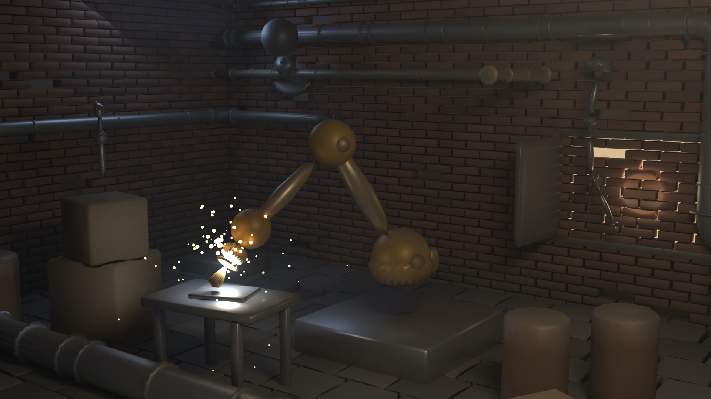
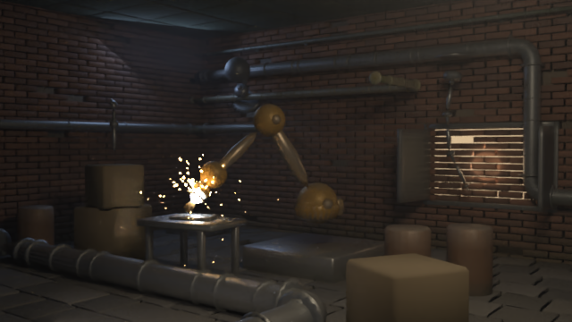
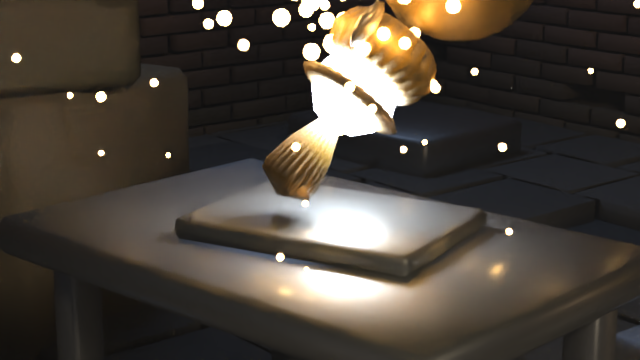

# Showcase 01 — 整備ドック（Maintenance Bay）



このリポジトリで作ってきた HDA を **6 本まとめて 1 つの絵にしたもの** です。
ツールのカタログではなく、「この道具だけでここまで組める」を見せるための作品シーンです。

壁も床も配管も小道具もロボットアームも、**モデリングは 1 つもしていません**。
全部 HDA のパラメータと、1 行のレシピ文字列と、Python スクリプトでできています。

| 使った HDA | このシーンでの役割 |
|---|---|
| [01 Mech Transform](../../tools/01_mech_transform/) | 右の壁の点検ハッチが開く |
| [02 Brick Wall](../../tools/02_brick_wall/) | 奥の壁・左の壁・床・天井 |
| [03 Pipe Run](../../tools/03_pipe_run/) | 配管 5 本（フランジ・バンド・壁付け金具つき） |
| [04 Weathering Mask](../../tools/04_weathering_mask/) | 全部の物の汚し。色・粗さ・金属度のもとになります |
| [05 Hydraulic Piston](../../tools/05_mech_leg/) | 床に転がっている予備のシリンダー 2 本 |
| [06 Mecha Chain](../../tools/06_mecha_chain/) | 溶接アーム（主役）・見張りメカ・レーダー・吊りアーム |

## 必要なもの

| もの | 確認したバージョン | 備考 |
|---|---|---|
| Houdini Indie | 21.0.700（Windows） | ファイルは Indie 形式（`.hiplc` / `.hdalc`）。SideFX Labs はいりません |

レンダラーは Houdini に入っている **Karma（CPU）** です。追加のインストールはいりません。

## ファイル

| ファイル | 中身 |
|---|---|
| `maintenance_bay.hiplc` | シーン本体。開いてすぐ見られます |
| `otls/` | シーンが使う HDA のコピー 6 個。**これがとなりにあるから、シーンを開くだけで使えます** |
| `scripts/build_scene.py` | このシーンをゼロから組み直すスクリプト。壊したときの復旧用 |
| `images/` | レンダリング結果 |
| `render/` | スクリプトが画像を書き出す先（空のことがあります） |

## まず見てみる

1. `maintenance_bay.hiplc` を Houdini で開きます。HDA は同じフォルダの `otls/` から自動で読み込まれます。
2. `/obj/BAY` の中が、形を作っているところです。ノードが並んでいますが、**縦 1 列が物 1 個**です。
3. `/stage` が、USD に持っていってマテリアルとライトを付けてレンダリングするところです。
4. `/stage/render_karma` を選んで **Render** を押すと、画像が出ます。

再生ボタンを押すと動きます（1〜96 フレーム、24 fps）。アームが溶接し、点検ハッチが開き、
レーダーが首を振り、天井から吊ったアームが揺れます。




## 画面なしで作り直す / レンダリングする

Houdini を開かずに、コマンドだけで全部やり直せます。このフォルダで:

```
"C:/Program Files/Side Effects Software/Houdini 21.0.700/bin/hython.exe" scripts/build_scene.py
```

後ろに言葉を足すと、レンダリングまでやります。

| コマンド | 何が出るか | だいたいの時間 |
|---|---|---|
| （なし） | `.hiplc` を組み直して保存するだけ | 30 秒 |
| `test` | 640×360 の確認用（`render/test.png`） | 1 分 |
| `still` | 本番の静止画 3 枚（`render/cam_*.png`） | 1 時間ほど |
| `seq` | 連番（`render/seq/bay.####.png`） | 1 時間ほど |

## どこをいじると何が変わるか

### シーンの中身を変える

`scripts/build_scene.py` の上のほうを書き換えて、もう一度走らせるのがいちばん早いです。

| 場所 | 変えると |
|---|---|
| `LOOKS` の表 | 物の色・粗さ・金属度。1 行が 1 つのマテリアルです |
| `hero_recipe` などのレシピ文字列 | メカの形と動き。[06 の README](../../tools/06_mecha_chain/README.md) の書き方そのままです |
| `wall(...)` の引数 | 壁の大きさ・レンガの大きさ・抜けの量 |
| `pipe(...)` の折れ線 | 配管の通り道。点を並べるだけです |
| `HERO_FRAME` | 静止画をどのフレームで撮るか |

### Houdini の中で直接いじる

| やりたいこと | 触るところ |
|---|---|
| アームの動きを変える | `/obj/BAY/mech_hero` の **レシピ** 欄 |
| 汚れの量を変える | `/obj/BAY/*_weather`（04 Weathering Mask）の Strength |
| 色を変える | `/obj/BAY/*_look` の VEX。`basecol` が色、`rough` が粗さ、`metal` が金属度です |
| 明るさを変える | `/stage` のライト。`key_lamp` が作業灯、`rim_cool` が奥からの光 |
| 空気の濁りを変える | `/stage/air_haze` の Density |
| 解像度を変える | `/stage/render_settings` の Resolution |

## 「どうやって汚しているのか」だけ先に

ふつうは汚れをテクスチャで描きますが、このシーンでは **形から計算して頂点に書いています**。

1. [04 Weathering Mask](../../tools/04_weathering_mask/) が、角・へこみ・上面・地際の 4 つのマスクを点に書く
2. その後ろの `*_look` という VEX ノードが、4 つのマスクを混ぜて
   **色（`basecol`）・粗さ（`rough`）・金属度（`metal`）** の 3 つの点属性にする
3. USD に持っていくと、その 3 つがそのまま primvar になる
4. Karma 側のマテリアルは、その 3 つを読むだけ

テクスチャが 1 枚もないので、壁を広げてもレンガを増やしても、UV の心配がいりません。
くわしくは [REPORT.md](REPORT.md) に書きました。

## うまくいかないとき

| こうなった | 原因と直し方 |
|---|---|
| 「using incomplete asset definition」と出た / ノードが赤い | HDA が読み込まれていません。`.hiplc` のとなりに `otls/` フォルダがあるか確かめてください（`scripts/build_scene.py` を走らせると作り直します）。**この状態で保存しないでください** |
| 真っ白・真っ黒になる | `/stage` のライトの **Exposure** を 1〜2 動かしてみてください。1 で倍、-1 で半分です |
| 物が全部クロームみたいになる | `*_weather` の **Edge Width** が小さすぎます。大きくすると「角」と判定される場所が減ります |
| 色が全部同じになる | `*_look` の VEX で `@srccol` ではなく `@Cd` を読んでいませんか。04 は `Cd` を上書きします |
| 箱や円筒がふくらんで見える | `*_subdiv`（Subdivide）が入っています。角張ったままにしたいものは外してください |
| レンダリングが終わらない | `/stage/render_settings` の **Pixel Samples** を下げるか、解像度を下げてください |
| 火花が出ない | `/obj/BAY/spark_move` は 2 番目の入力（トーチ先端）がつながっている必要があります |

## 仕組みを知りたい

組み方、引っかかった落とし穴、Karma の設定は [REPORT.md](REPORT.md) にまとめました。
技術記事のたたき台のつもりで書いてあります。
