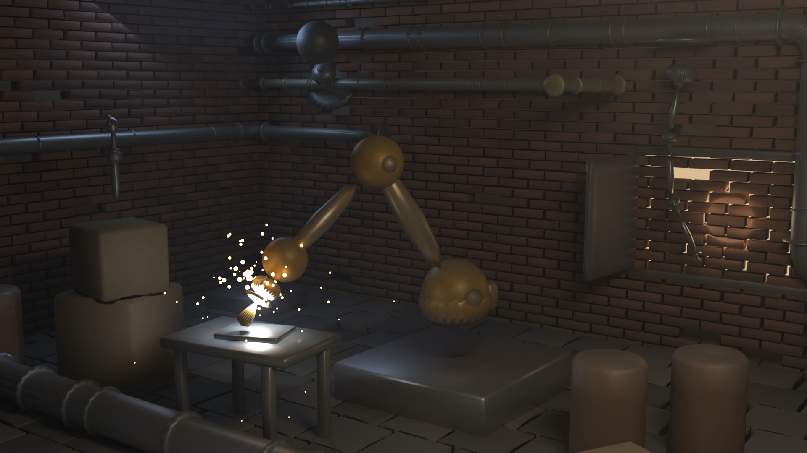
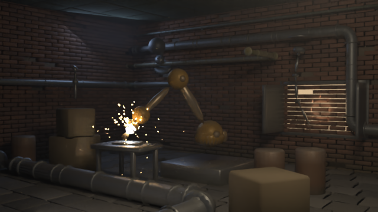
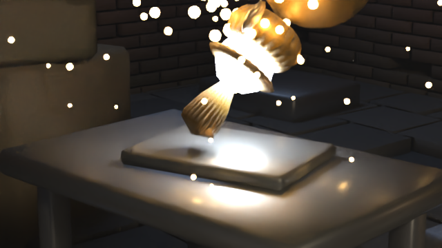

# 自作 HDA 6 本だけで背景を 1 枚組む — 整備ドックの作り方



ツールを作りためていると、「で、結局それで何が作れるの」に答えられないままになりがちです。
この回は、それまでに作った HDA を **6 本まとめて 1 つの絵にする** ことだけを目標にしました。

できたものは、レンガの壁に配管が走る整備ドックで、オレンジの産業用アームが溶接をしています。
このシーンには **手で作ったモデルが 1 つもありません**。壁も床も天井も配管もロボットも、
HDA のパラメータと 1 行のレシピ文字列と、Python スクリプトだけでできています。

- Houdini 21.0.700 Indie / Windows
- レンダラーは Karma CPU（追加インストールなし）
- 96,722 ポリゴン、テクスチャ 0 枚
- シーンの組み立ては [hython](https://www.sidefx.com/docs/houdini/ref/utils/hython.html) から 30 秒

ソースは [`scripts/build_scene.py`](scripts/build_scene.py) に全部入っています。

---

## 1. 方針 — SOP で全部作って、USD には 1 回だけ渡す

最初に決めたのは、**オブジェクトを増やさない**ことでした。

Houdini の素直な作りだと、壁は壁のオブジェクト、配管は配管のオブジェクト…と
`/obj` にノードが増えていきます。でも今回は物が 30 個以上あるので、それだと
`/stage` 側で 30 回 import することになります。

そこで、`/obj/BAY` という [Geometry オブジェクト](https://www.sidefx.com/docs/houdini/nodes/obj/geo.html) を 1 つだけ作り、
その中に全部の物を縦 1 列ずつ並べて、最後に [Merge SOP](https://www.sidefx.com/docs/houdini/nodes/sop/merge.html) で 1 本にまとめました。

```
brick_wall ─ xform ─ keepcol ─ weathering ─ look ─ path ─┐
pipe_run   ─ subdiv ─ weathering ─ look ─ path ──────────┤
box        ─ bevel ─ weathering ─ look ─ path ───────────┼─ MERGE_ALL ─ OUT
mecha_chain ─ unpack ─ xform ─ weathering ─ look ─ path ─┤
...                                                      ┘
```

バラバラの物を 1 本にまとめてしまうと、USD 側で「どれがどれ」が分からなくなりそうですが、
そこは **`path` というプリム属性**で解決します。

```c
// 壁の場合。面の name を見て、USD のプリムを 2 つに分ける
s@path = (s@name == "mortar") ? "/bay/env/wall_back_mortar"
                              : "/bay/env/wall_back_brick";
```

[SOP Import LOP](https://www.sidefx.com/docs/houdini/nodes/lop/sopimport.html) の **Path Attribute** に `path` を指定すると、
この文字列がそのまま USD の階層になります。結果はこうなりました。

```
/bay/env/wall_back_brick      /bay/pipes/pipe_main     /bay/mech/mech_hero
/bay/env/wall_back_mortar     /bay/pipes/pipe_yellow   /bay/mech/hatch
/bay/env/floor_brick          /bay/props/crate_a       /bay/fx/torch
/bay/env/ceiling_brick        /bay/props/barrel_a      /bay/fx/sparks
```

あとは [Assign Material LOP](https://www.sidefx.com/docs/houdini/nodes/lop/assignmaterial.html) で
`/bay/env/* /bay/props/crate_*` のようにパターンを書けば、マテリアルが貼れます。
**SOP の中の 1 行の VEX が、USD の構造とマテリアル割り当てを同時に決めている**のが、今回いちばん気に入っている部分です。

---

## 2. 汚しを「テクスチャ」ではなく「属性」で運ぶ

この記事の本題はここです。

[04 Weathering Mask](../../tools/04_weathering_mask/) は、メッシュの形だけから 4 つのマスクを計算して、点属性に書く HDA です。

| 属性 | 何の場所か |
|---|---|
| `mask_edge` | 出っぱった角（擦れ・塗装はがれ） |
| `mask_cavity` | へこみ・すき間・付け根（汚れだまり） |
| `mask_top` | 上を向いた面（ほこり） |
| `mask_bottom` | 地面に近いところ（泥・苔） |

ふつうはこれを FBX に乗せて Unity のシェーダーで混ぜます。今回は Houdini の中で完結するので、
**SOP の側でマスクを「見た目」に変換してしまう** ことにしました。

### 変換する VEX

[Attribute Wrangle SOP](https://www.sidefx.com/docs/houdini/nodes/sop/attribwrangle.html)（Point モード）1 個で済みます。

```c
// 素の色。use_cd=1 なら入力の色（レンガごとの色など）をそのまま使う
vector base = 1 ? v@srccol : set(0.52, 0.27, 0.21);

// 4 つのマスクを、強さを掛けて取り出す
float e = clamp(@mask_edge   * 0.5, 0.0, 1.0);   // 角の擦れ
float c = clamp(@mask_cavity * 0.7, 0.0, 1.0);   // へこみの汚れ
float t = clamp(@mask_top    * 0.18, 0.0, 1.0);  // 上面のほこり
float g = clamp(@mask_bottom * 1.0, 0.0, 1.0);   // 地際の苔

// 点の位置で細かいムラを作る（頂点カラーだけだと平坦に見えるため）
float n = noise(@P * 6.0 + 11.0);

// 色を順に混ぜる。最後に角を混ぜるので、擦れがいちばん上に出る
vector col = base * (1.0 + 0.22 * (n - 0.5) * 2.0);
col = lerp(col, set(0.11, 0.08, 0.07), c);   // へこみの汚れ
col = lerp(col, set(0.13, 0.20, 0.10), g);   // 地際の苔
col = lerp(col, set(0.40, 0.37, 0.32), t);   // 上面のほこり
col = lerp(col, set(0.46, 0.33, 0.27), e);   // 角の擦れ

// 粗さ: へこみはざらつき、角は擦れて少し光る
float rough = lerp(0.92, 0.96, c * 0.85);
rough = lerp(rough, 0.84, e);

// 金属度: 塗装がはげた角だけ地金が出る
float metal = lerp(0.0, 0.0, e);

v@basecol = clamp(col, 0.0, 1.0);
f@rough   = clamp(rough + 0.10 * (n - 0.5), 0.04, 1.0);
f@metal   = clamp(metal, 0.0, 1.0);
```

出てくるのは `basecol`（色）・`rough`（粗さ）・`metal`（金属度）の 3 つだけ。
スクリプトでは、この色の組み合わせを `LOOKS` という表にして、
`brick` `stone` `pipe` `pipe_y` `mech` `mech_h` `crate` `steel` `rust` の 9 種類を使い分けています。
**1 行足せばマテリアルが 1 種類増える**ので、見た目の試行錯誤がとても速くなりました。

### 受け取る側の MaterialX は拍子抜けするほど簡単

SOP Import は点属性をそのまま USD の primvar にしてくれます。なので Karma のマテリアルは、
[MaterialX Geometry Property Value](https://www.sidefx.com/docs/houdini/nodes/vop/mtlxgeompropvalue.html) を 3 個置いて、
[MaterialX Standard Surface](https://www.sidefx.com/docs/houdini/nodes/vop/mtlxstandard_surface.html) につなぐだけです。

```
mtlxgeompropvalue (color3, "basecol") ──→ base_color
mtlxgeompropvalue (float,  "rough")   ──→ specular_roughness   mtlxstandard_surface
mtlxgeompropvalue (float,  "metal")   ──→ metalness
```

シーン全体でマテリアルは 5 個しかありません（石材 / 金属 / 発光 3 種）。
見た目の違いは全部 primvar から来ています。

### この作りの良いところ・悪いところ

良いところ:

- **UV がいらない**。壁を 2 倍に広げても、レンガを増やしても、何も調整しなくていい
- マテリアルの試行錯誤が VEX の数値いじりで済む。シェーダーのノードをつなぎ直さなくていい
- マスクは点属性のまま残っているので、`mask_top` で雪を散らす、みたいな二次利用ができる

悪いところ:

- **細かさがメッシュの点の数で決まる**。寄りの画だと、汚れの境目がぼんやりします
- 近づいて見せる主役には向きません。今回は寄りのカットでも 1.5 m 幅くらいまでにしました

背景の中景〜遠景には、この作りがよく合うと思います。

---

## 3. 踏んだ落とし穴

ここからが本番です。全部、今回の制作で実際にハマったものです。

### 3-1. 04 Weathering Mask は `Cd` を上書きする

いちばん時間を溶かしました。レンガ壁をレンダリングすると、**灰色の壁**になるのです。

原因は、04 の **Preview** が `Material Preview` のとき、自分のプレビュー色を `Cd` に書くから。
[02 Brick Wall](../../tools/02_brick_wall/) が作ったレンガごとの色は、04 を通った時点で消えていました。

直し方は簡単で、04 の手前で色を別名に逃がすだけです。

```c
// 04 は Cd を上書きするので、入ってきた色を先に srccol へ
v@srccol = (@Cd == {0,0,0}) ? {1,1,1} : v@Cd;
```

HDA をつなぐときは「この HDA が何を上書きするか」を Geometry Spreadsheet で確かめる、
という当たり前のことを、毎回やったほうがいいという教訓です。



### 3-2. Edge Width を小さくすると、世界が全部クロームになる

04 の **Edge Width** は「曲率をこの値で割って角のマスクにする」パラメータで、
README にも「小さいほど、ゆるい丸みでも角になる」と書いてあります。

最初、メカに `0.10` を入れていました。すると `mask_edge` がほぼ全面で 1 になり、
`metal` も 1 になり、**全部のオブジェクトがピカピカのクローム**になりました。
最初のテストレンダーが「銀の惑星」みたいな画だったのはこれが原因です。

`0.6〜0.8` に上げたら一発で直りました。感度パラメータは、**効きすぎているときほど原因に気づきにくい**です。

### 3-3. Subdivide で箱と円筒がふくらむ

マスクは点ごとに計算するので、点が少ないと角もへこみも見つかりません。
04 の README どおり [PolyBevel](https://www.sidefx.com/docs/houdini/nodes/sop/polybevel.html) +
[Subdivide](https://www.sidefx.com/docs/houdini/nodes/sop/subdivide.html) をかけたところ、
木箱もドラム缶も **クッションみたいにふくらんで**しまいました。Catmull-Clark の性質です。

結局、箱と円筒は Subdivide をやめて、PolyBevel だけにしました。
ベベルで増えた点だけでも、角のマスクは十分に出ます。
配管とメカのように、もともと面の多いものだけ Subdivide を 1 回かけています。

### 3-4. パック済みの出力は unpack してから USD へ

[01 Mech Transform](../../tools/01_mech_transform/) と [06 Mecha Chain](../../tools/06_mecha_chain/) は、
出力が[パックドプリミティブ](https://www.sidefx.com/docs/houdini/model/packed.html)です。

点検ハッチのプリム数を数えたら **3** でした。扉 2 枚と枠で 3 個のパック、という意味です。
この状態だと中の面に属性が書けないので、
[Unpack SOP](https://www.sidefx.com/docs/houdini/nodes/sop/unpack.html) でほどいてから汚しをかけます（ほどくと 36 面）。

### 3-5. 05 Hydraulic Piston は「原点から 2 点目へ」作る

2 点の線を渡せば、その 2 点の間にシリンダーができると思っていました。実際は、
**1 点目を無視して、原点から 2 点目までの間**に作られます（未完成のツールなので仕方ない）。

向きだけ渡して、置き場所は後ろの [Transform SOP](https://www.sidefx.com/docs/houdini/nodes/sop/xform.html) で決める、という形に変えました。

```python
ln.parmTuple("pt0").set((0.0, 0.0, 0.0))
ln.parmTuple("pt1").set((p1[0] - p0[0], p1[1] - p0[1], p1[2] - p0[2]))
...
x = xform(bay, name + "_place", hp, t=p0)   # 置き場所はここで
```

### 3-6. 06 Mecha Chain の `axis` は「チェーンのローカル軸」

主役のアームが、**横倒しのまま床をなぎ払う**動きになりました。

06 のチェーンは +Z 方向に伸びます。土台の旋回（ターンテーブル）を作るつもりで
`motor_rot(axis=1)` と書いたのですが、`axis` は**チェーンのローカル軸**なので、
Y 軸はチェーンの横方向です。アームは立ち上がる前に横に振られていました。

旋回させたいなら、**チェーンが伸びる向き = `axis=2`** が正解です。

```
base > motor_osc(axis=2, b=16, speed=0.18) > hinge(axis=0, a=30, ...) > link(...)
         ^^^^^^ 土台の旋回                     ^^^^^^ 肘の曲げ
```

ついでに、`motor_rot` だと 4 秒で 200°も回ってしまい、アームが壁に突っ込んでいたので、
往復する `motor_osc(b=16)` に変えました。背景に置くメカは、回り続けるより往復のほうが扱いやすいです。

### 3-7. Karma Render Settings の解像度（縦）はロックされている

`hou.Parm.set()` が `hou.PermissionError` で落ちました。

```
hou.PermissionError: Failed to modify node or parameter because of a permission error.
```

ライセンスの問題かと思いましたが、[Karma Render Settings LOP](https://www.sidefx.com/docs/houdini/nodes/lop/karmarendersettings.html) の
`resolutiony` が、**縦横比の連動でロックされている**だけでした。

```python
p.lock(False)   # 連動を切ってから
p.set(1080)
```

スクリプトの `setp()` は、`PermissionError` が来たら 1 回だけロックを外して入れ直すようにしてあります。

### 3-8. Light LOP のパラメータ名は読めない

[Light LOP](https://www.sidefx.com/docs/houdini/nodes/lop/light.html) のパラメータは、
USD の名前空間をエンコードした名前になっています。

| 中身 | パラメータ名 |
|---|---|
| Intensity | `xn__inputsintensity_i0a` |
| Exposure | `xn__inputsexposure_vya` |
| Color | `xn__inputscolor_ztar` / `_ztag` / `_ztab` |
| Radius | `xn__inputsradius_mva` |
| Cone Angle | `xn__inputsshapingconeangle_wcbhe` |

推測では当たらないので、`[p.name() for p in node.parms()]` で出すのが確実です。
さらに、値を書いても **`..._control` を `"set"` にしないと USD に書き出されません**。

```python
setp(n, **{"xn__inputsintensity_control_jeb": "set",
           "xn__inputsintensity_i0a": 34.0})
```

### 3-9. 壁だけ作ると、引きの画で空が見える

引きのカメラを確認したら、壁の上に**明るい空**が写っていました。Dome Light です。
天井がないので当然なのですが、頭から抜けていました。

床と同じ [02 Brick Wall](../../tools/02_brick_wall/) を、大きめの「レンガ」（1.3 × 0.95 m のコンクリート板）にして
`rx=90` で伏せ、高さ 4.62 m に置いて天井にしました。壁用の HDA がそのまま天井に使えるのは、
**ジェネレーターを素直に作っておいた御利益**だと思います。

### 3-10. 画面のどこに何が写るかは、レンダリングせずに数えられる

最初のテストで、点検ハッチがアームの真後ろに重なり、ドラム缶は画面の外にいました。
Karma のテストは 1 枚 1〜2 分かかるので、当てずっぽうで動かすと日が暮れます。

カメラ行列を自分で組んで、オブジェクトの中心を画面座標に落とすだけのスクリプトを書きました。

```python
m = hou.hmath.buildRotate(rx, ry, 0.0)
inv = m.inverted()

def project(p):
    v = (hou.Vector3(p) - pos) * inv          # カメラ空間（-Z が前方）
    if v[2] >= -0.001:
        return None                           # 後ろにある
    sx = (v[0] / -v[2]) * (focal / (ap * 0.5))
    sy = (v[1] / -v[2]) * (focal / (ap * 0.5)) * (W / H)
    return (W * 0.5 * (1.0 + sx), H * 0.5 * (1.0 - sy))
```

出力はこうなります。レンダリングなしで 10 秒。

```
mech_hero_place        world(  0.44   1.43   0.17)  screen ( 398, 264)
hatch_place            world( -1.96   1.62  -2.71)  screen ( 380, 193)   ← アームの真後ろ
barrel_a_place         world(  2.95   0.46   1.25)  screen ( 605, 474)   ← 画面の下（H=450）
```

ハッチを右へ、ドラム缶を手前へ動かして一発で解決しました。
**構図の調整は、絵を見る前に数字で詰められる**というのは、今回いちばんの収穫かもしれません。

---

## 4. ライティング

ライトは 6 灯です。Karma は物理ベースなので、だいたい写真のつもりで置けば合います。

| ライト | 種類 | 役割 |
|---|---|---|
| `sky_ambient` | [Dome Light](https://www.sidefx.com/docs/houdini/nodes/lop/domelight.html) | 全体を薄い青で起こす。Intensity 0.018 と極端に弱い |
| `key_lamp` | Rect Light | 右手前上の作業灯。暖色。これが主役の光 |
| `rim_cool` | Rect Light | 奥左からの冷たい光。アームの輪郭を出す |
| `floor_bounce` | Rect Light | 床からの跳ね返りの代わり。Specular は 0.25 に落とす |
| `hatch_inner` | Sphere Light | 点検ハッチの中の灯り |
| `torch_arc` | Sphere Light | 溶接の光。**アームの先端を追いかける** |

暖色（右手前）と寒色（奥左）で挟むのは定番ですが、レンガの赤と相性が良く、1 回で決まりました。

### 溶接の光をアームに追従させる

溶接の光だけは、毎フレーム位置が変わります。
06 Mecha Chain の **2 番目の出力（ソケット = 骨組みの点）**から、いちばん深い点を取り出して、

```c
// いちばん深いソケット（チェーンの先端）だけ残す
float md = 0;
for (int i = 0; i < @numpt; i++) md = max(md, point(0, "depth", i));
if (@depth < md - 0.5) removepoint(0, @ptnum);
```

その位置を、シーンを組むときに 96 フレーム分まとめて読んで、ライトにキーを打っています。

```python
for f in range(FSTART, FEND + 1):
    hou.setFrame(f)
    p = tip_node.geometry().points()[0].position()
    # tx / ty / tz に hou.Keyframe を積む
```

式でつなぐより、**組むときに焼いてしまったほうが、後で見たときに分かりやすい**と思ってこうしました。

### 空気を濁らせる

[Karma Fog Box LOP](https://www.sidefx.com/docs/houdini/nodes/lop/karmafogbox.html) を 1 個、
部屋をすっぽり覆う大きさ（13 × 5.2 × 10 m）で Density 0.055、Shadow オン。
これだけで、溶接の光のまわりがふわっとして、奥行きが出ます。コストに対して効果が大きい設定でした。

---

## 5. 火花

絵として「おっ」と思わせる担当です。[Add SOP](https://www.sidefx.com/docs/houdini/nodes/sop/add.html) で 110 個の点を作り、
Attribute Wrangle で放物線を描かせて、[Copy to Points](https://www.sidefx.com/docs/houdini/nodes/sop/copytopoints.html) で小さい球を貼っています。

```c
// 2 番目の入力（トーチ先端）の位置
vector tip = point(1, "P", 0);
float id = float(@ptnum);

// 粒ごとにずらした寿命（0〜1）。フレームで進む
float life = frac(rand(id * 12.9898) + @Frame * 0.075);

// 飛び出す向き。真下には飛ばさない
vector dir = normalize(set(rand(id * 3.1 + 0.7) - 0.5,
                           rand(id * 3.1 + 1.3) * 0.8 + 0.25,
                           rand(id * 3.1 + 2.9) - 0.5));
float speed = 1.4 + rand(id * 5.77) * 2.2;
float t = life * 0.55;                      // 秒

// 放物線（初速度 + 重力）
@P = tip + dir * speed * t - set(0, 1, 0) * 4.9 * t * t;

// 消えるほど小さく。床についたら消す
f@pscale = fit01(pow(1.0 - life, 1.6), 0.004, 0.024);
if (@P.y < 0.02) removepoint(0, @ptnum);
```

[POP](https://www.sidefx.com/docs/houdini/nodes/dop/popsolver.html) を使っていないので、
**どのフレームからでも同じ絵が出ます**。連番の途中から焼き直せるのは、こういう小物では大事です。

最初は発光を 22 にしていたら真っ白な点にしか見えず、7.5 まで落としてやっとオレンジに見えました。
**発光は「明るさ」ではなく「色が残るか」で決める**のが分かりやすいです。



---

## 6. レンダリング

| 設定 | 値 |
|---|---|
| エンジン | Karma CPU（`BRAY_HdKarma`） |
| 解像度 | 1920 × 1080 |
| Pixel Samples | 48 |
| デノイザ | OIDN（Open Image Denoise） |
| フレーム | 46 / 全 96 フレーム（24 fps） |

デノイザを前提にすると、Pixel Samples はかなり落とせます。
最初 200 で見積もったら 3 時間コースだったので、48 + デノイザにして 20 分台にしました。
テスト中は 640×360 / 12 サンプルで 35 秒ほど。**確認用の設定を最初に用意しておく**と、試行回数が稼げます。

---

## 7. やってみて

HDA を作っているときは「汎用的に使えるように」と考えますが、
実際に 6 本つないでみると、**汎用性が効いた場面と効かなかった場面**がはっきりしました。

効いたところ:

- 壁の HDA が、そのまま床と天井に使えた（向きを変えるだけ）
- 汚しの HDA が、レンガにも配管にもロボットにも同じようにかかった
- メカの HDA が、レシピ 1 行で主役にも背景の小物にもなった（4 体使って、形は全部違う）

効かなかったところ:

- 属性の約束ごと（`Cd` を上書きする／パックで出す）が HDA ごとにバラバラで、つなぐたびに調べ直した
- 「どの軸を使うか」の意味が HDA ごとに違う（ワールドの軸か、ローカルの軸か）

次に HDA を作るときは、**README に「入力の何を壊すか」「出力はパックか」を必ず書く**ことにしました。
つなぐ人（未来の自分）がいちばん知りたいのはそこでした。

---

## 付録: ファイル

| ファイル | 中身 |
|---|---|
| [`maintenance_bay.hiplc`](maintenance_bay.hiplc) | シーン本体 |
| [`scripts/build_scene.py`](scripts/build_scene.py) | ゼロから組み直すスクリプト（約 880 行） |
| [`README.md`](README.md) | 使い方 |

使った HDA:
[01 Mech Transform](../../tools/01_mech_transform/) /
[02 Brick Wall](../../tools/02_brick_wall/) /
[03 Pipe Run](../../tools/03_pipe_run/) /
[04 Weathering Mask](../../tools/04_weathering_mask/) /
[05 Hydraulic Piston](../../tools/05_mech_leg/) /
[06 Mecha Chain](../../tools/06_mecha_chain/)
