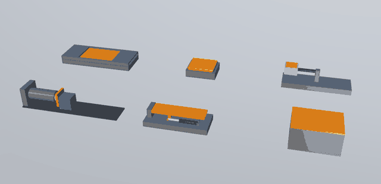
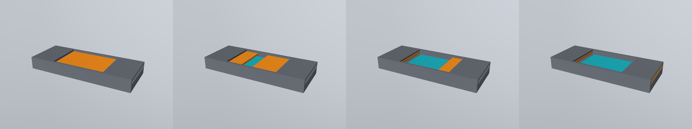
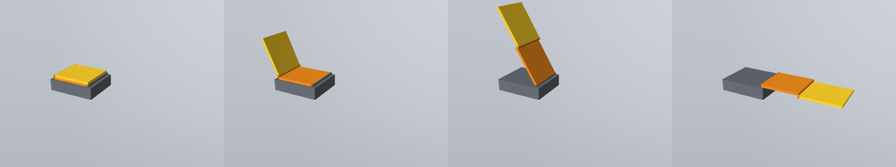
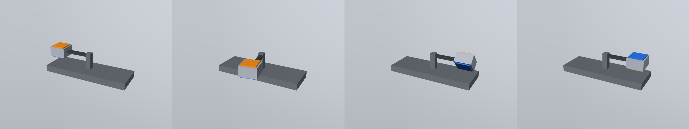
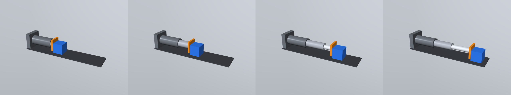
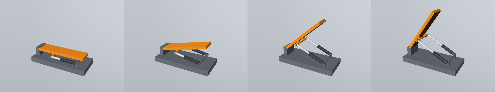
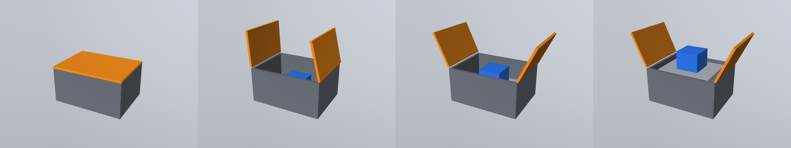

# 01 Mech Transform — メカ変形パーツ（使い方マニュアル）



パーツに **属性（名前・スライド量・ヒンジの位置と角度・動くタイミング・親パーツ）** を付けるだけで、
スライドパネル、折り返す板、伸びるシリンダー、油圧ピストン、開閉ハッチのような「変形機構」のアニメーションを作る HDA です。
出力はパックドプリミティブで、そのまま **VAT（Vertex Animation Texture）** として Unity に持っていけます。

形はぜんぶ箱・板・円筒だけ。動きの「型」を部品として揃えることが目的なので、見た目は自分のモデルに差し替えて使ってください。

## 必要なもの

| もの | 確認したバージョン | 備考 |
|---|---|---|
| Houdini Indie | 21.0.700（Windows） | ファイルは Indie 形式（`.hiplc` / `.hdalc`） |
| SideFX Labs | 21.0 | **VAT 書き出しにだけ**必要。HDA 本体は Labs なしで動きます |
| Unity + URP | Unity 2021.3 以上、URP 12 以上 | Labs 同梱の VAT 3.0 用シェーダーパッケージの条件です |

## ファイル

| ファイル | 内容 |
|---|---|
| `otls/mech_transform.hdalc` | HDA 本体（SOP）。Tab メニューの **HoudiniClaude ▸ Mech Transform** |
| `mech_transform_sample.hiplc` | サンプルシーン。機構パーツ 6 種のカタログと、VAT 書き出し用 ROP 6 個 |
| `export/` | サンプルを VAT で書き出した結果（FBX、EXR、Unity のマテリアル）。Unity でそのまま試せます |
| `images/` | 各パーツの動きの連続画像と、カタログ全体の GIF |
| `scripts/build_sample.py` | HDA とサンプルを Python でゼロから作り直すスクリプト。壊したときの復旧用。読むと作り方が分かります |

## まず動かしてみる

1. `mech_transform_sample.hiplc` を開きます（HDA は同じフォルダの `otls/` から自動で読み込まれます）。
2. 再生ボタンを押します。1〜72 フレームで 6 つの部品がいっせいに動きます。
3. `/obj` の中の好きな部品（たとえば `hatch_box`）に入ります。中はこの順に並んでいます。

   ```
   Box / Tube（形） → Name（パーツ名を付ける） → Merge → Normal
   → part_attributes（オレンジ: 動きの属性を書く Wrangle）
   → mech_transform1（緑: この HDA） → OUT_VAT → place_in_catalog
   ```

4. **オレンジ色の `part_attributes`** を開くと、パーツごとの動きが VEX で書いてあります。数字を変えて再生すると、すぐ結果が変わります。
   各部品のネットワークに置いてある黄色いメモ（Sticky Note）に「試してみよう」が書いてあります。

### 部品カタログ

| 部品 | 動き | 使っている属性 |
|---|---|---|
| `slide_panel` スライドパネル | 2 枚のパネルが左右にスライドして、固定カバーの下にしまわれる | `move`, `begin`, `end` |
| `hinge_fold` 折り返しヒンジ板 | 重なった 2 枚の板がヒンジで順番に開いて、1 本の長い板になる | `hinge`, `axis`, `angle`, `parent` |
| `flip_block` 裏返しブロック | 腕がブロックを反対側へ運び、ブロックが裏返って別の面が上になる | `hinge`, `axis`, `angle`, `parent`（3 段） |
| `telescopic_cylinder` 伸縮シリンダー | 2 段の筒が順番に伸びて、先の箱を押し出す | `move`, `parent`（4 段） |
| `hydraulic_arm` 油圧ピストン | アームが持ち上がると、ピストンが自動で取り付け点を追いかけて伸びる | `aim`, `aim_pos`, `stretch` |
| `hatch_box` 開閉ハッチ | フタが左右に開き、そのあと中の台がせり上がる | `hinge`, `angle`, `move`, `parent`, `begin`/`end` |








## 自分のモデルで使う

### 1. パーツごとに名前（`name`）を付ける

HDA は、プリミティブ属性 `name` が同じ面を 1 個のパーツ（パックドプリミティブ）にまとめます。付け方はなんでも構いません。

- 部品ごとに別のノードで作っているなら、それぞれに [Name SOP](https://www.sidefx.com/docs/houdini/nodes/sop/name.html) をつないでから [Merge SOP](https://www.sidefx.com/docs/houdini/nodes/sop/merge.html) で合流（サンプルはこの方法）
- 1 つのメッシュをグループで分けてあるなら、Name SOP の **Name from Group** を使う
- 離れたかたまりごとに自動で分けたいなら、[Connectivity SOP](https://www.sidefx.com/docs/houdini/nodes/sop/connectivity.html)（Connectivity Type: Primitive、Attribute Name: `name`、Attribute Type: String）

`name` が空の面は、まとめて `unnamed` という「動かないパーツ」になります。土台など、動かさないものは名前を付けなくても大丈夫です。

### 2. 動きの属性を書く

[Attribute Wrangle](https://www.sidefx.com/docs/houdini/nodes/sop/attribwrangle.html) を **Run Over: Primitives** にして、パーツ名ごとに属性を書きます。書かなかった属性は 0 =「動かない」です。

```c
// フタ: 左のふちをヒンジにして、前半で 110 度開く
if (s@name == "lid")
{
    v@hinge = {-0.5, 1.0, 0};   // ヒンジ（回転の中心）の位置
    v@axis  = {0, 0, 1};        // ヒンジの軸の向き
    f@angle = 110;              // 回す角度（度）
    f@begin = 0.0;              // 動き始めるタイミング (0〜1)
    f@end   = 0.5;              // 動き終わるタイミング (0〜1)
}

// 台: フタが開いたあとで上へ 0.3 スライド
if (s@name == "tray")
{
    v@move  = {0, 0.3, 0};
    f@begin = 0.5;
}

// 台に載った中身: 自分では動かず、台と一緒に動く
if (s@name == "cargo")
{
    s@parent = "tray";
}
```

#### パーツ属性一覧（すべてプリミティブ属性）

| 属性 | 型 | 意味 |
|---|---|---|
| `name` | 文字列 | パーツ名。同じ名前の面が 1 個のパーツになる |
| `parent` | 文字列 | 親パーツ名。親が動くと、このパーツも一緒に動く。何段でも重ねられる |
| `move` | ベクトル | スライドする量 |
| `hinge` | ベクトル | ヒンジ（回転の中心）の位置 |
| `axis` | ベクトル | ヒンジの軸の向き。省略すると Y 軸 |
| `angle` | 小数 | 回す角度（度）。マイナスで逆回り |
| `begin` | 小数 | 動き始めるタイミング。全体の進み具合 0〜1 のどこで動き出すか |
| `end` | 小数 | 動き終わるタイミング。省略すると 1（最後まで） |
| `aim` | 文字列 | ピストン用。向き続ける相手のパーツ名 |
| `aim_pos` | ベクトル | ピストン用。相手側の取り付け点の位置（動く前の座標） |
| `stretch` | 整数 | ピストン用。1 なら相手との距離に合わせて伸び縮みする（ロッド）、0 なら向きだけ変える（シリンダー） |
| `Cd` | ベクトル | 色（なくても動きます。VAT のカラーテクスチャに入ります） |

覚えておくこと:

- **位置や向きは、ぜんぶ「動く前の形」の座標で書きます。** 親を持つパーツでも、親が動く前の座標で書けば HDA が計算してくれます。
- 1 パーツの動きは「ヒンジを中心に `angle` だけ回す → `move` だけスライド」の順です。両方書けば、回りながら動きます。
- ピストンは `hinge` を「自分側の取り付け点（根元）」として使います。`aim` を持つパーツは、ほかのパーツの親にはできません。
- `parent` や `aim` に書いた名前が見つからないと、HDA に黄色い警告（どの名前が見つからないか）が出ます。

### 3. HDA をつないで再生する

Tab メニューで **HoudiniClaude ▸ Mech Transform** を置き、Wrangle の出力をつなぎます。
**Drive** を **Frame Range** にすると、タイムラインの 1〜72 フレーム（Start/End Frame で変更可）で動きます。
**Progress Slider** にすると、スライダーで好きな進み具合に止められます。

#### ノードのパラメータ

| パラメータ | 意味 |
|---|---|
| Drive | 何で動きを進めるか。**Progress Slider** = 下の Progress の値、**Frame Range** = タイムラインのフレーム番号 |
| Progress | 全体の進み具合。0 = 入力した形のまま、1 = すべてのパーツが動ききった姿 |
| Start/End Frame | Drive が Frame Range のとき、動きが始まるフレームと終わるフレーム（既定 1〜72） |
| Reverse | 逆再生（動ききった姿から、入力した形へ戻る）。**VAT に書き出すときはオフ** |
| Easing | 動きの緩急。Linear（一定）、Ease In（ゆっくり動き出す）、Ease Out（ゆっくり止まる）、Ease In-Out、Overshoot（少し行き過ぎてから戻る） |

「Part Attributes (input)」の折りたたみは、上の属性一覧をノード上で見られるようにしたメモです。

### 4. 出力の形

出力はパーツごとの **パックドプリミティブ** です。パック 1 個につき点が 1 つあり、ポイント属性 `P`（位置）、`orient`（回転）、`pivot`（回転の中心）、`name` を持っています。

- Houdini の中でそのままレンダリングできます。ポリゴンに戻したいときは [Unpack SOP](https://www.sidefx.com/docs/houdini/nodes/sop/unpack.html) をつなぎます。
- 入力に `N`（法線）や `uv` があれば、パックの中に保たれたまま出力されます。

## VAT で書き出す（Houdini 側）

サンプルの `/out` には部品ごとに `vat_〜` という ROP（[Labs Vertex Animation Textures 3.0](https://www.sidefx.com/docs/houdini/nodes/out/labs--vertex_animation_textures-3.0.html)）があります。
**Render All** を押すと `export/` に次のファイルが出ます（`$HIP/export/`、Asset Name は部品名）。

```
export/geo/<部品名>_mesh.fbx      … 静止メッシュ（UV2〜UV4 にパーツ番号やピボットが埋め込まれています）
export/tex/<部品名>_pos.exr       … 位置テクスチャ（横 = パーツ数、縦 = フレーム数）
export/tex/<部品名>_rot.exr       … 回転テクスチャ
export/tex/<部品名>_col.exr       … 色テクスチャ（Cd）
export/unity/<部品名>_mat.mat     … Unity 用マテリアル（フレーム数・FPS・バウンズが書き込み済み）
```

自分のシーンで ROP を作るときの設定（サンプルと同じ値）:

| 設定 | 値 | 理由 |
|---|---|---|
| Mode / Target Engine | **Rigid-Body Dynamics (Rigid)** / **Unity** | パーツ = 剛体。Unity を選ぶと座標系（左手系 Y-up）とスケールが自動で合う |
| Start/End | 1 / 72 | HDA の Start/End Frame と同じにする |
| Input Geometry | HDA の下流の Null（サンプルでは `OUT_VAT`） | 位置をずらす Transform より**前**を指すこと |
| Settings ▸ Rigid-Body Dynamics ▸ Rotation Interpolation | **Basic Short-Path Slerp without Angular Velocity** | この HDA は角速度属性 `w` を出さないため。1 フレームに 180 度未満の回転なら正しく補間される |
| Export ▸ Export Path / Asset Name | `$HIP/export` / 部品名 | 好きな場所でよい |

注意:

- **書き出しの最初のフレームは、必ず「動く前の形」にしてください**（HDA の Reverse はオフ、Start Frame で Progress が 0）。VAT の剛体モードは最初のフレームを基準の姿勢として記録します。
- パーツ数が多いと、テクスチャの横幅は Target Texture Width（既定 1024）で折り返されます。数十パーツなら気にしなくて大丈夫です。
- Houdini の FPS（サンプルは 24）がマテリアルに書き込まれます。Unity 側の再生速度はこれに従います。

## Unity に持っていく

1. **シェーダーパッケージを入れる。** Unity の Package Manager で **＋ ▸ Add package from disk...** を選び、SideFX Labs のインストール先にある
   `unity/shaders/URP_VAT3/package.json` を開きます（例: `C:\Program Files\Side Effects Software\sidefx_packages\SideFXLabs21.0\unity\shaders\URP_VAT3\`）。
   VAT ROP の **Real-Time Shaders** タブにある **Unity Package and Guides** ボタンでも、このフォルダが開きます。
2. **ファイルを Unity に入れる。** `export/` の中身（`geo/`、`tex/`、`unity/`）を、まるごと `Assets/` の下にコピーします。
3. **インポート設定を合わせる。** 同じ `URP_VAT3` フォルダの `VAT Import Settings Guide.txt` のとおりに設定します。
   要点は、FBX は Mesh Compression を Off・Optimize Mesh を無し・Normals と Tangents を Import、テクスチャは sRGB などのトグルを全部オフ・Non-Power of 2 を None・Filter を Point・フォーマットを RGBA Half です。
   `URP_VAT3/Editor/Presets/` にプリセット（`VAT_FBX_Import_Houdini`、`VAT_HDR_Texture_Import_Houdini`）が入っているので、インスペクタの Preset ボタンから当てるのが早いです。
4. **マテリアルにテクスチャを入れる。** `unity/<部品名>_mat.mat` を開き、Position Texture に `_pos.exr`、Rotation Texture に `_rot.exr`、Color Texture に `_col.exr` を入れます。フレーム数・FPS・バウンズは書き込み済みです。
5. **メッシュに付ける。** `geo/<部品名>_mesh.fbx` をシーンに置き、そのマテリアルを付けます。Play すると動きます。
   好きなコマで止めたいときは、マテリアルの **Auto Playback** をオフにして **Display Frame**（1〜72）を動かします。**Playback Speed** で速さを変えられます。

## うまくいかないとき

| 症状 | 見るところ |
|---|---|
| HDA に「パーツ名が見つかりません: parent = ...」と警告が出る | `parent` や `aim` に書いた名前のつづり。`name` と同じ文字列にする |
| 子パーツが置いていかれる | `s@parent` を書いたか。親の名前が合っているか |
| 回る向きが逆 | `angle` の符号を変えるか、`axis` の向きを反転する |
| ヒンジの位置がずれる | `hinge` は「動く前の形」の座標。親が動く前の位置で書く |
| 入力をつないだだけで何も動かない | 正常です。属性を書いていないパーツは動きません（まず `name` と `move` だけ書いてみる） |
| VAT ROP が「packed primitives を期待」とエラー | Input Geometry が HDA より上流（パック前）を指していないか |
| VAT ROP が「angular velocity attribute "w"」とエラー | Rotation Interpolation を Basic Short-Path Slerp にする |
| Unity で動くが形が崩れる | FBX の Mesh Compression / Optimize Mesh、テクスチャの Filter（Point）と sRGB（オフ）を見直す |
| OneDrive 上で保存や書き出しに失敗する | 同期を一時停止してからやり直す |

## 仕組みを知りたい

ノードごとの役割、VEX の読み方、パックドプリミティブの回転のさせ方、VAT が中で何をしているかは [REPORT.md](REPORT.md) にまとめてあります。
