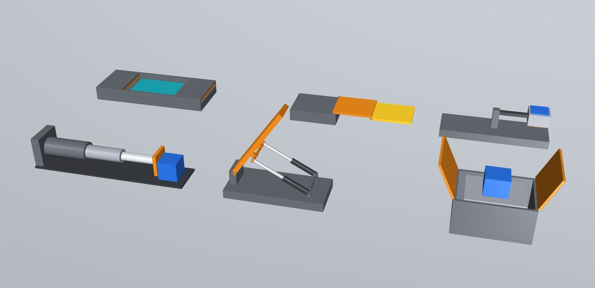
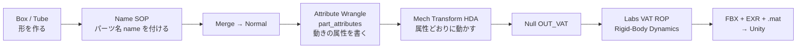
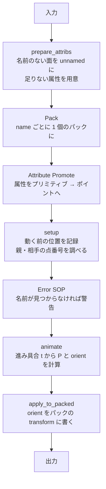

# 01 Mech Transform — 解説レポート

「パーツに属性を付けるだけで、メカの変形アニメーションができて、そのまま Unity に VAT で持っていける」ツールを作りました。
このレポートは、その中身を **ノード → VEX → VAT** の順に、はじめて触る人向けに説明します。
使い方だけ知りたい人は [README.md](README.md) へ。



## 1. 何を作ったか、なぜこの作りにしたか

やりたいことは「スライドする」「ヒンジで回る」「親が動けば子も動く」「ピストンが相手を追いかける」という、変形機構の **動きの型** を部品として揃えることです。

設計で決めたのは次の 3 つです。

1. **パーツ = パックドプリミティブ 1 個。** パーツの位置と回転は「点 1 つの属性」で持てるので、計算が軽く、考えることも減ります。VAT の剛体モードがちょうどこの形を要求します。
2. **動きは入力側の属性で決める。** HDA のパラメータは「全体の進み具合」と「緩急」だけ。どのパーツがどう動くかは、入力ジオメトリのプリミティブ属性（`move`、`hinge`、`angle`、`parent`…）に書きます。属性なら、Wrangle でもスプレッドシートでも、あとから別のツールからでも書き換えられます。
3. **1 パーツの動きを 4x4 行列 1 個にまとめる。** スライドもヒンジ回転も親子連動も、ぜんぶ「行列の掛け算」に落とすと、VEX が短くなります。

## 2. 全体の流れ



HDA の中はこうなっています（上から下へ一直線）。



## 3. 入力側: パーツ分けと属性

### パーツ名を付ける

[Name SOP](https://www.sidefx.com/docs/houdini/nodes/sop/name.html) は、プリミティブ属性 `name` に文字列を入れるだけのノードです。
サンプルでは部品ごとに Name SOP を置いて [Merge SOP](https://www.sidefx.com/docs/houdini/nodes/sop/merge.html) で合流しています。
この `name` が、あとで「どの面をひとまとめにするか」の目印になります。

### 動きを属性で書く

[Attribute Wrangle](https://www.sidefx.com/docs/houdini/nodes/sop/attribwrangle.html) を **Run Over: Primitives** にして、名前ごとに `if` で分けて属性を書いています。

```c
// ---- door_L : 左のフタ。箱の左上のふちをヒンジにして、外側へ開く ----
if (s@name == "door_L")
{
    v@hinge   = {-0.8, 0.825, 0};   // ヒンジ（回転の中心）の位置
    v@axis    = {0, 0, 1};          // ヒンジの軸の向き
    f@angle   = 115;                // 回す角度（度）。マイナスで逆回り
    f@begin   = 0;                  // 動き始めるタイミング (0〜1)
    f@end     = 0.45;               // 動き終わるタイミング (0〜1)
    v@Cd      = {0.9, 0.52, 0.1};   // 色
}
```

`s@name`、`v@hinge`、`f@angle` の頭の文字は属性の型です（`s` = 文字列、`v` = ベクトル、`f` = 小数、`i` = 整数）。
VEX の `@` 属性の書き方は公式の [VEX スニペット](https://www.sidefx.com/docs/houdini/vex/snippets.html) にまとまっています。

属性の設計はこうです。「1 パーツにつき、ヒンジ回転 1 つ + スライド 1 つ + タイミング」。これだけで今回の 6 部品が全部作れました。

| 属性 | 役割 |
|---|---|
| `move` | スライドする量 |
| `hinge`, `axis`, `angle` | ヒンジの位置・軸・角度 |
| `begin`, `end` | 全体の進み具合 0〜1 のうち、どこからどこまでで動くか |
| `parent` | 親パーツ名。親の動きが足し込まれる |
| `aim`, `aim_pos`, `stretch` | ピストン用。相手の取り付け点を向き続け、必要なら伸び縮み |

## 4. HDA の中身をノードごとに

### prepare_attribs（Wrangle, Primitives）

```c
if (s@name == "") s@name = "unnamed";   // 名前のない面は、動かない 1 パーツにまとめる
s@parent  = s@parent;                   // 「自分に自分を代入」すると、無かった属性が 0 で作られる
v@move    = v@move;
...
if (!hasprimattrib(0, "Cd")) v@Cd = {1, 1, 1};
```

ここでの小技は **「自分に自分を代入する」** です。入力に `move` が無いまま後ろのノードに渡すと、[Attribute Promote](https://www.sidefx.com/docs/houdini/nodes/sop/attribpromote.html) が「そんな属性は無い」と警告を出します。
Wrangle で `v@move = v@move;` と書くと、属性が無ければ 0 で作られ、あれば値はそのままです。これで「書かなかった属性 = 動かない」が成り立ちます。

### Pack（パックドプリミティブにする）

[Pack SOP](https://www.sidefx.com/docs/houdini/nodes/sop/pack.html) を **Pack By Name**（Name Attribute = `name`）にすると、同じ名前の面が 1 個の [パックドプリミティブ](https://www.sidefx.com/docs/houdini/model/packed.html) になります。
パックドプリミティブは「ジオメトリの塊を 1 個の点で持ち運ぶ箱」のようなもので、点を動かせば中身ごと動きます。

- **Pivot Location = Centroid**: パックの点を、パーツの中心に置きます。これがあとで VAT に渡す `pivot` になります。
- **Transfer Attributes**: `name parent move hinge ...` と書いて、面に付けた属性をパックのプリミティブ属性として残します（書かないと中に閉じ込められて、外から読めません）。

### Attribute Promote（プリミティブ → ポイント）

パック 1 個には点が 1 つあります。動かす計算は点に対して行うので、[Attribute Promote](https://www.sidefx.com/docs/houdini/nodes/sop/attribpromote.html) で属性をプリミティブからポイントへ移します（Promotion Method は First。どうせ 1 対 1 です）。

### setup（Wrangle, Points）

```c
v@rest_P = @P;   // 動く前の、パーツの中心の位置
v@pivot  = @P;   // 回転の中心（VAT ROP の剛体モードが必要とする属性）

i@parent_pt = -1;
if (s@parent != "") i@parent_pt = findattribval(0, "point", "name", s@parent);
```

[findattribval()](https://www.sidefx.com/docs/houdini/vex/functions/findattribval.html) は「`name` がこの文字列の点は何番か」を返します。
親の **名前** を **点番号** に変えておくと、次のノードで `point(0, "move", parent_pt)` のように親の属性をすぐ読めます。見つからなければ -1 です。

見つからないときは [setdetailattrib()](https://www.sidefx.com/docs/houdini/vex/functions/setdetailattrib.html) でディテール属性 `missing` にメッセージを残し、次の [Error SOP](https://www.sidefx.com/docs/houdini/nodes/sop/error.html) が
`strlen(details(opinputpath(".", 0), "missing")) > 0` という式で有効になって、警告を出します。
HDA の外にこの警告を見せるには、HDA の Type Properties ▸ Node ▸ **Message Nodes** に Error SOP の名前を登録する必要があります（これをしないと、中のノードの警告は外から見えません）。

### animate（Wrangle, Points）— ここが本体

VEX の全文はノードの中にコメント付きで入っています。考え方だけ抜き出します。

**(1) 1 パーツの動きを行列にする**

```c
matrix m = ident();                       // 何もしない行列
translate(m, -hinge);                     // ヒンジを原点へ運ぶ
rotate(m, angle * lt, normalize(axis));   // 軸のまわりに回す
translate(m, hinge + move * lt);          // 元の場所へ戻し、さらにスライドさせる
```

「ヒンジを中心に回す」は、そのままでは書けません。**ヒンジを原点に持ってきて → 回して → 戻す** の 3 手順にします。戻すときに `move` を足せば、スライドも同じ行列に入ります。
使っている関数は [ident()](https://www.sidefx.com/docs/houdini/vex/functions/ident.html)、[translate()](https://www.sidefx.com/docs/houdini/vex/functions/translate.html)、[rotate()](https://www.sidefx.com/docs/houdini/vex/functions/rotate.html) です。
`lt` はこのパーツの進み具合（0〜1）で、角度もスライド量も `lt` 倍しています。

**(2) タイミングと緩急**

```c
float lt = clamp((t - begin) / (end - begin), 0.0, 1.0);   // t が begin で 0、end で 1
lt = apply_ease(lt, ease_type);                            // 緩急をかける
```

全体の進み具合 `t` を、パーツごとの `begin`〜`end` の区間で 0〜1 に引き伸ばします。[clamp()](https://www.sidefx.com/docs/houdini/vex/functions/clamp.html) で区間の外は 0 か 1 に固定するので、「まだ動かない」「もう動き終わった」が自然にできます。
緩急は [smooth()](https://www.sidefx.com/docs/houdini/vex/functions/smooth.html)（Ease In-Out）や `x*x`（Ease In）のような、0〜1 を 0〜1 に写す小さな関数です。Overshoot は少し 1 を超えてから戻る式で、カチッとはまる感じになります。

**(3) 親子は行列の掛け算**

```c
matrix m = part_motion(@ptnum, t, ease_type);     // 自分の動き
int parent = i@parent_pt;
for (int i = 0; i < 32 && parent >= 0; i++)       // 親 → 親の親 → … とたどる
{
    m *= part_motion(parent, t, ease_type);       // 親の動きを後ろから掛ける
    parent = point(0, "parent_pt", parent);
}
@P       = v@rest_P * m;                          // 動く前の中心を、行列で動かす
p@orient = quaternion(matrix3(m));                // 回転成分をクォータニオンに
```

VEX では「点に行列を掛ける」を `P * m` と書き、`m = A * B` は **A を先に、B を後に** 適用する意味になります。
だから `m = 自分 * 親 * 親の親` とすれば、「自分のヒンジで回ってから、親に運ばれる」という順序になります。
`hinge` や `move` を **動く前の座標** で書けばよいのは、この順序のおかげです（自分の動きは、まだ誰も動いていない状態で計算される）。
最後に [quaternion()](https://www.sidefx.com/docs/houdini/vex/functions/quaternion.html) で回転だけを取り出して `orient` にします。

**(4) ピストン**

```c
vector target = v@aim_pos * chain_motion(i@aim_pt, t, ease_type);  // 相手側の取り付け点の、いまの位置
vector base   = v@hinge * m;                                       // 自分の根元の、いまの位置
vector dir0   = normalize(v@aim_pos * m - base);                   // いま向いている向き
vector dir1   = normalize(target - base);                          // 向きたい向き
translate(m, -base);  m *= matrix(dihedral(dir0, dir1));  translate(m, base);
if (i@stretch == 1) translate(m, dir1 * (distance(target, base) - distance(v@aim_pos, v@hinge)));
```

[dihedral()](https://www.sidefx.com/docs/houdini/vex/functions/dihedral.html) は「ベクトル a を b に重ねる最小の回転」を返す関数です。
根元 `base` を中心にこの回転を掛けると、ピストンは相手の取り付け点を向き続けます。
ロッド（`stretch = 1`）は、相手との距離が最初より伸びたぶんだけ、向きに沿ってスライドさせます。
サンプルの油圧アームでは、72 フレームすべてでロッドの先端がアーム側のピンから 1/1000 mm もずれないことを確認しています。

### apply_to_packed（Wrangle, Points）— パックの落とし穴

```c
int     prims[] = pointprims(0, @ptnum);   // この点を使っているプリミティブ（= パック 1 個）
matrix3 rot     = qconvert(p@orient);      // クォータニオン → 3x3 の回転行列
setprimintrinsic(0, "transform", prims[0], rot, "set");
```

パックドプリミティブは、点の `P` を動かせば一緒に動きます。**でも、点に `orient` を書いただけでは回りません。**
パックの回転は、プリミティブが内部に持つ値（**intrinsic**）の `transform` にあります。これを [setprimintrinsic()](https://www.sidefx.com/docs/houdini/vex/functions/setprimintrinsic.html) で書き換えると、ビューポートでも回ります。
`orient` のほうも残しておくのは、VAT ROP が点属性の `orient` を読むからです（両方を同じ値にしておく）。

> 書き方の注意: `setprimintrinsic(0, "transform", pr, qconvert(q), "set")` と 1 行で書くと「引数の型があいまい」というエラーになります。いったん `matrix3` の変数に入れてから渡します。

## 5. VAT で書き出す

### VAT とは

VAT（Vertex Animation Texture）は、**アニメーションをテクスチャに焼き込み、ゲームエンジンの頂点シェーダーで再生する** 手法です。
ボーンもスキンも要らず、GPU だけで動くので、背景の機構やたくさん並べる小物に向いています。
Houdini では [SideFX Labs](https://github.com/sideeffects/SideFXLabs) の [Vertex Animation Textures ROP](https://www.sidefx.com/docs/houdini/nodes/out/labs--vertex_animation_textures-3.0.html) が書き出しを引き受けてくれます。

### 剛体モードが欲しがるもの

ROP の Input タブに書いてあるとおり、Rigid-Body Dynamics モードの入力は **「パックドプリミティブ、点に `P`・`pivot`・`orient`」** です。
この HDA の出力がまさにそれなので、HDA の下流の Null を Input Geometry に指すだけで済みます。

ROP の中では、最初のフレームの `orient` を基準にして各フレームの回転を相対化し、`pivot` を FBX の UV チャンネルに埋め込み、パーツごとの位置と回転を 1 ピクセルずつテクスチャに書いています。
だから **最初のフレームは「動く前の形」でなければいけません**（回転した姿から始めると、基準がずれて結果が狂います。試して確認済みです）。

### 書き出された中身

| ファイル | 内容 |
|---|---|
| `*_mesh.fbx` | 動く前の形のメッシュ。UV2 にテクスチャのどの列を読むか、UV3/UV4 にピボットが入っています |
| `*_pos.exr` | 横 = パーツ数、縦 = フレーム数。各ピクセル RGB がそのフレームのパーツ位置（Unity 向けに X が反転） |
| `*_rot.exr` | 同じ並びで回転。ROP の中身を読んだ限りでは、クォータニオンの最大成分を省いた 3 成分と、どれを省いたかを入れています |
| `*_col.exr` | `Cd` の色 |
| `*_mat.mat` | Unity マテリアル。フレーム数（72）、Houdini の FPS（24）、バウンズが書き込み済み。テクスチャは自分で入れます |

サンプルでは、書き出した `pos` / `rot` テクスチャを読み戻して、Houdini 側の `P` と `orient` に一致することを 6 部品 × 72 フレームぶん確認しました（位置は誤差 0、回転は 1e-4 以下）。

### Unity 側

Labs に同梱の `URP_VAT3` パッケージ（Shader Graph）が、テクスチャを読んで頂点を動かします。
Houdini の FPS と Unity の時間からフレーム番号を決め、位置テクスチャと回転テクスチャの該当ピクセルを読み、ピボットのまわりに頂点を回す、という処理です。
手順は [README.md の「Unity に持っていく」](README.md#unity-に持っていく) にまとめました。

## 6. 壊して学ぶヒント

サンプルの黄色いメモに書いた実験のほか、こんな壊し方がおすすめです。

- `hatch_box` の `lift` の `begin` を 0 にする → フタが開く前に台が上がってぶつかる。**順番は `begin`/`end` で作る** のが分かる。
- `hinge_fold` の `plate_B` から `s@parent` の行を消す → 上の板が置いていかれる。**親子は行列の掛け算で、消せばただの独立パーツ**。
- `hydraulic_arm` の `rod` の `stretch` を 0 にする → ロッドが伸びずにピンから離れる。
- HDA の `apply_to_packed` をバイパスする → 位置は動くのに回転だけ止まる。**パックの回転は intrinsic** の意味が体で分かる。
- VAT ROP の Start を 10 にして書き出す → Unity で形が崩れる。**最初のフレームは動く前の形** の意味。

## 7. 次にやれそうなこと

- 歯車やリンク機構: 「親の角度の何倍で回る」比率属性を足す（`angle` を親の `lt` から決める）
- 複数の状態: `begin`/`end` を 2 組持って「開く → 閉じる」を 1 本の VAT にする
- 自分のモデルを使う: 形だけ差し替えて、`name` と属性はそのまま
- Houdini 内での利用: パックのまま Karma でレンダリング、または Unpack してさらに加工

## 参考リンク（Houdini 公式マニュアル）

- ノード: [Name](https://www.sidefx.com/docs/houdini/nodes/sop/name.html) / [Merge](https://www.sidefx.com/docs/houdini/nodes/sop/merge.html) / [Normal](https://www.sidefx.com/docs/houdini/nodes/sop/normal.html) / [Attribute Wrangle](https://www.sidefx.com/docs/houdini/nodes/sop/attribwrangle.html) / [Pack](https://www.sidefx.com/docs/houdini/nodes/sop/pack.html) / [Attribute Promote](https://www.sidefx.com/docs/houdini/nodes/sop/attribpromote.html) / [Error](https://www.sidefx.com/docs/houdini/nodes/sop/error.html) / [Unpack](https://www.sidefx.com/docs/houdini/nodes/sop/unpack.html) / [Null](https://www.sidefx.com/docs/houdini/nodes/sop/null.html) / [Transform](https://www.sidefx.com/docs/houdini/nodes/sop/xform.html) / [Box](https://www.sidefx.com/docs/houdini/nodes/sop/box.html) / [Tube](https://www.sidefx.com/docs/houdini/nodes/sop/tube.html)
- 概念: [パックドプリミティブ](https://www.sidefx.com/docs/houdini/model/packed.html) / [コピーとインスタンスの属性（orient, pivot）](https://www.sidefx.com/docs/houdini/copy/instanceattrs.html) / [デジタルアセット](https://www.sidefx.com/docs/houdini/assets/index.html)
- VEX: [VEX スニペット](https://www.sidefx.com/docs/houdini/vex/snippets.html) / [VEX 言語リファレンス](https://www.sidefx.com/docs/houdini/vex/lang.html) / [ident](https://www.sidefx.com/docs/houdini/vex/functions/ident.html) / [translate](https://www.sidefx.com/docs/houdini/vex/functions/translate.html) / [rotate](https://www.sidefx.com/docs/houdini/vex/functions/rotate.html) / [dihedral](https://www.sidefx.com/docs/houdini/vex/functions/dihedral.html) / [quaternion](https://www.sidefx.com/docs/houdini/vex/functions/quaternion.html) / [qconvert](https://www.sidefx.com/docs/houdini/vex/functions/qconvert.html) / [setprimintrinsic](https://www.sidefx.com/docs/houdini/vex/functions/setprimintrinsic.html) / [findattribval](https://www.sidefx.com/docs/houdini/vex/functions/findattribval.html) / [point](https://www.sidefx.com/docs/houdini/vex/functions/point.html) / [pointprims](https://www.sidefx.com/docs/houdini/vex/functions/pointprims.html) / [setdetailattrib](https://www.sidefx.com/docs/houdini/vex/functions/setdetailattrib.html) / [fit](https://www.sidefx.com/docs/houdini/vex/functions/fit.html) / [clamp](https://www.sidefx.com/docs/houdini/vex/functions/clamp.html) / [smooth](https://www.sidefx.com/docs/houdini/vex/functions/smooth.html) / [ch / chf / chv](https://www.sidefx.com/docs/houdini/vex/functions/ch.html)
- VAT: [Labs Vertex Animation Textures 3.0](https://www.sidefx.com/docs/houdini/nodes/out/labs--vertex_animation_textures-3.0.html) / [SideFX Labs（GitHub）](https://github.com/sideeffects/SideFXLabs)
