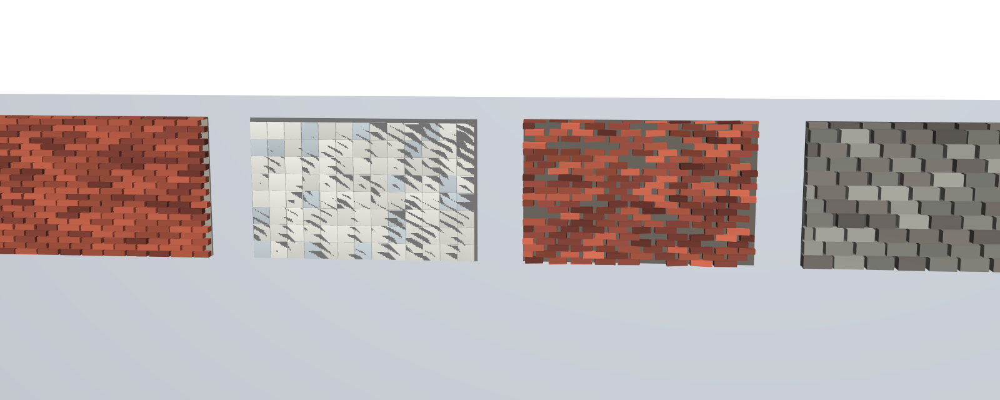
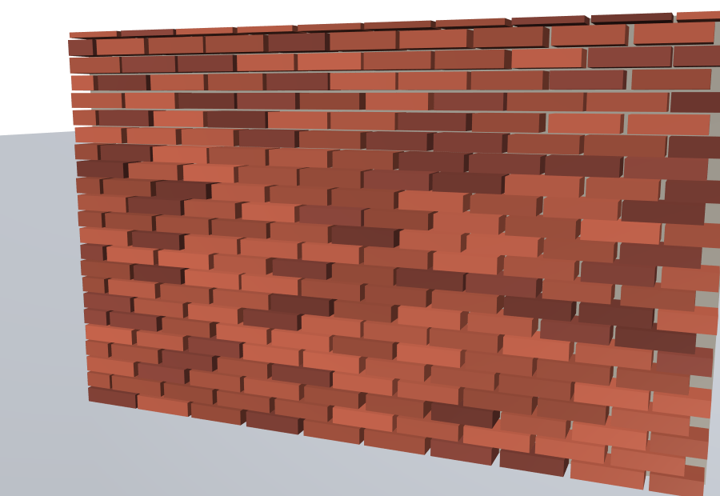
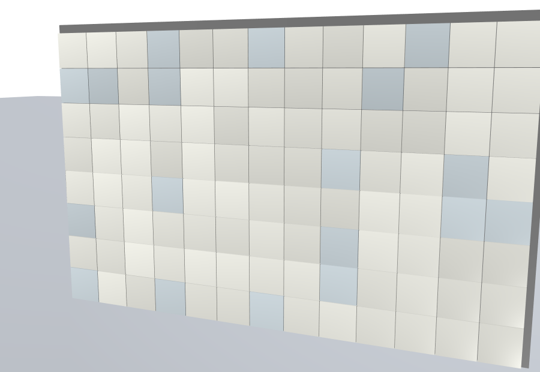
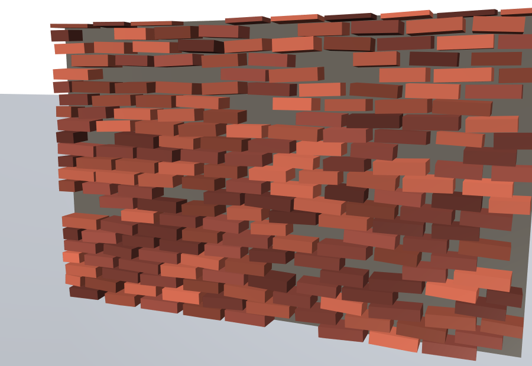
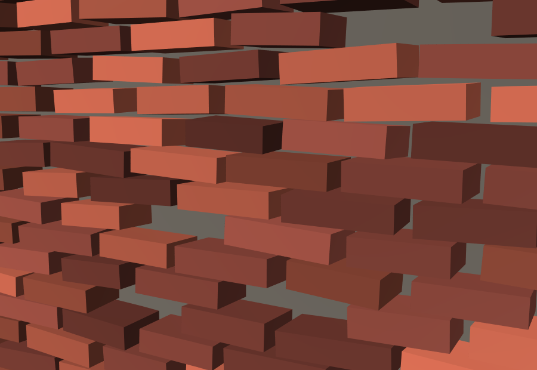
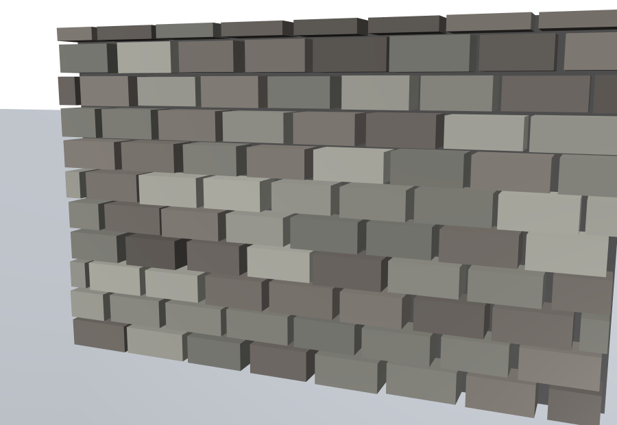

# 02 Brick Wall — レンガ壁ジェネレーター（使い方マニュアル）

幅と高さ、レンガ 1 個の大きさを決めるだけで、壁いっぱいにレンガを敷き詰める HDA です。
段ごとのずれ（レンガ積み / タイル / 階段模様）、目地の幅、レンガごとのばらつき、抜け、2 色の混ぜ具合を調整できます。
同じノードでレンガ・タイル・石積みが作れます。背景の壁や床のベースに使ってください。

## 必要なもの

| もの | 確認したバージョン | 備考 |
|---|---|---|
| Houdini Indie | 21.0.700（Windows） | ファイルは Indie 形式（`.hiplc` / `.hdalc`）。ほかに必要なものはありません |
| Unity | FBX が読めれば何でも | 頂点カラーを使うならシェーダー側で Vertex Color を読みます |

## ファイル

| ファイル | 内容 |
|---|---|
| `otls/brick_wall.hdalc` | HDA 本体（SOP、入力なし）。Tab メニューの **HoudiniClaude ▸ Brick Wall** |
| `brick_wall_sample.hiplc` | サンプルシーン。4 種類の壁のカタログと、FBX 書き出し用 ROP |
| `export/` | サンプルを FBX で書き出した結果（`wall_default.fbx`、`wall_old.fbx`） |
| `images/` | カタログと各壁の画像 |
| `scripts/build_sample.py` | HDA とサンプルを Python でゼロから作り直すスクリプト。壊したときの復旧用。読むと作り方が分かります |

## まず動かしてみる

1. `brick_wall_sample.hiplc` を開きます（HDA は同じフォルダの `otls/` から自動で読み込まれます）。
2. `/obj` に 4 つの壁があります。どれも中は **brick_wall1（緑の HDA）→ OUT → place_in_catalog** だけで、違いはパラメータだけです。
3. `brick_wall1` を選んで、パラメータを動かしてみてください。黄色いメモ（Sticky Note）に「試してみよう」が書いてあります。

| 壁 | 何をしたか |
|---|---|
| `wall_default` | 既定値そのまま。レンガ積み（段ごとに半分ずらす） |
| `wall_tiles` | レンガを正方形で薄くして、Bond Offset を 0 に。角を落とす Bevel をオン |
| `wall_old` | Variation だけで、くずれた古い壁に。抜けた穴から目地の板が見える |
| `wall_stone` | 大きめの石を 3 段で 1 周する階段模様（Bond Offset 0.333）で。Output は Packed |

## 自分のシーンで使う

Tab メニューで **HoudiniClaude ▸ Brick Wall** を置くだけです。入力はありません。
壁は X 方向に原点を中心として広がり、Y = 0（地面）から上に伸びます。置き場所は後ろに [Transform SOP](https://www.sidefx.com/docs/houdini/nodes/sop/xform.html) をつないで決めてください。

### パラメータ

| フォルダ | パラメータ | 意味 |
|---|---|---|
| Wall | Width / Height | 壁の幅と高さ |
| | Mortar Backing / Backing Depth / Mortar Color | レンガの後ろに置く目地の板と、その厚みと色。抜けたレンガの穴から見えます |
| Brick | Brick Size | レンガ 1 個の大きさ（長さ, 高さ, 奥行き） |
| | Gap | レンガとレンガのすき間（目地の幅） |
| | Bond Offset | 段ごとに横へずらす量（レンガ 1 個ぶん = 1）。**0.5 = レンガ積み、0 = タイル、0.333 = 階段模様** |
| | Min Cut | 壁の端で切れたレンガが、この割合より短ければ作らない |
| | Bevel / Bevel Size | レンガの角を落とす |
| Variation | Seed | 乱数のタネ。変えるとばらつき方が変わる |
| | Size Jitter | レンガをランダムに少し短くして、目地を不ぞろいにする |
| | Depth Jitter | レンガを前後にランダムにずらす |
| | Rotation Jitter | レンガをランダムに少し傾ける（度） |
| | Missing | 抜けるレンガの割合 |
| | Color A / Color B / Color Mix | 2 色のレンガを混ぜる。Color Mix は B になる割合 |
| | Color Variation | レンガごとの明るさのばらつき |
| Output | Output | **Polygons**（Unity へ持っていくときはこちら）/ **Packed**（軽いパックドプリミティブ） |
| | UV Scale | 1 m にテクスチャを何回くり返すか（ボックス投影 UV の細かさ） |

### 出力の形

- **Polygons** のとき: レンガごとに面に `name`（`brick_0`, `brick_1`, ...）、目地の板には `name = mortar` が付きます。点には色 `Cd`、頂点には `uv`（ボックス投影）と法線 `N` が付きます。
  点にはほかに `brick_id`（通し番号）、`row`（何段目か）、`cut`（端で切られたレンガなら 1）もあります。
- **Packed** のとき: レンガ 1 個が 1 個のパックドプリミティブになります。パックの点に `Cd`、`brick_id`、`row`、`cut` が付きます。UV はレンガの形に付いた 0〜1 のもの（ボックス投影ではありません）。
- `name` が付いているので、**[01 Mech Transform](../01_mech_transform/) にそのままつなぐと、レンガ単位で動かせます**（`name` ごとに `move` や `hinge` を書くだけ）。

## Unity に持っていく

1. サンプルの `/out` にある `fbx_wall_default` / `fbx_wall_old`（[FBX ROP](https://www.sidefx.com/docs/houdini/nodes/out/filmboxfbx.html)）の **Render** を押すと、`export/` に FBX が出ます。
   自分のシーンでは、FBX ROP の **Start Node** を壁のオブジェクト（`/obj/〜`）に、**Output File** を好きな場所にして Render します。
   **Convert Units** はオンにしてあります（Houdini の 1 m を FBX の 100 cm として書くので、Unity に入れたとき正しい大きさになります）。
2. FBX を Unity の `Assets/` に入れます。インポート設定は既定のままで大丈夫です（Scale Factor 1、Convert Units オン）。
3. FBX には頂点カラー `Cd`、UV、法線が入っています。レンガの色の違いを出すには、Shader Graph で **Vertex Color** ノードを Base Color に掛けます。
   テクスチャは UV がボックス投影なので、くり返しのレンガ模様やノイズをそのまま貼れます（UV Scale で細かさを合わせます）。
4. 目地の板とレンガを別のマテリアルにしたいときは、Houdini 側で `name` 属性を使ってマテリアルを分けてから書き出します（[Material SOP](https://www.sidefx.com/docs/houdini/nodes/sop/material.html) のグループに `@name=mortar` と書けます）。

## うまくいかないとき

| 症状 | 見るところ |
|---|---|
| 重い | Output を Packed にするか、Bevel をオフにします。4 m × 2.5 m の既定の壁でポリゴンは約 1400 面です |
| レンガ同士がめり込む | Rotation Jitter と Depth Jitter を小さくします |
| 穴から向こうが見える | Mortar Backing がオフになっていないか |
| 端のレンガが細すぎる / 消えた | Min Cut を調整します（大きいほど短いレンガを作らない） |
| タイルの目地がそろわない | Size Jitter を 0 にします |
| Unity で小さすぎる / 大きすぎる | FBX ROP の Convert Units がオンか、Unity 側の Scale Factor が 1 か |

## 仕組みを知りたい

VEX で点を作る部分、Copy to Points が読む属性、ボックス投影 UV、点とプリミティブの色の落とし穴は [REPORT.md](REPORT.md) にまとめてあります。
