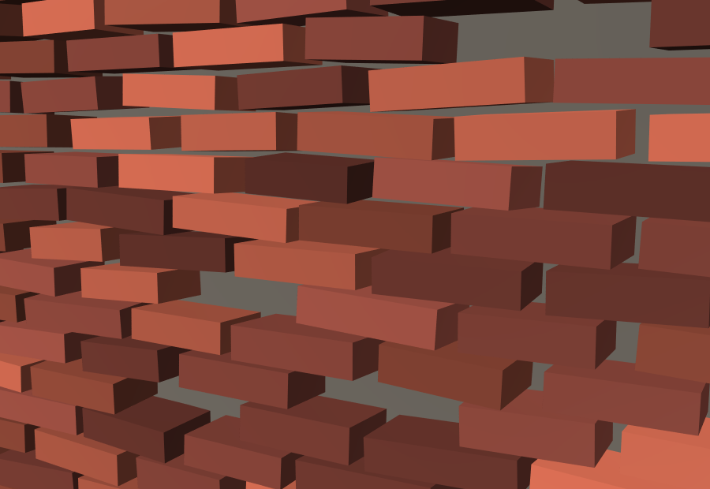
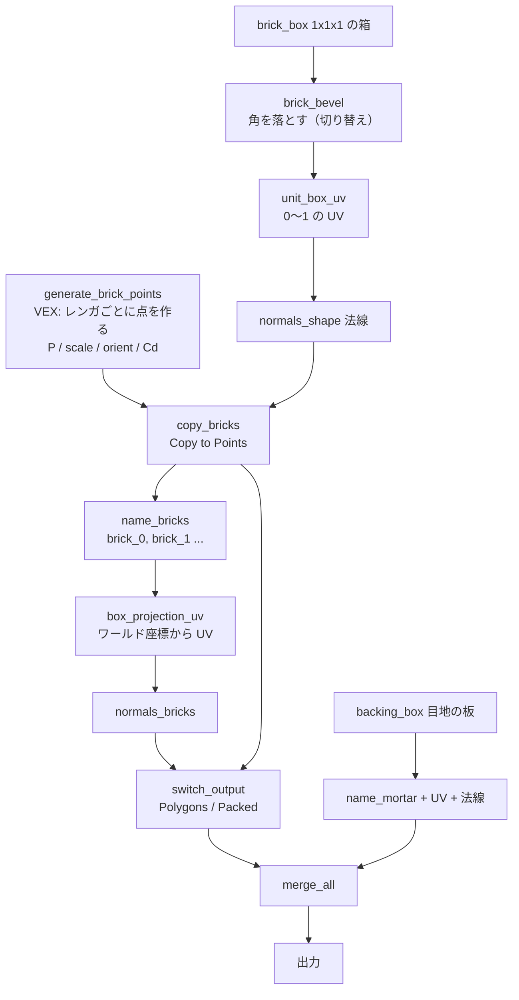

# 02 Brick Wall — 解説レポート

「VEX で点を並べて、Copy to Points で形を置く」という、Houdini のいちばん基本的なプロシージャルモデリングの型を、レンガ壁で学ぶツールです。
使い方だけ知りたい人は [README.md](README.md) へ。



## 1. 何を作ったか、なぜこの作りにしたか

レンガ壁は「同じ形を規則的に並べる」だけなので、プロシージャルモデリングの練習にぴったりです。
作りは 2 段階に分けました。

1. **VEX でレンガ 1 個につき点を 1 つ作る。** 点には位置 `P` のほかに、大きさ `scale`、向き `orient`、色 `Cd` を持たせます。
2. **[Copy to Points](https://www.sidefx.com/docs/houdini/nodes/sop/copytopoints.html) で、点にレンガの形（箱）を置く。** Copy to Points は点の `scale` と `orient` を読んで、箱の大きさと向きを変えてくれます。

「どこに、どんなレンガを置くか」を全部点の属性で決めるので、VEX を書き換えれば並べ方を自由に変えられます。
形のほうは箱 1 個なので、別の形（丸い石など）に差し替えるのも簡単です。

## 2. 全体の流れ



## 3. VEX で点を作る（generate_brick_points）

[Attribute Wrangle](https://www.sidefx.com/docs/houdini/nodes/sop/attribwrangle.html) を **Run Over: Detail** にすると、VEX は 1 回だけ実行されます。
その中で `for` ループを回して、[addpoint()](https://www.sidefx.com/docs/houdini/vex/functions/addpoint.html) で点を増やしていきます。全文はノードの中にコメント付きで入っています。考え方だけ抜き出します。

### 段と列のループ

```c
float pitch_x = bs.x + gap;   // 横のくり返し幅 = レンガの長さ + 目地
float pitch_y = bs.y + gap;   // 縦のくり返し幅 = レンガの高さ + 目地
int   nrows   = int(ceil(H / pitch_y));

for (int row = 0; row < nrows; row++)
{
    float y0 = row * pitch_y;                 // この段の下端
    float y1 = min(y0 + bs.y, H);             // 上端（壁の高さで切る）
    ...
    for (float x0 = -W * 0.5 - shift; x0 < W * 0.5; x0 += pitch_x)
    {
        float a = max(x0, -W * 0.5);          // レンガの左端（壁の端で切る）
        float b = min(x0 + bs.x, W * 0.5);    // レンガの右端
        if (b - a < bs.x * mincut) continue;  // 短すぎる切れ端は作らない
        ...
    }
}
```

外側のループが段（row）、内側のループが横方向です。
壁の端からはみ出したレンガは `max()` / `min()` で切り、切れ端が短すぎれば `continue` で作りません。
これだけで「端のレンガが半分になる」レンガ積みの見た目になります。

### 段ごとのずれ（Bond Offset）

```c
float shift = frac(row * bond) * pitch_x;
```

[frac()](https://www.sidefx.com/docs/houdini/vex/functions/frac.html) は小数部分を返します。`bond = 0.5` なら `row * bond` は 0, 0.5, 1.0, 1.5 … で、小数部分は 0, 0.5, 0, 0.5 … となり、1 段おきに半分ずれます。
`bond = 0.333` なら 0, 0.333, 0.667, 0, … と 3 段で 1 周する階段模様です。式 1 行で「積み方」を切り替えられます。

### レンガごとの乱数

```c
float s = id * 3.1 + seed * 97.0;             // このレンガ専用のタネ
if (rand(s + 0.11) < chf("../missing")) continue;   // 抜けたレンガ
size.x   *= 1.0 - rand(s + 0.23) * chf("../jitter_size");
center.z += (rand(s + 0.41) - 0.5) * 2.0 * chf("../jitter_depth");
```

[rand()](https://www.sidefx.com/docs/houdini/vex/functions/rand.html) は「同じ数を入れれば同じ乱数を返す」関数です。
レンガの通し番号 `id` と Seed からタネを作り、用途ごとに少しずつ違う数（+0.11、+0.23 …）を足して使い分けます。
こうすると Seed を変えない限り結果が毎回同じになり、「Seed を変えると別の壁になる」という使い心地になります。

### 点に持たせる属性

```c
int pt = addpoint(0, center);
setpointattrib(0, "scale",    pt, size);      // Copy to Points がレンガの大きさに使う
setpointattrib(0, "orient",   pt, orient);    // Copy to Points がレンガの向きに使う
setpointattrib(0, "Cd",       pt, col);
setpointattrib(0, "brick_id", pt, id - 1);
```

`scale` と `orient` は Copy to Points が特別扱いする属性です（[コピーとインスタンスの属性](https://www.sidefx.com/docs/houdini/copy/instanceattrs.html)）。
`orient` はクォータニオンで、[eulertoquaternion()](https://www.sidefx.com/docs/houdini/vex/functions/eulertoquaternion.html) で角度（度 → ラジアン）から作っています。
`Cd` は「Attributes from Target」の既定の設定で、置いたレンガの点にそのままコピーされます。

## 4. Copy to Points と形の準備

- **brick_box**: 1 × 1 × 1 の [Box](https://www.sidefx.com/docs/houdini/nodes/sop/box.html)。大きさは点の `scale` で決まるので、形は単位サイズにしておきます。
- **brick_bevel**: [PolyBevel](https://www.sidefx.com/docs/houdini/nodes/sop/polybevel.html) で角を落とします。[Switch](https://www.sidefx.com/docs/houdini/nodes/sop/switch.html) で、Bevel パラメータがオフなら素の箱を通します。
- **normals_shape**: [Normal SOP](https://www.sidefx.com/docs/houdini/nodes/sop/normal.html)（頂点法線、カスプ角 40 度）。Packed 出力では中身の法線がそのまま表示されるので、ここで角がカクッと見える法線を付けておきます。付けないと、箱がまくらのように丸く陰影が付きます。
- **copy_bricks**: Copy to Points。Output が Packed のときだけ **Pack and Instance** をオンにする式（`ch("../output")`）が入っています。

## 5. ボックス投影 UV（box_projection_uv）

レンガはただの箱ですが、UV はあとからテクスチャを貼るために要ります。
箱の UV を展開する代わりに、**面の向きを見て、ワールド座標をそのまま UV にする**「ボックス投影」を VEX で書きました（Run Over: Vertices）。

```c
vector n = prim_normal(0, @primnum, 0.5, 0.5);   // この面の向き
vector p = @P * chf("../uv_scale");               // 1 m にテクスチャを何回くり返すか
if (abs(n.x) >= abs(n.y) && abs(n.x) >= abs(n.z))
    @uv = set(-p.z * sign(n.x), p.y, 0);          // 左右を向く面 → (z, y)
else if (abs(n.y) >= abs(n.z))
    @uv = set(p.x, -p.z * sign(n.y), 0);          // 上下を向く面 → (x, z)
else
    @uv = set(p.x * sign(n.z), p.y, 0);           // 前後を向く面 → (x, y)
```

[prim_normal()](https://www.sidefx.com/docs/houdini/vex/functions/prim_normal.html) で面の法線を取り、いちばん大きい成分の軸を「投影する方向」にします。残りの 2 軸の座標が UV です。
`sign()` を掛けているのは、裏側の面でテクスチャが鏡写しにならないようにするためです。
ワールド座標から作るので、**レンガの大きさが違ってもテクスチャの細かさがそろい、隣のレンガと模様がつながります**。ゲームの背景でよく使う、いわゆるトリプラナー投影の UV 版です。

## 6. 名前と色: 落とし穴

### 面には name、点には Cd

- `name_bricks`（Run Over: Primitives）が面ごとに `brick_0` のような名前を付けます。[primpoint()](https://www.sidefx.com/docs/houdini/vex/functions/primpoint.html) で面の最初の点を取り、その点の `brick_id` を読んでいます。
- 色 `Cd` は点に付けています。

### 点とプリミティブの両方に Cd があると、点が勝つ

作っている途中、目地の板が真っ白になる不具合がありました。原因は、目地の Wrangle を Run Over: Primitives にして `v@Cd = ...` と書いたことです。
これだと `Cd` が **プリミティブ属性** として付きます。一方レンガの `Cd` は **点属性** です。
2 つを [Merge](https://www.sidefx.com/docs/houdini/nodes/sop/merge.html) すると、両方の属性が全体に作られ、目地の板の点には既定値の白（1, 1, 1）が入り、ビューポートは点の `Cd` を優先して表示するので白くなりました。

直し方は、目地の色も点に付けること。Run Over: Primitives のまま、面の点をループして [setpointattrib()](https://www.sidefx.com/docs/houdini/vex/functions/setpointattrib.html) で書いています。

```c
s@name = "mortar";
foreach (int pt; primpoints(0, @primnum))
    setpointattrib(0, "Cd", pt, chv("../mortar_color"));
```

**同じ名前の属性は、同じクラス（点 / 頂点 / 面）にそろえる**。Merge するときの基本ルールです。

## 7. Polygons と Packed

| | Polygons | Packed |
|---|---|---|
| 既定の壁（230 個） | 約 1,400 面 | 97 プリミティブ（レンガ 91 + 目地） |
| 使いどころ | Unity に書き出す、さらに加工する | Houdini 内で大きな壁をたくさん置く |
| UV | ボックス投影（ワールド座標） | 箱に付いた 0〜1 |

[パックドプリミティブ](https://www.sidefx.com/docs/houdini/model/packed.html) は「同じ形の参照」なので、メモリも表示も軽くなります。
Unity には展開した状態で持っていく必要があるので、書き出すときは Polygons にします。

## 8. Unity へ

[FBX ROP](https://www.sidefx.com/docs/houdini/nodes/out/filmboxfbx.html) で書き出すと、頂点カラー `Cd`、UV、法線が FBX に入ることを確認しました（FBX のテキストを読んで `LayerElementColor`、`LayerElementUV`、`LayerElementNormal` があることを見ています）。
**Convert Units** をオンにしないと、Houdini の 1 m が FBX の 1 cm として書かれ、Unity で 100 分の 1 の大きさになります。サンプルの ROP はオンにしてあります。

## 9. 壊して学ぶヒント

- `generate_brick_points` の `float shift = frac(row * bond) * pitch_x;` を `float shift = 0;` にする → どの Bond Offset でもタイル積みになる。**ずらしているのはこの 1 行だけ** と分かる。
- `if (b - a < bs.x * mincut) continue;` を消す → 端に極端に細いレンガができる。
- `brick_bevel` の代わりに [Sphere](https://www.sidefx.com/docs/houdini/nodes/sop/sphere.html) をつなぐ → 丸い石の壁になる（Copy to Points は何でも置ける）。
- `name_mortar` の `setpointattrib` を `v@Cd = ...` に戻す → 目地が白くなる（6 章の落とし穴を体験）。
- Output を Packed にして、Geometry Spreadsheet で Primitives タブを見る → 91 個しかない。

## 10. 次にやれそうなこと

- カーブに沿った壁: 点を作ったあと、[Ray](https://www.sidefx.com/docs/houdini/nodes/sop/ray.html) や曲線上の位置で曲げる
- 窓や扉の穴: 入力ジオメトリで「作らない範囲」を指定する
- 欠けや割れ: [Boolean](https://www.sidefx.com/docs/houdini/nodes/sop/boolean.html) でレンガを削る
- 02 の出力を [01 Mech Transform](../01_mech_transform/) に入れて、レンガを 1 個ずつ動かす

## 参考リンク（Houdini 公式マニュアル）

- ノード: [Attribute Wrangle](https://www.sidefx.com/docs/houdini/nodes/sop/attribwrangle.html) / [Copy to Points](https://www.sidefx.com/docs/houdini/nodes/sop/copytopoints.html) / [Box](https://www.sidefx.com/docs/houdini/nodes/sop/box.html) / [PolyBevel](https://www.sidefx.com/docs/houdini/nodes/sop/polybevel.html) / [Normal](https://www.sidefx.com/docs/houdini/nodes/sop/normal.html) / [Switch](https://www.sidefx.com/docs/houdini/nodes/sop/switch.html) / [Merge](https://www.sidefx.com/docs/houdini/nodes/sop/merge.html) / [Transform](https://www.sidefx.com/docs/houdini/nodes/sop/xform.html) / [FBX ROP](https://www.sidefx.com/docs/houdini/nodes/out/filmboxfbx.html)
- 概念: [コピーとインスタンスの属性（scale, orient, Cd）](https://www.sidefx.com/docs/houdini/copy/instanceattrs.html) / [パックドプリミティブ](https://www.sidefx.com/docs/houdini/model/packed.html) / [VEX スニペット](https://www.sidefx.com/docs/houdini/vex/snippets.html)
- VEX: [addpoint](https://www.sidefx.com/docs/houdini/vex/functions/addpoint.html) / [setpointattrib](https://www.sidefx.com/docs/houdini/vex/functions/setpointattrib.html) / [rand](https://www.sidefx.com/docs/houdini/vex/functions/rand.html) / [frac](https://www.sidefx.com/docs/houdini/vex/functions/frac.html) / [eulertoquaternion](https://www.sidefx.com/docs/houdini/vex/functions/eulertoquaternion.html) / [prim_normal](https://www.sidefx.com/docs/houdini/vex/functions/prim_normal.html) / [primpoint](https://www.sidefx.com/docs/houdini/vex/functions/primpoint.html) / [primpoints](https://www.sidefx.com/docs/houdini/vex/functions/primpoints.html) / [sprintf](https://www.sidefx.com/docs/houdini/vex/functions/sprintf.html) / [ch / chf / chv](https://www.sidefx.com/docs/houdini/vex/functions/ch.html)
