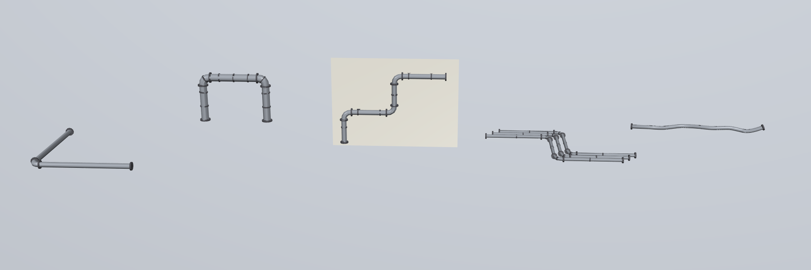
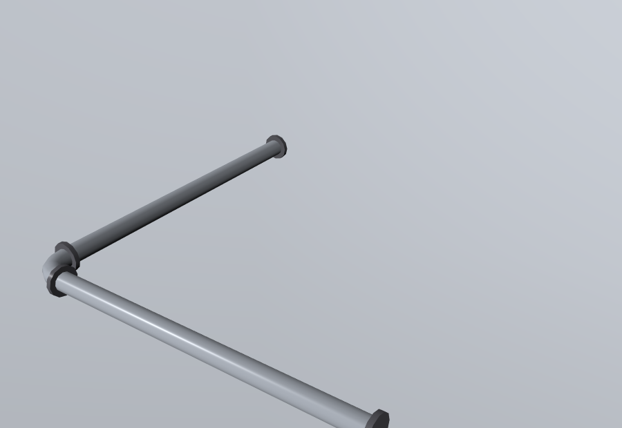
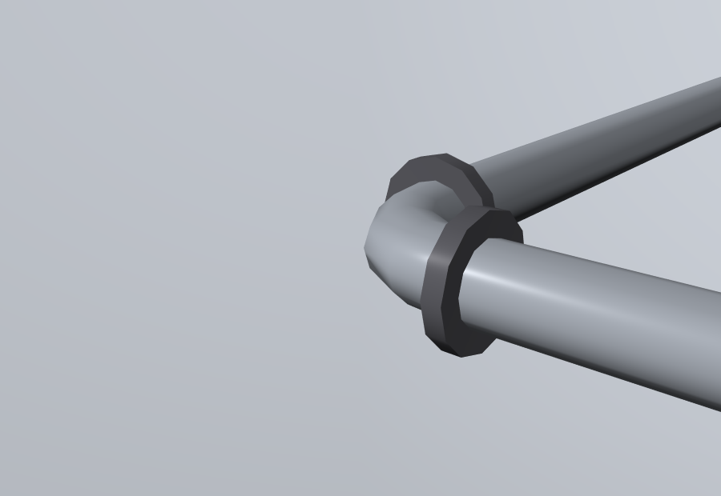
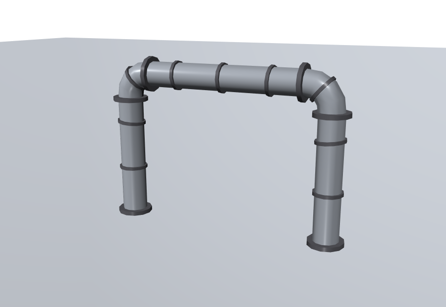
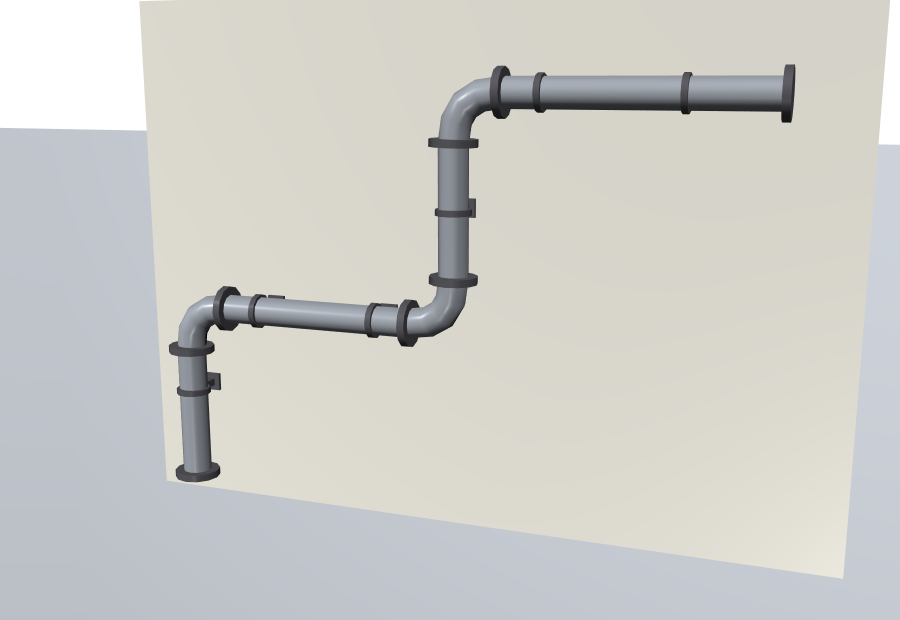
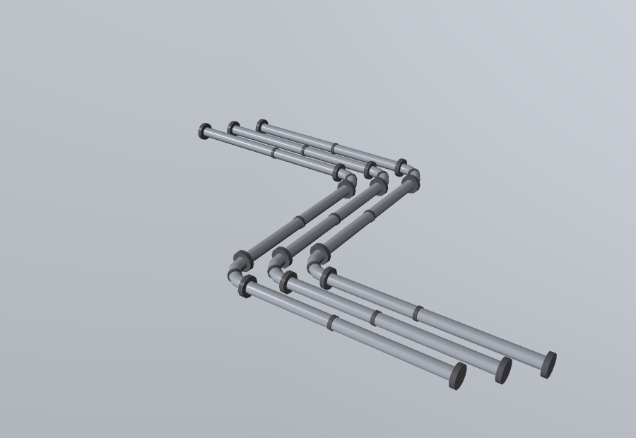
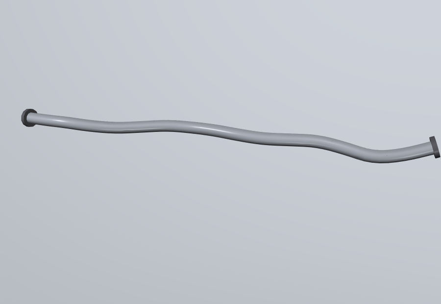

# 03 Pipe Run — 配管ジェネレーター（使い方マニュアル）

折れ線（カーブ）をつなぐだけで、角の丸い配管を作る HDA です。
端と曲がり目のフランジ、等間隔のバンド、壁や天井への取り付け金具も付けられます。
工場・地下・宇宙船のような背景に、配管をたくさん這わせるときに使ってください。

## 必要なもの

| もの | 確認したバージョン | 備考 |
|---|---|---|
| Houdini Indie | 21.0.700（Windows） | ファイルは Indie 形式（`.hiplc` / `.hdalc`）。ほかに必要なものはありません |
| Unity | FBX が読めれば何でも | 部品ごとの色は頂点カラー、マテリアル分けは `name` 属性で |

## ファイル

| ファイル | 内容 |
|---|---|
| `otls/pipe_run.hdalc` | HDA 本体（SOP、入力 1 つ）。Tab メニューの **HoudiniClaude ▸ Pipe Run** |
| `pipe_run_sample.hiplc` | サンプルシーン。配管 5 種のカタログと、FBX 書き出し用 ROP |
| `export/` | サンプルを FBX で書き出した結果（`run_L.fbx`、`run_zigzag.fbx`） |
| `images/` | カタログと各配管の画像 |
| `scripts/build_sample.py` | HDA とサンプルを Python でゼロから作り直すスクリプト。壊したときの復旧用。読むと作り方が分かります |

## まず動かしてみる

1. `pipe_run_sample.hiplc` を開きます（HDA は同じフォルダの `otls/` から自動で読み込まれます）。
2. `/obj` に 5 つの配管があります。中は **曲線（Add ノードなど）→ pipe_run1（緑の HDA）→ OUT → place_in_catalog** です。
3. 曲線の点を動かすと配管が追いかけます。`pipe_run1` のパラメータも動かしてみてください。黄色いメモ（Sticky Note）に「試してみよう」が書いてあります。

| 配管 | 何をしたか |
|---|---|
| `run_L` | 折れ線 3 点（角 1 つ）。既定値のまま |
| `run_U` | Radius を太くして、Band Interval 0.5 で等間隔のバンド |
| `run_zigzag` | 後ろの壁に向かう取り付け金具（Brackets オン、Bracket Direction (0, 0, -1)） |
| `run_multi` | 3 本の折れ線を Merge して 1 つの HDA に |
| `run_freehand` | 直線を細かく分けて VEX のノイズで波打たせた、なめらかな曲線 |

## 自分のシーンで使う

### 1. 折れ線を用意する

入力は **ポリゴンの曲線（折れ線）** です。角の点だけがある折れ線がいちばんきれいに仕上がります。

- 数値で置くなら [Add SOP](https://www.sidefx.com/docs/houdini/nodes/sop/add.html)（点を並べて、Polygons タブで 1 本につなぐ。サンプルはこの方法）
- ビューポートで描くなら [Curve SOP](https://www.sidefx.com/docs/houdini/nodes/sop/curve.html)。**Primitive Type は Polygon** にしてください
- 複数の折れ線を [Merge](https://www.sidefx.com/docs/houdini/nodes/sop/merge.html) して 1 つの HDA に入れても大丈夫です（設定は共通になります）

### 2. HDA をつなぐ

Tab メニューで **HoudiniClaude ▸ Pipe Run** を置き、折れ線をつなぎます。

### パラメータ

| フォルダ | パラメータ | 意味 |
|---|---|---|
| Pipe | Radius | パイプの半径 |
| | Segments | 断面の分割数 |
| | Bend Radius | 角を丸める半径。隣の角までの距離の半分より大きくできません |
| | Bend Divisions | 角の丸めの分割数 |
| | End Caps | 端にフタをする |
| | UV Scale | フランジなど部品のボックス投影 UV の細かさ |
| Flanges | Flange at Ends / Flange at Bends | 端 / 曲がりの始まりと終わりにフランジを置く |
| | Flange Radius / Flange Width | フランジの半径（パイプの半径に対する倍率）と厚み |
| Bands | Band Interval | バンド（細い輪）の間隔。0 で置かない |
| | Band Radius / Band Width | バンドの半径（倍率）と幅 |
| Brackets | Brackets | 取り付け金具を置く |
| | Bracket Interval | 金具の間隔。まっすぐな区間ごとに等間隔で、角とフランジは避けます |
| | Bracket Direction | 金具が伸びる向き。(0, -1, 0) なら床へ、(0, 0, -1) なら奥の壁へ |
| | Bracket Length / Bracket Size | パイプの中心から壁までの長さ、金具の太さ |
| Colors | Pipe Color / Fitting Color | パイプ本体 / 部品（フランジ・バンド・金具）の色（頂点カラー） |

### 出力の形

- 面に `name`（`pipe` / `flange` / `band` / `bracket`）、点に色 `Cd`、頂点に `uv` と法線 `N` が付いたポリゴンです。
- パイプ本体の UV は [Sweep](https://www.sidefx.com/docs/houdini/nodes/sop/sweep.html) が付けたもので、**u が周方向（0〜1）、v が長さ方向** です。v は「周の長さを 1 としたときの長さ」なので、テクスチャのタイルが正方形のまま伸びます。
- フランジなどの部品はボックス投影 UV（UV Scale で細かさを変えられます）。

## Unity に持っていく

1. サンプルの `/out` にある `fbx_run_L` / `fbx_run_zigzag`（[FBX ROP](https://www.sidefx.com/docs/houdini/nodes/out/filmboxfbx.html)）の **Render** を押すと、`export/` に FBX が出ます。
   自分のシーンでは、FBX ROP の **Start Node** を配管のオブジェクトに、**Output File** を好きな場所にして Render します。**Convert Units** はオンにしてあります（Houdini の 1 m を FBX の 100 cm として書くので、Unity で正しい大きさになります）。
2. FBX を Unity の `Assets/` に入れます。インポート設定は既定のままで大丈夫です。
3. 部品ごとに色を変えるには、Shader Graph で **Vertex Color** を Base Color に掛けます。
   マテリアルを分けたいときは、Houdini 側で [Material SOP](https://www.sidefx.com/docs/houdini/nodes/sop/material.html) のグループに `@name=flange` のように書いて割り当ててから書き出します。

## うまくいかないとき

| 症状 | 見るところ |
|---|---|
| 角が丸まらない / 形が崩れる | 入力がポリゴンの曲線か（NURBS や Bezier なら [Convert](https://www.sidefx.com/docs/houdini/nodes/sop/convert.html) で Polygon に）。Bend Radius が隣の角までの距離の半分を超えていないか |
| フランジの向きがおかしい | 曲線に重なった点（同じ位置の点）がないか。[Fuse](https://www.sidefx.com/docs/houdini/nodes/sop/fuse.html) で重なりを消します |
| 金具が付かない | まっすぐな区間が短すぎる（角の丸めとフランジを避けると置く場所がない）か、Bracket Direction とパイプが平行 |
| バンドがフランジと重なる | Band Interval を変えるか、Flange Width を小さく |
| 点の多いなめらかな曲線で、小さな折れが丸まらない | 3 度未満の折れは意図的に丸めません。丸めたい点だけ残して [Resample](https://www.sidefx.com/docs/houdini/nodes/sop/resample.html) か [Facet](https://www.sidefx.com/docs/houdini/nodes/sop/facet.html) で間引きます |
| Unity で小さすぎる / 大きすぎる | FBX ROP の Convert Units がオンか、Unity 側の Scale Factor が 1 か |

## 仕組みを知りたい

PolyBevel で角を丸める仕組み、Sweep、曲線の向きをフランジに合わせる方法（PolyFrame と Copy to Points）、金具を置く VEX は [REPORT.md](REPORT.md) にまとめてあります。
