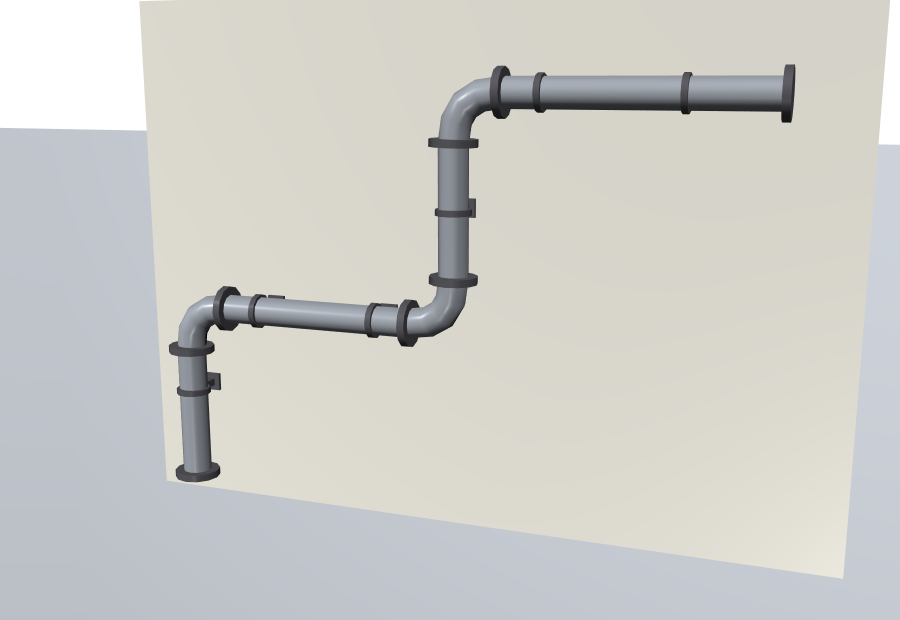
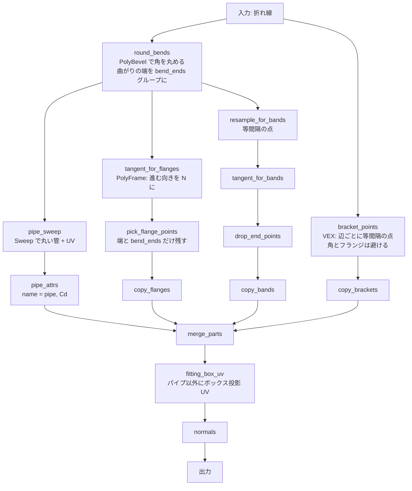

# 03 Pipe Run — 解説レポート

「曲線を道しるべにして、部品を置いていく」プロシージャルモデリングの型を、配管で学ぶツールです。
角を丸める、管にする、曲線の向きに部品をそろえる、という 3 つの技を使っています。
使い方だけ知りたい人は [README.md](README.md) へ。



## 1. 何を作ったか、なぜこの作りにしたか

配管は背景によく出てきますが、手で角を作ると大変です。折れ線を描くだけで済むように、次の 3 段階にしました。

1. **角を丸める**: 折れ線の角の点を [PolyBevel](https://www.sidefx.com/docs/houdini/nodes/sop/polybevel.html) で円弧にします。
2. **管にする**: 丸めた曲線に沿って [Sweep](https://www.sidefx.com/docs/houdini/nodes/sop/sweep.html) で丸い管を張ります。
3. **部品を置く**: 曲線の上の「端の点」「曲がりの始まりと終わりの点」「等間隔の点」に、[Copy to Points](https://www.sidefx.com/docs/houdini/nodes/sop/copytopoints.html) でフランジやバンドを置きます。

部品はすべて「点に置く」だけなので、形を差し替えればバルブでも計器でも同じ仕組みで付けられます。

## 2. 全体の流れ



## 3. 角を丸める（PolyBevel）

PolyBevel は面の角を落とすノードとして有名ですが、**Group Type を Points にして折れ線に使うと、角の点を円弧に置き換えてくれます**。

- **Offset** が丸めの半径（Bend Radius）、**Divisions** が円弧の分割数です。
- **Ignore Flat Points** をオンにして Flat Angle を 3 度にしてあるので、点が多いなめらかな曲線でも、ほとんど曲がっていない点は丸めません。
- **Offset Points** という出力グループをオンにすると、円弧の始まりと終わりの点がグループに入ります。これを `bend_ends` と名付けて、フランジの置き場所に使っています。

ノードを 1 個置くだけで「曲がりの端の点」が手に入るのがポイントです。自分で角度を計算する必要はありません。

## 4. 管にする（Sweep 2.0）

[Sweep](https://www.sidefx.com/docs/houdini/nodes/sop/sweep.html) の **Surface Shape** を Round Tube にすると、断面の形を用意しなくても丸い管になります。

- Radius と Columns（Segments）は HDA のパラメータから `ch("../radius")` のような式で読んでいます。
- **End Caps** は Single Polygon。パラメータ側のトグルを `ch("../end_caps")` でメニューの番号（0 = None、1 = Single Polygon）に渡しています。
- **Compute UVs** をオンにすると、u が周方向（0〜1）、v が長さ方向の UV が付きます。Length-Weighted なので、v は「周の長さを 1 としたときの長さ」になり、テクスチャが引き伸ばされません（半径 0.08 のパイプは周が約 0.5 m なので、1 m 進むと v が 2 増えます）。

## 5. 曲線の向きに部品をそろえる（PolyFrame + Copy to Points）

フランジは管の向きに合わせて置かなければなりません。Copy to Points は、点に `N` があれば **置く形の +Z 軸を N に合わせます**（[コピーとインスタンスの属性](https://www.sidefx.com/docs/houdini/copy/instanceattrs.html)）。

そこで [PolyFrame](https://www.sidefx.com/docs/houdini/nodes/sop/polyframe.html) で曲線の「進む向き（接線）」を計算し、それを `N` という名前で点に付けます。
フランジの形は [Tube](https://www.sidefx.com/docs/houdini/nodes/sop/tube.html) の Orientation を Z にして、軸が +Z を向くように作ってあります。これで管と同じ向きに置かれます。

> **落とし穴**: PolyFrame の **Entity** は既定が Primitives で、このとき接線は **頂点属性** として付きます。点の Wrangle で `v@N` と書いても 0 しか読めず、Copy to Points も向きを拾えません。
> 作っている途中、これでフランジが全部同じ向きになりました。Entity を **Points** にすると点属性になります。

置く点を選ぶ VEX は短いものです。

```c
int at_end  = neighbourcount(0, @ptnum) == 1;          // つながりが 1 本だけ = 曲線の端
int at_bend = inpointgroup(0, "bend_ends", @ptnum);    // 曲がりの始まり・終わり
int keep = 0;
if (at_end  && chi("../flange_ends"))  keep = 1;
if (at_bend && chi("../flange_bends")) keep = 1;
if (!keep) removepoint(0, @ptnum);
```

[neighbourcount()](https://www.sidefx.com/docs/houdini/vex/functions/neighbourcount.html) は「この点につながっている点の数」です。折れ線の端は 1、途中は 2 になります。
[inpointgroup()](https://www.sidefx.com/docs/houdini/vex/functions/inpointgroup.html) で PolyBevel が作ったグループを見て、要らない点は [removepoint()](https://www.sidefx.com/docs/houdini/vex/functions/removepoint.html) で消します。

バンドは [Resample](https://www.sidefx.com/docs/houdini/nodes/sop/resample.html) で等間隔に打ち直した点に置き、端の点だけ消しています（端にはフランジがあるので）。

## 6. 取り付け金具を置く VEX（bracket_points）

金具は「まっすぐな部分にだけ、等間隔に」置きたい部品です。
最初は丸めた曲線を Resample して、隣の点と向きが違う点（曲がっている最中）を除く方法で作りましたが、うまくいきませんでした。
Resample した点の向きは隣の点との平均になるので、曲がりの近くの点も全部「向きが違う」と判定され、金具が 1 つも残らなかったのです。

そこで、**丸める前の折れ線の辺を 1 本ずつ見る**方法に変えました。Run Over: Primitives の Wrangle です。

```c
float  interval = max(chf("../bracket_interval"), 0.01);
float  margin   = chf("../bend_radius") + chf("../radius") * chf("../flange_radius") + chf("../bracket_size");  // 角とフランジを避ける長さ
vector dir      = normalize(chv("../bracket_dir"));

int pts[] = primpoints(0, @primnum);   // この折れ線の点を順番に
for (int i = 0; i < len(pts) - 1; i++)
{
    vector a = point(0, "P", pts[i]);
    vector b = point(0, "P", pts[i + 1]);
    vector t = normalize(b - a);                 // この辺の向き
    float  L = distance(a, b) - 2.0 * margin;    // 金具を置ける長さ
    if (L <= 0.0) continue;                      // 短すぎる辺
    if (abs(dot(t, dir)) > 0.99) continue;       // 取り付け方向と平行な辺には置けない

    int   n     = int(floor(L / interval)) + 1;               // 置く個数
    float start = margin + (L - (n - 1) * interval) * 0.5;    // 辺の中央にそろえる
    for (int k = 0; k < n; k++)
    {
        int pt = addpoint(0, a + t * (start + k * interval));
        setpointattrib(0, "N",  pt, t);      // 型の +Z をこの向きに
        setpointattrib(0, "up", pt, -dir);   // 型の +Y を取り付け方向の逆に
    }
}
removeprim(0, @primnum, 1);   // 元の曲線は消して、作った点だけ残す
```

- [primpoints()](https://www.sidefx.com/docs/houdini/vex/functions/primpoints.html) で折れ線の点の番号を順番に取り、隣り合う 2 点で辺を作ります。
- 丸めた曲線でも、まっすぐな部分は元の辺の上にそのままあるので、位置はずれません。角の丸めとフランジのぶんだけ `margin` で避けます。
- `up` は Copy to Points が **+Y 軸を合わせる向き**です。金具の型は -Y 方向に柱を伸ばして作ってあるので、`up` を取り付け方向の逆にすると、柱が壁へ向かいます。
- 最後に [removeprim()](https://www.sidefx.com/docs/houdini/vex/functions/removeprim.html) で元の折れ線を消し、点だけを Copy to Points に渡します。

「曲線の上で判定する」より「元の辺で考える」ほうが、短くて確実でした。うまくいかないときは、データの持ち方を変えるのが近道です。

## 7. 名前、色、UV

- 部品ごとの Wrangle（Run Over: Primitives）で、面に `name`、点に `Cd` を付けています。[02 Brick Wall のレポート](../02_brick_wall/REPORT.md) にも書いたとおり、`Cd` は点に付けないと Merge したときに白くなります。
- パイプ本体の UV は Sweep のまま。部品には `fitting_box_uv` でボックス投影 UV を付けています。`if (prim(0, "name", @primnum) == "pipe") return;` と、面の名前を見て処理を分けています。
- 最後に [Normal SOP](https://www.sidefx.com/docs/houdini/nodes/sop/normal.html)（頂点法線、カスプ角 60 度）で、管はなめらかに、フランジの角はカクッと見えるようにしています。

## 8. Unity へ

[FBX ROP](https://www.sidefx.com/docs/houdini/nodes/out/filmboxfbx.html) で書き出します。頂点カラー、UV、法線が入ります。
Convert Units をオンにして、Houdini の 1 m を FBX の 100 cm にしています（オフだと Unity で 100 分の 1 の大きさになります）。

## 9. 壊して学ぶヒント

- `round_bends` の Offset Points をオフにする → `bend_ends` グループが無くなり、曲がり目のフランジが消える。**グループが置き場所の正体**。
- `tangent_for_flanges` の Entity を Primitives に戻す → フランジが全部同じ向きになる（5 章の落とし穴を体験）。
- `pipe_sweep` の Surface Shape を Square Tube にする → 角ダクトになる。
- `flange_shape` を [Torus](https://www.sidefx.com/docs/houdini/nodes/sop/torus.html) に差し替える → 丸いリングのフランジになる。
- `bracket_points` の `margin` を 0 にする → 金具が角の丸めに食い込む。

## 10. 次にやれそうなこと

- バルブや計器: 新しい形を用意して、`bend_ends` や等間隔の点に置く
- 太さの変化: 曲線の点に `pscale` を付けて Sweep の Scale に使う
- 02 Brick Wall の壁の上を這わせる: 壁の前に折れ線を置くだけ
- 配管の束: Merge した折れ線を [Copy and Transform](https://www.sidefx.com/docs/houdini/nodes/sop/copyxform.html) で平行に複製

## 参考リンク（Houdini 公式マニュアル）

- ノード: [PolyBevel](https://www.sidefx.com/docs/houdini/nodes/sop/polybevel.html) / [Sweep](https://www.sidefx.com/docs/houdini/nodes/sop/sweep.html) / [PolyFrame](https://www.sidefx.com/docs/houdini/nodes/sop/polyframe.html) / [Copy to Points](https://www.sidefx.com/docs/houdini/nodes/sop/copytopoints.html) / [Resample](https://www.sidefx.com/docs/houdini/nodes/sop/resample.html) / [Tube](https://www.sidefx.com/docs/houdini/nodes/sop/tube.html) / [Box](https://www.sidefx.com/docs/houdini/nodes/sop/box.html) / [Add](https://www.sidefx.com/docs/houdini/nodes/sop/add.html) / [Curve](https://www.sidefx.com/docs/houdini/nodes/sop/curve.html) / [Line](https://www.sidefx.com/docs/houdini/nodes/sop/line.html) / [Merge](https://www.sidefx.com/docs/houdini/nodes/sop/merge.html) / [Normal](https://www.sidefx.com/docs/houdini/nodes/sop/normal.html) / [Attribute Wrangle](https://www.sidefx.com/docs/houdini/nodes/sop/attribwrangle.html) / [FBX ROP](https://www.sidefx.com/docs/houdini/nodes/out/filmboxfbx.html)
- 概念: [コピーとインスタンスの属性（N, up）](https://www.sidefx.com/docs/houdini/copy/instanceattrs.html) / [VEX スニペット](https://www.sidefx.com/docs/houdini/vex/snippets.html)
- VEX: [neighbourcount](https://www.sidefx.com/docs/houdini/vex/functions/neighbourcount.html) / [inpointgroup](https://www.sidefx.com/docs/houdini/vex/functions/inpointgroup.html) / [removepoint](https://www.sidefx.com/docs/houdini/vex/functions/removepoint.html) / [removeprim](https://www.sidefx.com/docs/houdini/vex/functions/removeprim.html) / [primpoints](https://www.sidefx.com/docs/houdini/vex/functions/primpoints.html) / [point](https://www.sidefx.com/docs/houdini/vex/functions/point.html) / [addpoint](https://www.sidefx.com/docs/houdini/vex/functions/addpoint.html) / [setpointattrib](https://www.sidefx.com/docs/houdini/vex/functions/setpointattrib.html) / [dot](https://www.sidefx.com/docs/houdini/vex/functions/dot.html) / [normalize](https://www.sidefx.com/docs/houdini/vex/functions/normalize.html) / [distance](https://www.sidefx.com/docs/houdini/vex/functions/distance.html) / [noise](https://www.sidefx.com/docs/houdini/vex/functions/noise.html)
