# 04 Weathering Mask — ウェザリングマスク（使い方マニュアル）

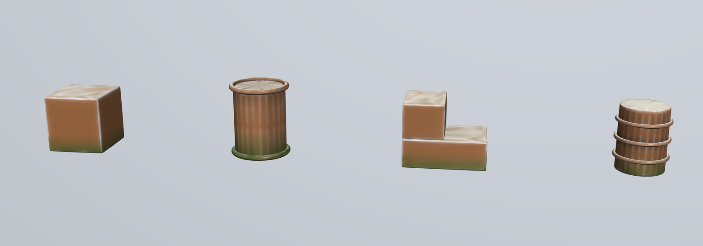

メッシュの **形だけ** から「汚れやすい場所」を計算して、4 つのマスクを頂点カラーに書く HDA です。

| マスク | 場所 | 使い道 |
|---|---|---|
| `mask_edge` | 出っぱった角 | 擦れ、塗装はがれ、金属の露出 |
| `mask_cavity` | へこみ、すき間、付け根 | 汚れ、ほこりだまり、サビ |
| `mask_top` | 上を向いた面 | ほこり、雪、落ち葉 |
| `mask_bottom` | 地面に近い部分 | 水あか、苔、泥はね |

テクスチャを描かなくても、Unity 側のシェーダーで頂点カラーを読めば、背景の小物にまとめて汚しを付けられます。

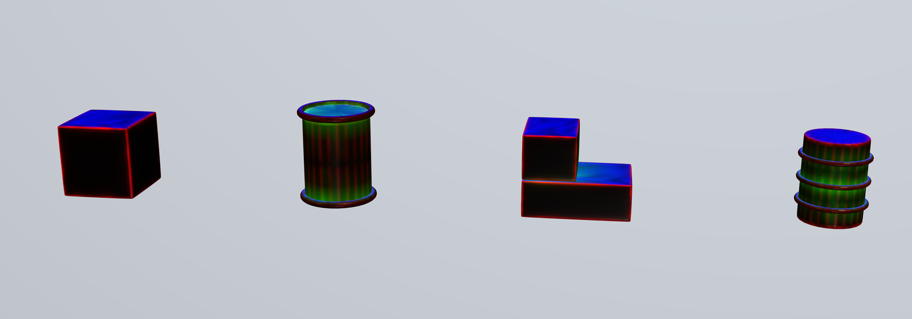

## 必要なもの

| もの | 確認したバージョン | 備考 |
|---|---|---|
| Houdini Indie | 21.0.700（Windows） | ファイルは Indie 形式（`.hiplc` / `.hdalc`）。ほかに必要なものはありません |
| Unity | FBX が読めれば何でも | Shader Graph の Vertex Color ノードで RGBA を読みます |

## ファイル

| ファイル | 内容 |
|---|---|
| `otls/weathering_mask.hdalc` | HDA 本体（SOP、入力 1 つ）。Tab メニューの **HoudiniClaude ▸ Weathering Mask** |
| `weathering_mask_sample.hiplc` | サンプルシーン。小物 4 種のカタログと、Unity 向けの書き出し用オブジェクト、FBX ROP |
| `export/weathering_masks_packed.fbx` | 4 種の小物にマスクを頂点カラー（RGB + Alpha）として付けた FBX |
| `images/` | Preview ごとのカタログと、各小物の画像 |
| `scripts/build_sample.py` | HDA とサンプルを Python でゼロから作り直すスクリプト。壊したときの復旧用。読むと作り方が分かります |

## まず動かしてみる

1. `weathering_mask_sample.hiplc` を開きます（HDA は同じフォルダの `otls/` から自動で読み込まれます）。
2. `/obj` に小物が 4 つあります。中は **形 → bevel → subdivide → SHAPE → weathering_mask1（緑の HDA）→ OUT → place_in_catalog** です。
3. `weathering_mask1` の **Preview** を切り替えてみてください。Material Preview（色の見本）、Packed（RGB + Alpha）、Edge / Cavity / Top / Bottom（白黒で 1 つずつ）があります。
   黄色いメモ（Sticky Note）に「試してみよう」が書いてあります。

| 小物 | 見どころ |
|---|---|
| `prop_crate` 木箱 | 角（Edge）、上面（Top）、地際（Bottom）の基本形 |
| `prop_tank` タンク | 上下の縁の付け根に Cavity（へこみ + AO） |
| `prop_blocks` 段のブロック | 段の入り隅に Cavity、段の上面に Top |
| `prop_barrel` 樽 | 帯の角が擦れ、帯の下に汚れ |

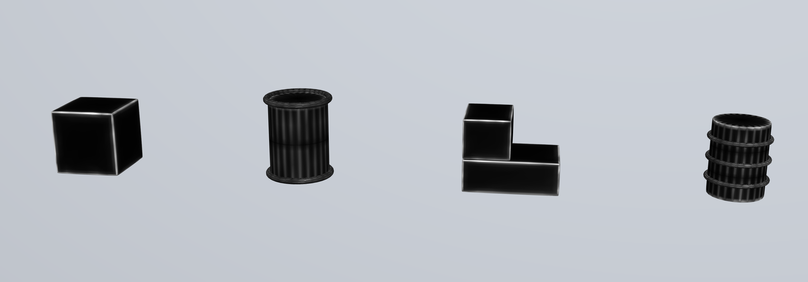
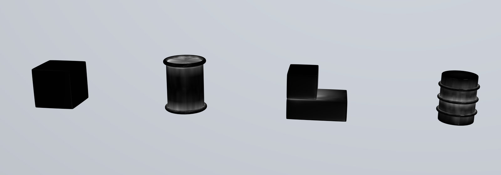
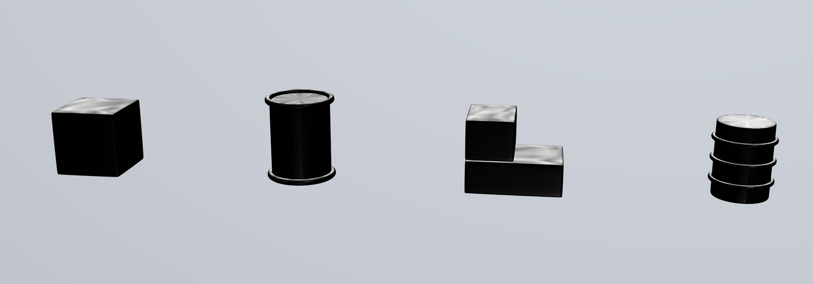
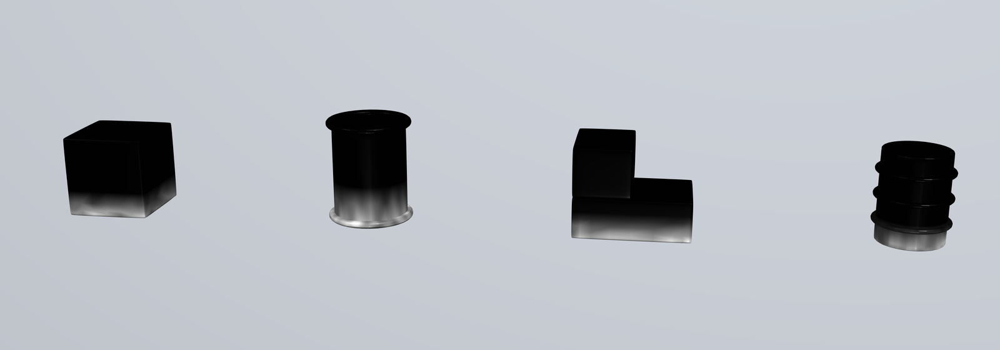

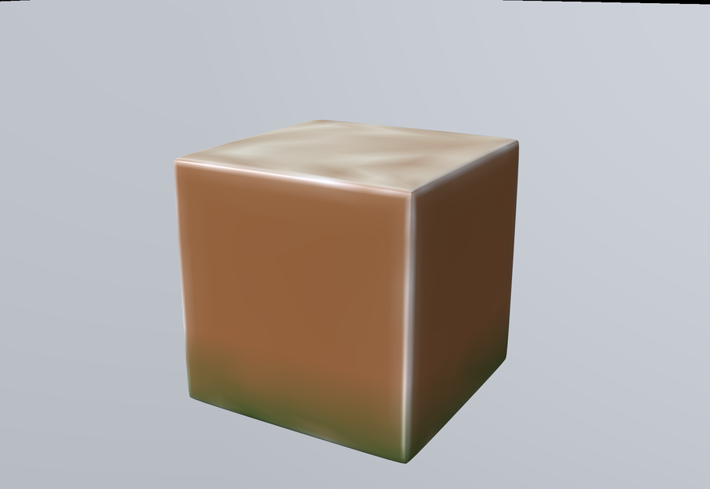
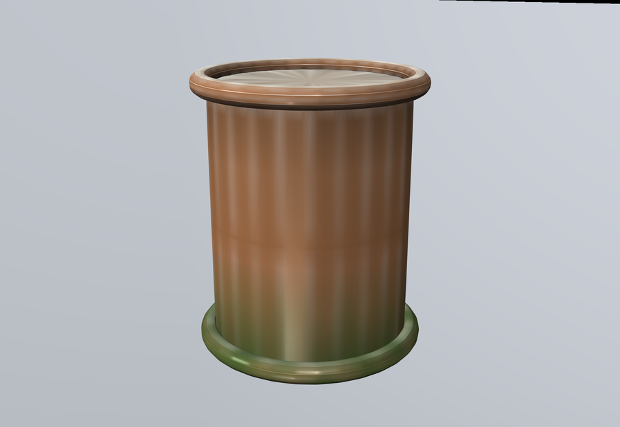
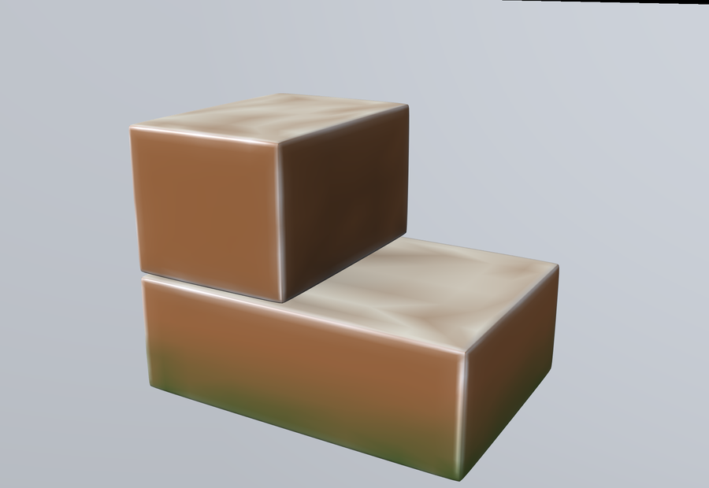
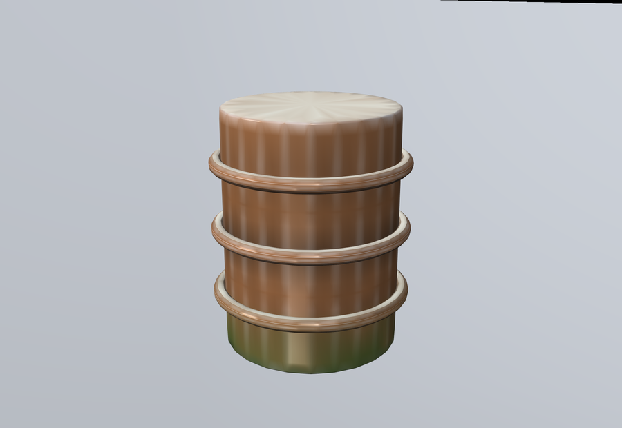
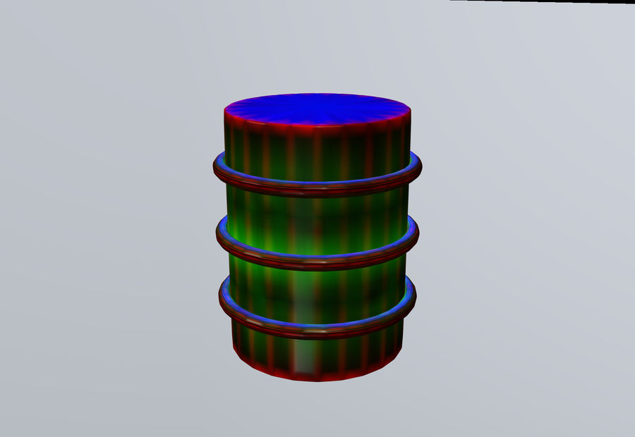

## 自分のモデルで使う

### 1. 形を少し細かくする

マスクは **点ごと** に計算するので、点が少ないローポリでは角もへこみも見つかりません。
サンプルと同じように、[PolyBevel](https://www.sidefx.com/docs/houdini/nodes/sop/polybevel.html) で角を少し丸め、[Subdivide](https://www.sidefx.com/docs/houdini/nodes/sop/subdivide.html) を 1〜2 回かけてから入れてください。
もともと細かいモデル（スキャン、スカルプト）はそのままで大丈夫です。

### 2. HDA をつなぐ

Tab メニューで **HoudiniClaude ▸ Weathering Mask** を置き、メッシュをつなぎます。既定値で 4 つのマスクが全部オンです。

### パラメータ

| フォルダ | パラメータ | 意味 |
|---|---|---|
| Edge Wear | Enable / Strength | 角のマスクのオン・オフと強さ |
| | Edge Width | 曲率をこの値で割って角のマスクにする。**小さいほど、ゆるい丸みでも角になる** |
| | Noise | ノイズでマスクを欠けさせる量 |
| Cavity Dirt | Enable / Strength | へこみのマスクのオン・オフと強さ |
| | Cavity Width | 曲率をこの値で割ってへこみのマスクにする |
| | AO Weight | AO（まわりに遮られている度合い）をどれだけ足すか。**0 にすると AO の計算を省いて速くなる** |
| | AO Samples | AO の計算の細かさ |
| | Noise | ノイズでマスクを欠けさせる量 |
| Top Dust | Enable / Strength | 上向きのマスクのオン・オフと強さ |
| | Top Angle | 真上からこの角度（度）まで傾いた面に積もる |
| | Noise | ノイズでマスクを欠けさせる量 |
| Bottom Grime | Enable / Strength | 地際のマスクのオン・オフと強さ |
| | Bottom Height | いちばん低い点からこの高さ（メートル）まで、上へ向かって薄くなる |
| | Noise | ノイズでマスクを欠けさせる量 |
| Noise | Seed / Frequency | ノイズのタネと細かさ（1 m に何回） |
| Output | Preview | Material Preview / Packed / Edge / Cavity / Top / Bottom |
| | Write Alpha (for FBX) | Packed のとき、地際のマスクを `Alpha` にも書く。**ビューポートでは透けて見えるので、FBX に書き出すときだけオン** |
| | Base, Edge, Dirt, Dust, Grime Color | Material Preview で使う色 |

曲率（角とへこみ）は **モデル全体の大きさで割った相対値** なので、Edge Width と Cavity Width はモデルごとに調整してください。
Preview を Edge や Cavity にして白黒で見ながら、ちょうどよい幅を探すのが早いです。

### 出力の形

- どの Preview でも、ポイント属性 `mask_edge`、`mask_cavity`、`mask_top`、`mask_bottom`（0〜1）が付きます。ほかのノードで使えます（例: `mask_top` で雪のジオメトリをスキャッターする）。
- **Packed** のとき: `Cd` = (角, へこみ, 上向き)。**Write Alpha** をオンにすると `Alpha` = 地際も書きます。Unity に持っていく形です。
- **Material Preview** のとき: `Cd` にマスクで混ぜた見本の色が入ります。見た目の確認用です。
- 途中計算の `curvature`（曲率）と `ao`（遮蔽、1 = 開けている）も点に残っています。Geometry Spreadsheet で見られます。

## Unity に持っていく

1. Preview を **Packed**、**Write Alpha** をオンにした状態で FBX に書き出します。サンプルでは `export_packed` というオブジェクト（4 つの小物の形を [Object Merge](https://www.sidefx.com/docs/houdini/nodes/sop/object_merge.html) で集めて Packed + Write Alpha にしたもの）を、`/out` の `fbx_export_packed`（[FBX ROP](https://www.sidefx.com/docs/houdini/nodes/out/filmboxfbx.html)）で書き出しています。**Render** を押すと `export/` に出ます。
   自分のシーンでは、FBX ROP の **Start Node** を書き出すオブジェクトに、**Output File** を好きな場所にして Render します。Convert Units はオン、**Export Invisible Objects** は "As Visible Full Nodes" にしてあります（表示を切ったオブジェクトも中身ごと書き出すため）。
2. FBX を Unity の `Assets/` に入れます。頂点カラーは自動で入ります。
3. Shader Graph で **Vertex Color** ノードを置き、**Split** で R / G / B / A に分けます。
   R（角）で金属色を、G（へこみ）で汚れ色を、B（上向き）でほこり色を、A（地際）で苔色を、それぞれ **Lerp** で Base Color に混ぜれば、Houdini の Material Preview と同じ見た目になります。
4. マスクは頂点ごとなので、細かい模様が欲しいところはシェーダー側でノイズテクスチャを掛けてください（Houdini 側の Noise はその下ごしらえです）。

## うまくいかないとき

| 症状 | 見るところ |
|---|---|
| 角もへこみも 0 のまま | メッシュが粗い。PolyBevel + Subdivide で細かくする。Edge Width / Cavity Width を小さくする |
| 上面（Top）が全部 0、へこみ（Cavity）が全部 1 | 法線が内側を向いている。[Box](https://www.sidefx.com/docs/houdini/nodes/sop/box.html) の Divisions で分割した箱はこうなるので、分割なしの Box に Subdivide をかける。[Reverse](https://www.sidefx.com/docs/houdini/nodes/sop/reverse.html) で向きを直してもよい |
| 遅い | AO Weight を 0 にする（AO の計算を省く）か、AO Samples を減らす。Subdivide の回数を減らす |
| まだらが細かすぎる / 粗すぎる | Noise の Frequency を変える |
| Packed にしたら、上のほうが透けて消えた | Write Alpha がオン。`Alpha` はビューポートで透明度として表示されます。確認中はオフにして、書き出すときだけオンに |
| Unity で色が出ない / 地際（A）が入らない | Preview が Packed か。Write Alpha がオンか。シェーダーが Vertex Color を読んでいるか |
| FBX が空（数 KB） | FBX ROP の Export Invisible Objects を "As Visible Full Nodes" にする（表示オフのオブジェクトは既定だと中身が書き出されない） |

## 仕組みを知りたい

曲率と AO の計算、ノイズの混ぜ方、マスクを頂点カラーに詰める方法、踏んだ落とし穴は [REPORT.md](REPORT.md) にまとめてあります。
