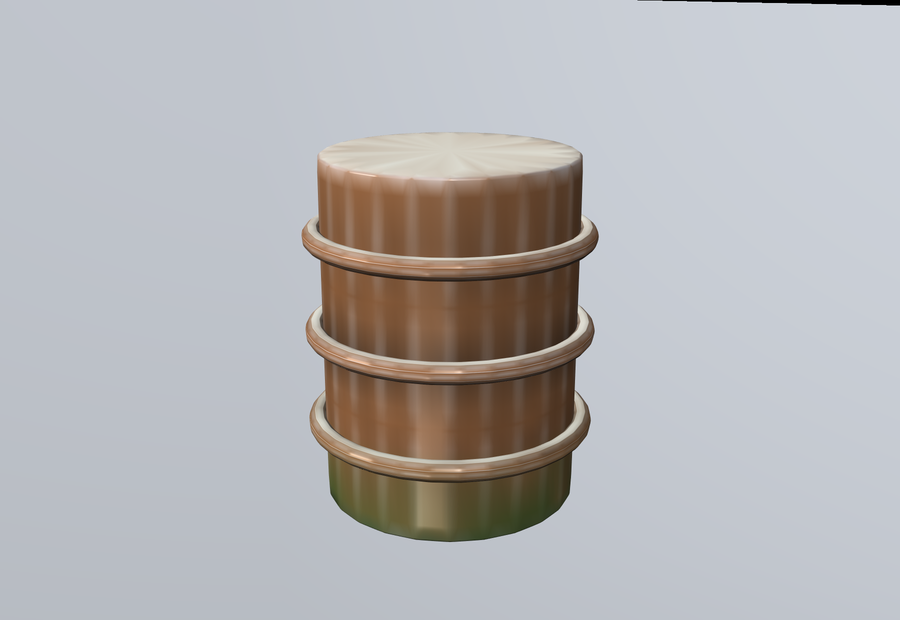
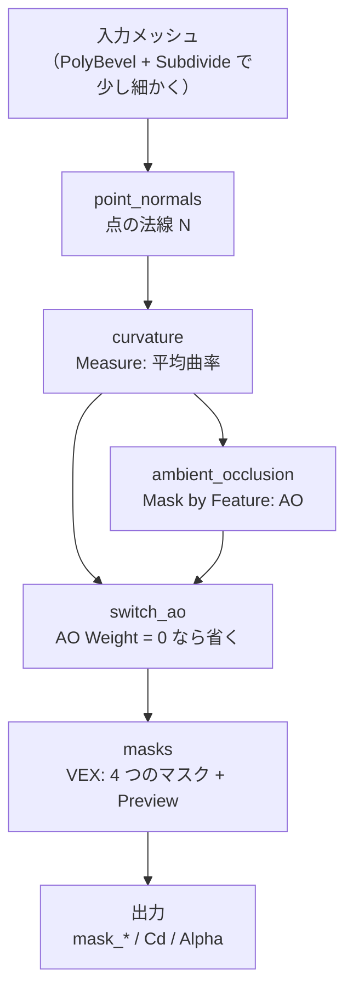

# 04 Weathering Mask — 解説レポート

「形から汚れの場所を推定する」という、テクスチャリングの下ごしらえを SOP と VEX で作るツールです。
曲率、AO、法線の向き、高さ。4 つの手がかりを 0〜1 のマスクにして、頂点カラーに詰めます。
使い方だけ知りたい人は [README.md](README.md) へ。



## 1. 何を作ったか、なぜこの作りにしたか

汚れは「形」で決まる場所が多いです。角は擦れ、へこみには汚れがたまり、上面にはほこりが積もり、地際は湿ります。
これらはメッシュの形から計算できるので、手で描く前に自動で下地を作れます。

ツールの方針は 3 つです。

1. **計算は Houdini の標準ノードに任せる。** 曲率は [Measure](https://www.sidefx.com/docs/houdini/nodes/sop/measure.html)、AO は [Mask by Feature](https://www.sidefx.com/docs/houdini/nodes/sop/maskbyfeature.html)。自分で書くのはそれを混ぜる VEX だけ。
2. **マスクは属性として残す。** `mask_edge` などの点属性があれば、色に詰める以外にも、スキャッターや変形の重みに使えます。
3. **見せ方（Preview）を切り替えられるようにする。** 白黒でマスクを 1 つずつ確認でき、Material Preview で使い道が分かり、Packed で Unity に持っていけます。

## 2. 全体の流れ



## 3. 曲率（Measure SOP）

[Measure](https://www.sidefx.com/docs/houdini/nodes/sop/measure.html) の **Measure を Curvature、Curvature Type を Mean** にすると、点ごとに平均曲率が出ます。
出っぱり（凸）がプラス、へこみ（凹）がマイナスです。球で試すとプラス、段の入り隅ではマイナスになることを確認しました。

ひとつ注意があります。Measure の **Scale Normalize** がオンだと、曲率は **モデル全体の大きさで割った相対値** になります。
半径 1 の球でも半径 0.04 の球でも、同じ約 0.22 です。「半径 5 cm より小さい丸み」のような絶対値では指定できません。
そこで Edge Width / Cavity Width は「曲率をこの値で割る」という相対的なしきい値にしました。白黒の Preview を見ながら合わせます。

## 4. AO（Mask by Feature SOP）

[Mask by Feature](https://www.sidefx.com/docs/houdini/nodes/sop/maskbyfeature.html) は、向き・影・AO の 3 種類のマスクを作れるノードです。ここでは **AO だけ** を使います。

- Direction と Shadow はオフ、**Ambient Occlusion** をオン。出力属性名を `ao` にしています。
- `ao` は「どれだけ開けているか」で、**1 = 開けている、0 = 遮られている** です。平らな板だけなら全部 1、2 枚の壁にはさまれた床は約 0.4 になりました。
- VEX では `1 - ao` を「遮られている度合い」として、へこみのマスクに足します。

AO はレイを飛ばすので、4 つの計算の中でいちばん重いです。[Switch](https://www.sidefx.com/docs/houdini/nodes/sop/switch.html) で、AO Weight が 0 のときはこのノードを通らないようにしました（`ch("../cavity_enable") && ch("../cavity_ao") > 0` という式）。
通らないときは `ao` 属性がないので、VEX 側は [haspointattrib()](https://www.sidefx.com/docs/houdini/vex/functions/haspointattrib.html) で「あるときだけ使う」ようにしています。

## 5. VEX でマスクを作る（masks）

### ノイズで欠けさせる

4 つとも、最後に同じ関数でノイズを混ぜています。

```c
float breakup(float m; vector p; float amount)
{
    float n = fit(noise(p), 0.3, 0.7, 0.0, 1.0);          // 0〜1 のノイズを、コントラスト強めに
    return clamp(m * lerp(1.0, n, amount), 0.0, 1.0);     // amount = 0 でそのまま、1 でノイズで大きく欠ける
}
```

[noise()](https://www.sidefx.com/docs/houdini/vex/functions/noise.html) は 0〜1 の値をなめらかに返しますが、ほとんどが 0.5 付近に集まります。[fit()](https://www.sidefx.com/docs/houdini/vex/functions/fit.html) で 0.3〜0.7 を 0〜1 に広げると、白黒がはっきりします。
[lerp()](https://www.sidefx.com/docs/houdini/vex/functions/lerp.html) で「1（そのまま）」と「ノイズ」を Noise パラメータの分だけ混ぜ、マスクに掛けます。
ノイズを引く位置 `np` は `@P * Frequency + Seed * 17.3` なので、Seed を変えると別の模様になります。

### 4 つの手がかり

```c
float edge   = clamp(curv / edge_width, 0.0, 1.0);          // 曲率プラス = 角
float cavity = clamp(-curv / cavity_width, 0.0, 1.0);        // 曲率マイナス = へこみ
if (haspointattrib(0, "ao")) cavity = max(cavity, (1.0 - f@ao) * ao_weight);   // 遮られているほど汚れる

float up  = dot(normalize(v@N), {0, 1, 0});                              // 真上で 1、水平で 0
float top = fit(up, cos(radians(top_angle)), 1.0, 0.0, 1.0);             // Top Angle より立っている面は 0

float ymin   = getbbox_min(0).y;                                         // 入力全体のいちばん低い点
float bottom = 1.0 - clamp((@P.y - ymin) / bottom_height, 0.0, 1.0);    // そこから Bottom Height まで薄くなる
```

- 上向きは、法線と上向きベクトルの [dot()](https://www.sidefx.com/docs/houdini/vex/functions/dot.html)（内積）です。内積は「2 つの向きがどれだけそろっているか」で、真上を向いていれば 1、水平なら 0 です。Top Angle を角度で指定できるように `cos(radians(角度))` をしきい値にしています。
- 地際は [getbbox_min()](https://www.sidefx.com/docs/houdini/vex/functions/getbbox_min.html) で入力全体のいちばん低い Y を取り、そこからの高さで決めます。モデルが地面に置いてあれば、原点がどこでも大丈夫です。
- 最後に Strength と Enable を掛けます。Enable はトグル（0 か 1）なので、掛けるだけでオン・オフになります。

### 見せ方と詰め方

```c
if (mode == 0)            // Material Preview: マスクで色を混ぜる
{
    vector col = base;
    col = lerp(col, dirt,  cavity);
    col = lerp(col, metal, edge);
    col = lerp(col, dust,  top);
    col = lerp(col, grime, bottom);
    v@Cd = col;
}
else if (mode == 1)       // Packed: RGB (+ Alpha) に詰める
{
    v@Cd = set(edge, cavity, top);
    if (chi("../write_alpha")) f@Alpha = bottom;   // 書き出すときだけ
}
```

Material Preview は、Unity のシェーダーでやることをそのまま VEX で書いたものです（下の色からマスクの順に `lerp` で上書き）。
Packed は、4 つのマスクを `Cd` の RGB と `Alpha` の 4 チャンネルに詰めます。FBX の頂点カラーは RGBA なので、ちょうど 4 つ入ります。

ただし `Alpha` は、Houdini のビューポートでは **透明度** として表示されます。地際以外は `Alpha = 0` なので、小物の上半分が消えて見えました（最初に作ったカタログ画像は、ほとんど空っぽでした）。
そこで Alpha を書くのは **Write Alpha** をオンにしたときだけにして、ふだんの確認では RGB だけを見るようにしています。

## 6. 踏んだ落とし穴

### Box の Divisions で分割した箱は、面が内側を向く

最初、木箱を [Box](https://www.sidefx.com/docs/houdini/nodes/sop/box.html) の Divisions で分割して作ったところ、上向きのマスクが全部 0、AO が全部 0（真っ暗）になりました。
分割した Box は面の向き（頂点の並び順）が逆で、法線が内側を向いていたのが原因です。
内側を向いた法線では「上向き」の内積がマイナスになり、AO のレイは箱の内側へ飛んで自分にぶつかります。
分割なしの Box に PolyBevel と Subdivide をかける作りに変えて直りました。**マスクが全部おかしいときは、まず法線の向きを疑う** と覚えておくと早いです。

### 表示オフのオブジェクトは FBX に中身が入らない

Unity 向けの `export_packed` は、カタログと重なるので表示をオフにしています。
そのまま [FBX ROP](https://www.sidefx.com/docs/houdini/nodes/out/filmboxfbx.html) で書き出すと、数 KB の空の FBX ができました。
FBX ROP の **Export Invisible Objects** の既定が「隠れたヌルノードとして」なので、中身が省かれていたのです。"As Visible Full Nodes" にすると書き出されます。

### Alpha を書くと、ビューポートで透ける

5 章のとおりです。`Alpha` という名前の点属性は、ビューポートがそのまま透明度に使います。
「属性の名前には意味がある」例です。`Cd`、`N`、`uv`、`Alpha`、`pscale` などは、Houdini が特別扱いします。

### 曲率は絶対値ではない

3 章のとおり、Measure の曲率はモデルの大きさで正規化された相対値です。パラメータ名を「半径」にしかけて、球で確かめて気づきました。
ノードの出力を使うときは、簡単な形（球、板）で値を確かめるのが確実です。

## 7. Unity へ

Packed で書き出した FBX の頂点カラーを、Shader Graph の Vertex Color ノードで読みます。
R / G / B / A に分けて、それぞれ色を Lerp で混ぜれば、Material Preview と同じ見た目になります。
頂点カラーはメッシュの細かさぶんの解像度しかないので、細かい模様はシェーダー側のノイズテクスチャで足してください。

## 8. 壊して学ぶヒント

- Preview を Edge にして、Edge Width を 0.1 → 2.0 と動かす → 角の「幅」が変わる。相対値の感覚がつかめる。
- `prop_blocks` の AO Weight を 0 にする → 入り隅の汚れが、曲率だけの細い線になる。**AO は「広いへこみ」を拾う** 担当だと分かる。
- `masks` の `float n = fit(noise(p), 0.3, 0.7, 0.0, 1.0);` を `float n = noise(p);` にする → まだらが薄くなる。fit の役目が分かる。
- `prop_crate` の `subdivide_crate` をバイパスする → 角が見つからなくなる。**点が無いところにマスクは出ない**。
- Top Angle を 89 にする → 少しでも上を向いた面に全部ほこりが積もる。

## 9. 次にやれそうなこと

- テクスチャに焼く: SideFX Labs の Maps Baker で頂点カラーをテクスチャにする
- マスクで置く: `mask_top` を重みにして雪や落ち葉を [Scatter](https://www.sidefx.com/docs/houdini/nodes/sop/scatter.html) する
- 02 Brick Wall や 03 Pipe Run の出力にそのままつなぐ: 壁の地際に苔、配管のフランジの角に擦れ
- 方向マスク: Mask by Feature の Direction を使って「風上だけ汚れる」を足す

## 参考リンク（Houdini 公式マニュアル）

- ノード: [Measure](https://www.sidefx.com/docs/houdini/nodes/sop/measure.html) / [Mask by Feature](https://www.sidefx.com/docs/houdini/nodes/sop/maskbyfeature.html) / [Normal](https://www.sidefx.com/docs/houdini/nodes/sop/normal.html) / [Attribute Wrangle](https://www.sidefx.com/docs/houdini/nodes/sop/attribwrangle.html) / [Switch](https://www.sidefx.com/docs/houdini/nodes/sop/switch.html) / [PolyBevel](https://www.sidefx.com/docs/houdini/nodes/sop/polybevel.html) / [Subdivide](https://www.sidefx.com/docs/houdini/nodes/sop/subdivide.html) / [Box](https://www.sidefx.com/docs/houdini/nodes/sop/box.html) / [Tube](https://www.sidefx.com/docs/houdini/nodes/sop/tube.html) / [Torus](https://www.sidefx.com/docs/houdini/nodes/sop/torus.html) / [Object Merge](https://www.sidefx.com/docs/houdini/nodes/sop/object_merge.html) / [FBX ROP](https://www.sidefx.com/docs/houdini/nodes/out/filmboxfbx.html)
- VEX: [noise](https://www.sidefx.com/docs/houdini/vex/functions/noise.html) / [fit](https://www.sidefx.com/docs/houdini/vex/functions/fit.html) / [clamp](https://www.sidefx.com/docs/houdini/vex/functions/clamp.html) / [lerp](https://www.sidefx.com/docs/houdini/vex/functions/lerp.html) / [dot](https://www.sidefx.com/docs/houdini/vex/functions/dot.html) / [normalize](https://www.sidefx.com/docs/houdini/vex/functions/normalize.html) / [getbbox_min](https://www.sidefx.com/docs/houdini/vex/functions/getbbox_min.html) / [haspointattrib](https://www.sidefx.com/docs/houdini/vex/functions/haspointattrib.html) / [radians](https://www.sidefx.com/docs/houdini/vex/functions/radians.html) / [ch / chf / chv / chi](https://www.sidefx.com/docs/houdini/vex/functions/ch.html) / [VEX スニペット](https://www.sidefx.com/docs/houdini/vex/snippets.html)
