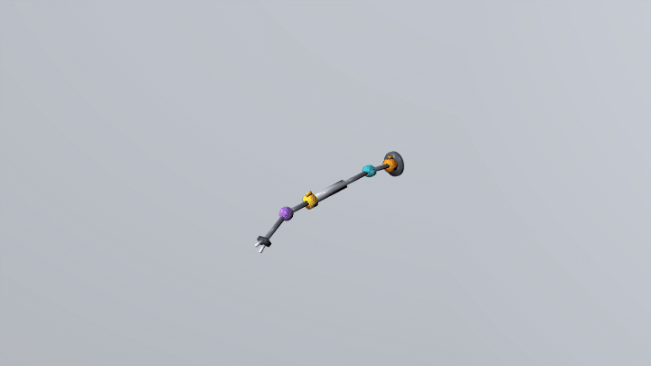
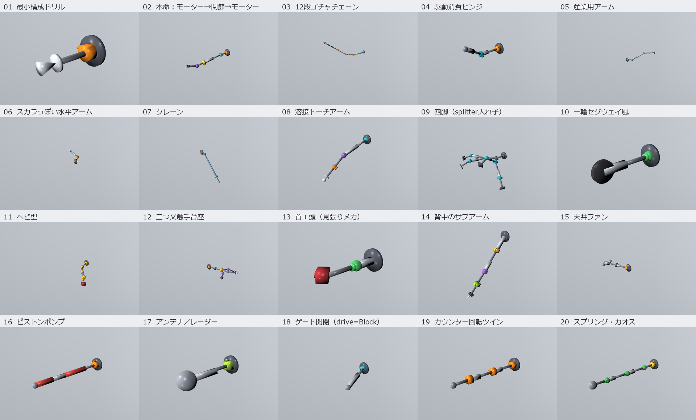
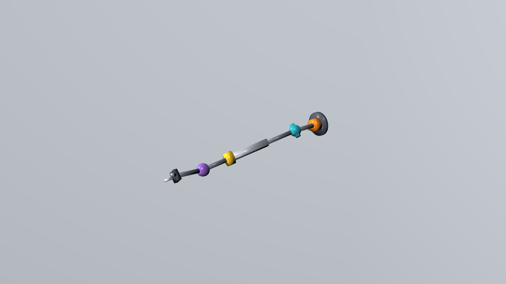
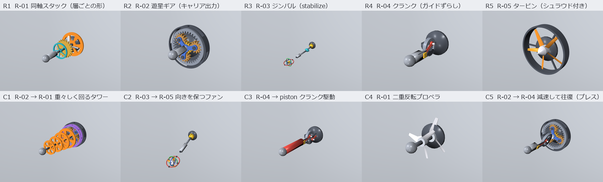
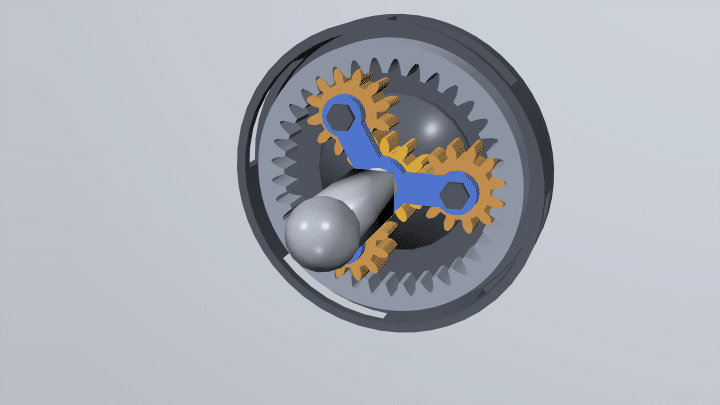

# 06 Mecha Chain — 汎用メカチェーン（使い方マニュアル）



文字列の **レシピ** を 1 行書くだけで、モーター・関節・リンクをつないだメカを組み立てて動かす HDA です。

```
base > motor_rot(speed=0.3) > hinge(axis=0, a=10, b=30, c=0.6) > link(len=1.2) > motor_osc(b=45, speed=0.8) > ball(a=20, c=10) > gripper(b=1)
```

パーツを `>` でつなぐだけなので、順番を入れ替えても、段を増やしても、途中で枝分かれさせても、そのまま動きます。
これは ikura さんの仕様「ソケット契約でメカチェーンを無限連結する HDA」の Phase1（計算と仮の造形）です。

## 必要なもの

| もの | 確認したバージョン | 備考 |
|---|---|---|
| Houdini Indie | 21.0.700（Windows） | ファイルは Indie 形式（`.hiplc` / `.hdalc`）。ほかに必要なものはありません |

## ファイル

| ファイル | 中身 |
|---|---|
| `mecha_chain_sample.hiplc` | 見本のシーン。レシピ02、プリセット 20 本、検証チェーン、練習用 |
| `otls/mecha_chain.hdalc` | HDA 本体（`hclaude::mecha_chain::1.0`、ラベル「汎用メカチェーン」） |
| `scripts/build_sample.py` | HDA と見本シーンと画像を、ゼロから作り直すスクリプト |
| `scripts/sop_code/` | HDA の中のノードのコード（パーサ、ソルバ、形のバリアント生成など）。ここを直して作り直します |
| `verify_log.txt` | 自動検証の結果（103 項目、すべて PASS） |
| `export/` | レシピ02 と回転系の見本 C1 を VAT（剛体モード）で書き出したもの（FBX + EXR + Unity 用マテリアル） |
| `images/` | この README の画像と GIF |
| `REPORT.md` | しくみの解説（技術記事のたたき台） |

## まず見てみる

1. `mecha_chain_sample.hiplc` を Houdini で開きます。
2. 再生ボタンを押します（1〜96 フレーム、24 fps）。
3. 原点にあるのが **レシピ02**（合格ラインのメカ）です。右の奥にはプリセット 20 本、左の奥には回転系の見本 10 本が並んでいます。



シーンの中身:

| オブジェクト | 中身 |
|---|---|
| `recipe02` | レシピ02（モーター → 関節 → モーター） |
| `playground` | 触って壊して学ぶ用。骨組み表示つき。ネットワークに付箋で「やってみること」を書いてあります |
| `test_bent_single` / `test_bent_double` | 回転の掛け算の順番を確かめる検証チェーン |
| `preset01`〜`preset20` | プリセットレシピ集の 20 本 |
| `rotaryR1`〜`rotaryR5`、`rotaryC1`〜`rotaryC5` | 回転モーター系 5 種の見本と、組み合わせの見本（下の「回転モーター系 5 種」） |
| `vat_recipe02` / `vat_rotary` | VAT 書き出し用（レシピ02 と、回転系の見本 C1） |

## 自分のシーンで使う

1. Geometry ノードの中で Tab メニューから **汎用メカチェーン** を置きます（入力はいりません）。
   メニューに出ない時は、Assets → Install Asset Library で `otls/mecha_chain.hdalc` を読み込みます。
2. **プリセットを読み込む** で 20 本から選ぶと、レシピ欄が入れ替わります。
3. あとは **レシピ** 欄を書き換えるだけです。

### パラメータ

| パラメータ | 意味 |
|---|---|
| プリセットを読み込む | 選ぶとレシピ欄をそのプリセットで上書きします |
| レシピ | パーツを `>` でつないだ文字列。`#` から行末まではメモとして読み飛ばします（改行して書いても OK） |
| 全体の速さ | 時間の進み方をまとめて変えます。0.5 で半分の速さ、2 で倍、0 で止まる |
| 全体の大きさ | でき上がりをまとめて拡大・縮小します |
| 骨組み（ソケット）を重ねて表示 | 各パーツのつなぎ目（点）と親子（線）を重ねて見せます |

出力は 2 本あります。1 本目が **パーツ**（パック済みの形）、2 本目が **ソケット**（骨組み）です。



## レシピの書き方

```
パーツ名(キー=値, キー=値) > パーツ名 > ...
```

- 最初はふつう `base`（土台）から始めます。
- 何も書かないパーツは、決まった値（既定値）で動きます。
- 太さ `rad` は、書いた所から先（下流）へ受け継がれます。

### どのパーツにも使えるキー

| キー | 既定 | 意味 |
|---|---|---|
| `len` | 1.0 | 次のつなぎ目までの長さ |
| `rad` | 親と同じ（根は 0.15） | 太さ |
| `axis` | 2 | 回る軸。0 = X、1 = Y、2 = Z（Z はチェーンが伸びる向き） |
| `speed` | 1.0 | 速さ（マイナスで逆回り） |
| `phase` | 0 | 動きのずらし（度）。段ごとにずらすと波になります |
| `drive` | 0 | 駆動の流し方。0 = 素通し、1 = ここで止める、2 = ギア（`ratio` 倍） |
| `limit_min` / `limit_max` | -180 / 180 | 関節の角度の上限・下限（度） |

### パーツごとのキー `a` `b` `c` `d`

| パーツ | a | b | c | d |
|---|---|---|---|---|
| `motor_rot`（回り続けるモーター） | 回る向き（1 / -1） | | | |
| `motor_osc`（往復するモーター） | 波の形（0 = sin、1 = 三角） | 振れ幅（度） | | |
| `servo`（サーボ） | 目標の角度 | 往復の幅 | 往復の速さ | |
| `hinge`（ちょうつがい） | 基準の角度 | 振れ幅（0 で固定） | 振れの速さ（0 で静止） | 1 で上流の回転をそのまま使う |
| `ball`（玉の関節） | X 曲げ | Y 曲げ | 揺れ幅 | |
| `bent`（曲げたリンク） | 曲げる角度 | 曲げる向き（度） | | |
| `twist`（ねじり） | ねじり角 | 回る速さ（度/秒） | | |
| `spring`（ばね） | 硬さ | 揺れ幅 | | |
| `piston`（ピストン） | ストローク | | | |
| `prismatic`（スライド） | 最小 | 最大 | 往復の速さ（0 で b に固定） | |
| `offset`（横ずらし） | X のずれ（太さ `rad` を 1 とした単位） | Y のずれ（同じ） | | |
| `splitter`（枝分かれ） | 枝の数（2〜4） | 広がる角度 | | |
| `gripper`（つかむ手） | 開く角度 | 1 で自動で開閉 | | |
| `head`（頭） | 首振りの幅 | うなずきの幅 | 速さ | |
| `drill` / `wheel` | 回る速さの倍率 | | | |

`offset` の横のずれだけは、長さ `len` と違って **太さ `rad` が 1 の物差し** です。`offset(a=1)` は「太さ 1 本ぶん横へずらす」で、`rad` を変えても形とずれの比率が変わりません。
（このため、レシピ集の 17 番の `offset(a=0.2)` は、HDA のプリセットでは同じ見た目になる `offset(a=1.333)` に読み替えてあります。）

`link`、`fixed`、`cap`（先端のふた）、`foot`（足）は共通のキーだけです。
別名も使えます: `mrot` = `motor_rot`、`mosc` = `motor_osc`、`uni` = `universal`、`slide` = `prismatic`、`endcap` = `cap`。

### 枝分かれ

`splitter` のすぐ後ろに `[ 枝 | 枝 ]` と書きます。枝の数は `a` とそろえます。

```
base > motor_rot(axis=1, speed=0.2) > splitter(a=3, b=50) [ motor_osc(b=35) > gripper | motor_osc(b=35, phase=120) > gripper | motor_osc(b=35, phase=240) > drill ]
```

- `splitter` はそのチェーンの終わりです。`]` の後ろに `>` で続けることはできません（続けたい時は枝の中に書きます）。
- 枝の中にまた `splitter` を置けます（四脚のプリセット09 がこの形）。

## 回転モーター系 5 種（R-01〜R-05）



回転するパーツを 1 個書くだけで、中の部品（層、歯車、リング、ロッド、羽根など）を自動で組み立てて動かします。
中の部品を自分で触る必要はありません。プリセットメニューの `R1`〜`R5`（5 種それぞれ）と `C1`〜`C5`（組み合わせ）から試せます。



| パーツ | 何をするか | よく使うキー（`名前=値`） |
|---|---|---|
| `coax`（R-01 同軸スタック） | 同じ軸の上に回る層を重ね、層ごとに別の速さで回す | `layers` 層の数 / `ratio=[1,-0.8,0.5]` 層ごとの速さの倍率 / `form=[disc,blades,gear,ring,cage]` 層ごとの形 / `layer_gap` 層の間隔 / `radius_step` 上の層ほど小さく / `stack_mode=cumulative`（親に運ばれる）か `independent`（親に運ばれない） |
| `planetary`（R-02 遊星ギア） | 太陽 → 遊星 → リングで減速して、キャリアの回転を出す | `sun_teeth` 太陽の歯数 / `planet_count` 遊星の数 / `planet_teeth`（0 で自動）/ `module` 歯の大きさ / `output=carrier,ring,sun` / `tooth_profile` 0 台形・1 インボリュート / `helical_angle` はすば / `housing_window` 窓の数 / `carrier_form=tri,cross,disc` |
| `gimbal`（R-03 ジンバル） | 3 つの入れ子のリング。先の向きを自由に変える | `mode=follow`（それぞれ揺れる）/ `stabilize`（先の向きを保つ）/ `track`（目標を向く）/ `axis_order=zxy` 軸の順 / `axis_enable=[1,1,1]` / `angle_list=[30,25,20]` 揺れ幅 / `target=[x,y,z]` か `target=番号` / `frame_form=ring,square,u` / `payload_form=socket,plate,sphere` |
| `crank`（R-04 クランク） | 回転を往復に変える。先につないだパーツが前後する | `eccentric` 偏心（ストロークの半分）/ `rod_len` ロッドの長さ / `guide_offset` ガイドのずれ / `output_axis` 2（Z）か 1（Y）/ `pin_count` ピンの数 / `pin_phase_list=[0,90]` / `wheel_form=spoke,disc` / `counterweight` / `d=1`（上流の回転で回す） |
| `turbine`（R-05 タービン） | ハブと羽根。プロペラ、ファン | `blade_count` 枚数 / `blade_len` 長さ / `width=[根元,先]` 幅 / `twist_root` `twist_tip` ねじれ / `sweep` 後退 / `lean` 前傾 / `section_form=sym,flat,camber,curve` 断面 / `pitch_anim` 羽根の角度の揺れ / `hub_form=spinner,cyl,sphere` / `shroud=1` 外周リング |

```
base > planetary(sun_teeth=10, planet_count=4, speed=2) > coax(layers=5, form=[cage,disc], layer_gap=0.45, stack_mode=independent) > cap
```

- **リストと名前**: `ratio=[1,-0.8,0.5]` のように `[ ]` で並べ、`form=disc` のように名前をそのまま書けます（レシピ文法 v1.2）。
- **大きさの単位**: 形の寸法（`eccentric`、`rod_len`、`module`、`blade_len` など）は **太さ `rad` を 1 とした単位** です。`rad=0.3` を付けるとパーツ全体が倍の大きさになります。`len` と `layer_gap` だけは生の長さです。
- **遊星の歯数**: 遊星を等間隔に置けない歯数のときは、`planet_teeth` を少しだけ自動で変えて、黄色い警告で知らせます。歯は噛み合う相手に合わせて少し削ってあるので、めり込みません。
- **ジンバル**: `stabilize` は、真ん中のリングが 80°〜90° に近づくと（ジンバルロック）補正を弱めて、ふつうの揺れに戻します。
- **クランク**: 先につないだパーツを前後させるのは **ピン 0**（`pin_phase_list` の最初）です。2 本目からのピンは、向きを変えたガイドで見た目だけ往復します（2 本なら向かい合わせ）。
- **タービン**: 羽根の幅は、隣の羽根に当たらない幅まで自動で細くなり、ハブは羽根の根元が埋まる高さまで伸びます。

### 形の素材を入れる（2 番目の入力）

HDA の 2 番目の入力に、断面カーブ・差し替えメッシュ・目標点をまとめて入れられます。

| 入れ方 | 使い道 |
|---|---|
| グループ `sections`（または開いたカーブ） | 羽根の断面 `turbine(section_form=curve, curve=0)`、遊星ギアの外形 `planetary(housing_curve=0)` |
| グループ `meshes`（または閉じた面。つながった塊ごとに 1 個） | 層の形の差し替え `coax(form=mesh, mesh=0)` |
| ポイントグループ `targets`（または面に属さない点） | ジンバルの目標 `gimbal(mode=track, target=0)` |

番号は入れた順に 0, 1, 2… と数えます。グループが無いときは、形（開いているか・閉じているか・点だけか）で見分けます。

## 触って壊して学ぶ

`playground` の中の `mecha_chain1` を選んで、レシピを書き換えてみてください。

1. `speed=0.3` を `1.5` にする → 根元の回転が速くなる
2. `link(len=1.2)` を `link(len=3)` にする → 腕だけが伸びて、モーターの形は伸びない
3. `hinge(...)` と `motor_osc(...)` の順番を入れ替える → 組み替えてもそのまま動く
4. `link(len=1.2, rad=0.3)` にする → そこから先だけ太くなる
5. `]` を 1 個消す、`motr_rot` と打ち間違える → ノードが赤くなり、何がおかしいか日本語で出る
6. **全体の速さ** を 0 にする → 止まる（ポーズの確認に便利）
7. `motor_osc(b=45, speed=0.8)` に `axis=0` を足す → ねじる動きが、首を振る動きに変わる

## VAT で書き出す（Unity 用）

見本シーンの `vat_recipe02` が、レシピ02 を VAT（Vertex Animation Texture）の **剛体モード** で書き出すための例です。
すでに書き出したものが `export/` に入っています。

| ファイル | 中身 |
|---|---|
| `export/geo/mecha_recipe02_mesh.fbx` | 1 フレーム目の形のメッシュ |
| `export/tex/mecha_recipe02_pos.exr` / `_rot.exr` / `_col.exr` | 各パーツの位置・回転・色（96 フレーム） |
| `export/unity/mecha_recipe02_mat.mat` | Unity 用のマテリアル（テクスチャ欄は空なので自分で入れます） |
| `export/*/mecha_C1_*` | 回転系の見本 C1（遊星ギア → 同軸スタック）。同じ形式 |

書き出し直す時は、`/out` の `vat_recipe02` か `vat_rotary` を選んで **Render** を押します（SideFX Labs が必要）。
Unity 側の手順は [01 Mech Transform の README「Unity に持っていく」](../01_mech_transform/README.md) と同じです。

しくみ: Labs の VAT は「書き出しの最初のフレームでは全パーツが回転なし」が前提です。
レシピ02 は 1 フレーム目から曲がっているので、`vat_prepare` で「1 フレーム目からどれだけ回ったか」に置き直してから渡しています。

注意: 剛体モードは「動く・回る」だけで、伸び縮みは書き出せません。`piston` や `prismatic` を含むレシピは、伸びない姿で書き出されます。

## うまくいかない時

| こうなった | 原因と直し方 |
|---|---|
| ノードが赤くなった | レシピの書き間違いです。ノードにカーソルを当てるとメッセージが出ます（例: 「知らないパーツ名です: motr_rot」） |
| 黄色い警告が出た | 使われないキーを書いています（例: `lenn=2`）。名前を確かめてください |
| 回っているのに形が動かない | 既定の `axis=2` はチェーンの伸びる向きなので、その場でねじれるだけです。振りたい時は `axis=0` か `axis=1` に |
| 長くしたのにモーターが伸びない | 仕様どおりです。モーターや関節は太さ `rad` だけで大きさが決まり、`len` の分は細い軸でつながります |
| 枝の数が違うと言われる | `splitter(a=3)` なら `[ 枝 | 枝 | 枝 ]` の 3 本にします |
| 「形の種類が多すぎます」 | 形のバリアント（歯数や羽根の枚数などの組み合わせ）は 1 本のチェーンで 32 種類までです。同じ形にそろえると 1 種類にまとまります |
| 「パーツは 256 個までです」 | 回転系は中で部品に分かれるので、分解後の数で数えます。メッセージの内訳で、どのパーツが何個使ったか分かります |
| 遊星の歯数が勝手に変わった | 遊星を等間隔に置ける歯数に寄せています（警告に元の数と新しい数が出ます） |
| ジンバルの先が少しずれる | 真ん中のリングが 80° を超えるとジンバルロックを避けるため補正を弱めます。`axis_order` を変えると避けられることがあります |

## 作り直す（開発する人向け）

コマンドプロンプトで、このフォルダから:

```
"C:/Program Files/Side Effects Software/Houdini 21.0.700/bin/hython.exe" scripts/build_sample.py
```

HDA、見本シーン、`verify_log.txt` を作り直します。後ろに `render` を付けると `images/` も描き直し、`vat` を付けると `export/` の VAT も書き出し直します（どれも画面なしで動きます）。

## まだできないこと（次の Phase）

- Phase1 の `motor_rot` などは外側ごと回ります（回転系 5 種は「回らない側」と「回る側」に分かれています）
- ケーブルやピストンロッドなど、パーツの間をつなぐ造形（Phase2）
- 出力: VAT（剛体モード）はレシピ02 と回転系の見本 C1 を書き出し済み（Unity での確認はこれから）。静止メッシュ → アニメ付き FBX の順に試す予定です
- 背景用途ライン（BG-01〜10）は、この Phase1 が通ったので着手できる状態です
