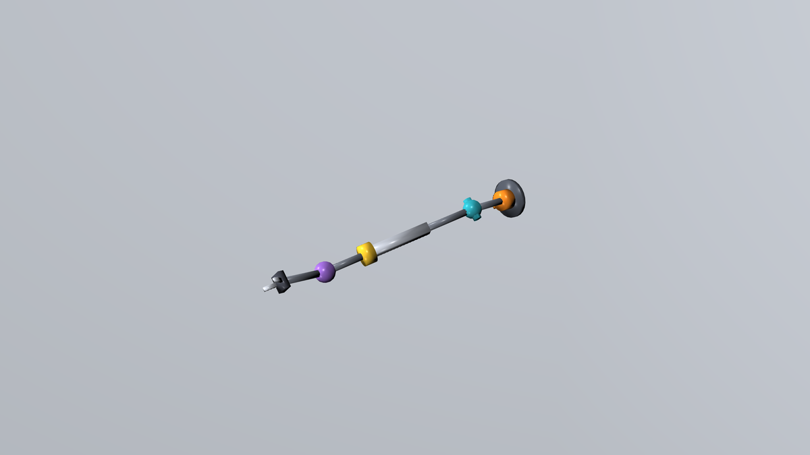

# 06 Mecha Chain — 解説レポート（Phase1）

「文字列のレシピ 1 行から、段数も順番も自由なメカを組み立てて動かす」HDA の作り方の記録です。
仕様は ikura さんの「HDA_Phase1_実装パケット v0.3」「HDA_初回構築チェックリスト v0.2」「HDA_プリセットレシピ集」。
仕様は変えずに、実機（Houdini 21.0.700 Indie）に合わせて関数名などを直して実装しました。
使い方だけ知りたい人は [README.md](README.md) へ。



## 1. 何を作ったか：ソケット契約

パーツ同士は、次の約束（ソケット契約）しか知りません。

1. 自分の **入力ソケット** を、親の **出力ソケット** にぴったり重ねる。
2. そこで自分の回転（モーターなら回転角、関節なら曲げ角）を足す。
3. 自分のローカル +Z 方向に `len` 進んだ所に、自分の出力ソケットを作る。

これだけなので、パーツを何段つないでも、途中を入れ替えても、計算の仕組みは変わりません。
合格ラインは「レシピ02（モーター → 関節 → モーター）が組み替えに耐えて動く」こと。実装パケットの Phase1 全体の条件「レシピ02 と 03 をコード変更なしに差し替えだけで再生できる」も満たしています（§6）。

## 2. 全体の流れ

```
one_point (Add)
  └ 1. recipe_parser (Python SOP)        レシピ → パーツ 1 個 = 点 1 個、親子は線
      └ 2. socket_solver (Wrangle/Detail)  親から順に frame / socket を計算
          ├ 3. frame_decompose (Wrangle/Point)  → @P / @orient / v@scale / s@piece
          │   └ detail_pieces (Wrangle/Point)    （追加）軸 rod とグリッパの指
          │       └ 5. copy_parts (Copy to Points, Piece Attribute = piece) ← templates
          │           └ global_scale → show_skeleton (Switch) → OUT（出力 1: パーツ）
          └ skeleton_view (Wrangle/Detail) → OUT_SOCKETS（出力 2: 骨組み）
```

使ったノード:
[Add](https://www.sidefx.com/docs/houdini/nodes/sop/add.html)、
[Python](https://www.sidefx.com/docs/houdini/nodes/sop/python.html)、
[Attribute Wrangle](https://www.sidefx.com/docs/houdini/nodes/sop/attribwrangle.html)、
[Tube](https://www.sidefx.com/docs/houdini/nodes/sop/tube.html) / [Box](https://www.sidefx.com/docs/houdini/nodes/sop/box.html) / [Sphere](https://www.sidefx.com/docs/houdini/nodes/sop/sphere.html)、
[Transform](https://www.sidefx.com/docs/houdini/nodes/sop/xform.html)、
[Pack](https://www.sidefx.com/docs/houdini/nodes/sop/pack.html)、
[Copy to Points](https://www.sidefx.com/docs/houdini/nodes/sop/copytopoints.html)、
[Switch](https://www.sidefx.com/docs/houdini/nodes/sop/switch.html)、
[Output](https://www.sidefx.com/docs/houdini/nodes/sop/output.html)。

ノードの役割分担は、実装パケット §4 の **属性の所有権表**（誰が書き、誰が読むか）のとおりです。
パーサが書いた属性をソルバが読み、ソルバが書いた `frame_pos` / `frame_orient` を decompose が標準の `@P` / `@orient` に写す。
この表を守っている限り、各ノードの中身は自由に直せます。

## 3. パーサ（Python SOP）

実装パケット §3 のコード v0.2 をほぼそのまま使っています。

- **トークンに分ける**: `>`、`[`、`]`、`|`、`パーツ名(...)` の 5 種類だけを正規表現で切り出します。
- **a〜d を pa〜pd に直す**: レシピは `a=` と書き、属性は `pa`。精査ログ第 2 周の「最重大」バグの修正がここに入っています。
- **rad の継承**: 明示した値が勝ち、書いていなければ親の解決済みの値を受け継ぎます。
- **splitter の分解**: `splitter [ A | B ]` を見つけたら、枝ごとに見えないパーツ `branch`（長さ 0、広がり角だけ持つ）を自動で差し込みます。ソルバは枝分かれを特別扱いせず、普通の親子として計算するだけです。
- **点の並び順 = 計算の順**: 親を先に作るので、点番号の小さい順に計算すれば親は必ず先に求まっています。

実装側で足したもの（`# 追加:` の行）:

| 追加 | 理由 |
|---|---|
| 知らないパーツ名をエラーにする | `motr_rot` のような打ち間違いが、形の無いパーツとして黙って通っていた |
| `splitter(a=3)` で枝が 2 本ならエラー | 元のコードは枝が **少ない** 時に空の枝を作って黙って進んでいた（多い時は止まる） |
| `]` の後ろに続けたらエラー | 一番外側でこれをすると、残りが黙って捨てられていた |
| 値が空・`=` が無い・読めない文字をエラー | Python の素のエラーではなく、何が悪いかを日本語で出すため |
| 使われないキーは警告 | `lenn=2` のような打ち間違いに気づけるように |
| `#` から行末をコメントにする | 長いレシピを改行してメモ付きで書けるように |

エラーは `raise hou.NodeError("...")` で出すと、ノードが赤くなり、そのメッセージがそのまま表示されます。
警告は `node.addWarning("...")` で、処理は止めずに黄色の表示だけを出せます。

## 4. ソルバ（Detail Wrangle）

### 4.1 状態はクォータニオンで持つ

実装パケット v0.3 の方式どおり、各パーツの状態を「位置ベクトル + クォータニオン」で持ちます。
回転を重ねる場所は `compose()` の 1 か所だけです。

```c
vector4 compose(vector4 parent_q; vector4 local_q)
{
    return qmultiply(parent_q, local_q);
}
...
vector4 fq = compose(pq, ql);                               // 親の向き × 自分の回転
vector fp = pp + qrotate(pq, off);
sout_pos[i] = fp + qrotate(fq, set(0, 0, lens[i] + ext));   // ローカル +Z に len 先が出力ソケット
```

[qmultiply](https://www.sidefx.com/docs/houdini/vex/functions/qmultiply.html)、
[qrotate](https://www.sidefx.com/docs/houdini/vex/functions/qrotate.html)、
[quaternion](https://www.sidefx.com/docs/houdini/vex/functions/quaternion.html) は仕様の仮置きのままで実在し、そのまま使えました。

### 4.2 掛け算の順番を実機で確かめる（実機確認点 3）

まず関数そのものを確かめました。X 軸 90° の `a` と Y 軸 90° の `b` で `+Z` を回すと:

| 式 | 結果 |
|---|---|
| `qrotate(qmultiply(a, b), {0,0,1})` | (1, 0, 0) |
| `qrotate(a, qrotate(b, {0,0,1}))`（先に b、次に a） | (1, 0, 0) |

つまり `qmultiply(a, b)` は「先に b（子のローカル回転）、次に a（親の向き）」。`compose(親, 子)` の引数の順番は仕様の第一案のままで正しい、という結果です。

次に、仕様 §5.2 の **bent テスト** `base > bent(a=45) > link > cap` を置きました。link は +Z から 45° 傾いた (0, -0.707, 0.707) へ伸び、合格です。

ただし、ここで 1 つ気づいたことがあります。**回転が 1 回しか入らないチェーンでは、掛け算の順番が逆でも同じ結果になります。**
根の向きは「回転なし」なので、`親 × 子` も `子 × 親` も同じ `子` になるからです。
そこで、回転が 2 回重なる **2 回折りテスト** を追加しました。

```
base > bent(a=90) > bent(a=90, b=90) > link
```

正しい順番なら link の先は (2, -1, 0)、逆なら (0, -3, 0) になり、はっきり見分けられます。結果は (2, -1, 0) でした。


回転の向きは右手系です（Houdini の Transform SOP と同じ）。`bent(a=45)` は X 軸まわりに +45° なので、+Z が -Y 側へ倒れます。

### 4.3 そのほかの確認（チェックリスト A2）

| 確認 | 結果 |
|---|---|
| motor_rot で末端が回る | レシピ02 の先端が最大 4.5 動く |
| motor_osc が往復し、上流に運ばれる | ±44.75°（96 フレームを 1 コマずつ見た最大）。位置も最大 1.78 動く |
| hinge の limit | 振幅 60° に `limit_min=-20, limit_max=20` → -20.00〜20.00° で頭打ち |
| hinge(d=1) が張り付かない（プリセット04） | 96 フレーム目で駆動角 855°、関節の向きは 135°（855° と同じ向き）。クランプしないので回り続ける |
| spring は深さで遅れる | 別の枝を伸ばして spring の点番号が 6 → 8 に変わっても角度は同じ -14.872° |
| global_speed | 2 倍ならフレーム 13、0.5 倍ならフレーム 49 で、1 倍のフレーム 25 と同じ姿勢 |

hinge(d=1) は、仕様 v0.3 のとおり「駆動消費の時はクランプしない」で実装しました。
角度は回転（クォータニオン）にしてしまえば 855° も 135° も同じ向きなので、±180° に折り返す処理は要りませんでした。

### 4.4 横ずれの単位（offset）

形は `v@scale = (rad, rad, …)` で rad 倍され、テンプレートは半径 1 で作ってあります。つまり **横（X/Y）方向の物差しは rad** です。
最初の実装では offset の横ずれ `off = set(pa, pb, 0)` を生の値のまま使っていたので、横方向だけ物差しが 2 種類混ざっていました
（別スレッドの仕様精査での指摘）。今のプリセットでは目立ちませんが、遊星ギアの公転半径や偏心ピンのように
「形に対してどこにずらすか」が大事なパーツで必ず崩れます。

そこでソルバで rad を掛けるように直しました。所有権表で `radius` の読み手にはソルバが入っているので、契約の範囲内です。

```c
off = set(pas[i], pbs[i], 0) * rads[i];   // 横ずれは「太さ rad = 1」の単位
```

パーサで掛けずにソルバで掛けたのは、Geometry Spreadsheet の `pa` / `pb` を「レシピに書いた値そのまま」にしておくためです（パーサの合格条件）。
目分量の係数ではなく rad そのものを掛けているので、rad を 2 倍にすると、ずれもちょうど 2 倍になります（自動検証: rad 0.15 → (0.150, 0.075)、rad 0.30 → (0.300, 0.150)）。
Z 方向の `len` と、piston / prismatic の伸び `ext` は、これまでどおり生の値です。

この変更で、プリセット17 の `offset(a=0.2)` は「0.2」から「0.2 × 0.15 = 0.03」のずれになりました。
前と同じ見た目にしたい時は `offset(a=1.33)` です（プリセットの文字列は仕様の一部なので変えていません）。

## 5. 造形（frame_decompose → Copy to Points）

### 5.1 pscale ではなく v@scale

`pscale` は XYZ が同じ倍率なので、「長さだけ伸ばす」ができません。そこで `v@scale` を使い、`scale_mode` で 2 通りに分けます。

| scale_mode | パーツ | v@scale |
|---|---|---|
| 1（伸びる） | link, offset, bent, prismatic, piston | (rad, rad, len + ext) |
| 0（固定） | それ以外 | (rad, rad, rad) |

確認: link は len 1.0 → 2.5 で長さも 1.00 → 2.50。motor は len を 1 → 2 にしても 0.240 のまま、rad を 2 倍にすると 0.480（造形の合格条件どおり）。

### 5.2 テンプレート

規約は「半径 1・長さ 1・+Z 向き。固定サイズのパーツは半径 1 を単位に設計」。
[Tube](https://www.sidefx.com/docs/houdini/nodes/sop/tube.html) は Y 軸向きが既定なので、すぐ後ろの [Transform](https://www.sidefx.com/docs/houdini/nodes/sop/xform.html) で **X 軸まわりに 90°** 回して +Z に倒しています（ノード名の末尾が `_toZ`）。

24 種類のテンプレートは、それぞれ Wrangle でプリミティブ属性 `s@piece` と点の色 `Cd` を付けてから 1 つに Merge し、
[Pack](https://www.sidefx.com/docs/houdini/nodes/sop/pack.html) の **Pack by Name**（Name Attribute = `piece`）で piece ごとに 1 個にまとめています。
Pivot は **Origin**（原点 = 入力ソケット）。こうすると回転の中心がつなぎ目になり、あとで VAT の剛体モードに渡す時にもそのまま使えます。

実機で分かったこと: Pack by Name の出力は `PackedGeometry` ではなく **`PackedFragment`**（1 つのジオメトリを名前で切り分けて参照する形）でした。Copy to Points ではどちらも同じように使えます。

### 5.3 Copy to Points の Piece Attribute（実機確認点 1）

[Copy to Points](https://www.sidefx.com/docs/houdini/nodes/sop/copytopoints.html) の **Piece Attribute** は、Python では `useidattrib`（オン/オフ）と `idattrib`（属性名）というパラメータ名でした。
`idattrib = piece` にすると、点の `s@piece` とテンプレートの `s@piece` が一致するものだけが置かれます。テンプレートが無い `branch` は何も置かれません。

- レシピ02 では、パーツ 7 個 + 軸 4 本 + 指 2 本 = 13 個が、期待どおりに出ました。
- Python で作った Copy to Points は Attributes from Target が空なので、`resettargetattribs` ボタンを押して既定値
  `*,^v,^Alpha,^N,^up,^pscale,^scale,^orient,^rot,^pivot,^trans,^transform` を入れ、そこから `^orient` だけを外しています。
  これで `name` や `part_type` と、向き `orient` がパック済みパーツの点に残ります（`orient` は VAT で使います）。
  パックの回転は intrinsic transform が持っているので、点に `orient` があっても二重には回りません。

For-Each への退避は不要でした。

### 5.4 実装側で足した見た目（detail_pieces）

仕様の所有権表には無い、見た目のための部品です。decompose の後ろに置いたので、表の契約は壊していません。

- **軸（rod）**: 固定サイズのパーツは len を伸ばしても形が伸びないので、そのままだとパーツの間がすき間になります。そこで、入力ソケットから出力ソケットまでを細い円柱（太さ 0.45 × rad、長さ len + ext）でつなぎました。
- **グリッパの指**: ソルバに `open_angle`（グリッパの開き角）を 1 つ足し、`b=1` なら sin で自動開閉します。指は 2 本の別パーツとして、付け根で X 軸まわりに開きます。

## 6. 自動検証

`scripts/build_sample.py` の `verify()` が、HDA を作るたびに 63 項目を確かめて `verify_log.txt` に書きます。全部 PASS です。

中心になっているのは「ソケット契約が崩れていないか」の検査です。どのパーツでも、どのフレームでも、

- 子の入力ソケット = 親の出力ソケット（offset の時だけ、親の向きで回したずれの分だけ離れる）
- 出力ソケットは、入力ソケットからちょうど `len + ext` の距離
- 向き（クォータニオン）の長さは 1

を 5 フレームおきに確かめます。プリセット 20 本と、レシピ02 の組み替え 4 種（順番入れ替え、2 倍に延長、先端で分岐、途中から太く）のすべてで、ずれは最大 7.7e-07（計算の丸め誤差の大きさ）でした。


## 7. 気づいたこと（仕様へのフィードバック候補）

仕様は編集していません。実装していて気づいたことだけを書きます。

1. **bent テストは 1 回折りでは順番の誤りを検出できない**（§4.2）。2 回折りのテストをチェックリストに足すと確実です。
2. **`axis` の既定が 2（チェーンの伸びる向き）なので、何も書かないモーターや spring は「その場でねじれる」だけ**になります。
   自動検証で先端の移動が 0 になったのは 01、10、19、20 の 4 本でした。01 と 19 は回転が見えれば十分ですが、
   20「スプリング・カオス（末端だけ暴れる）」と 10「一輪セグウェイ風」は、`axis=0` を足さないと揺れが形に出ません。
3. **モーターの外側ごと回る**のは仕様 v0.3 の §6 のとおりです。Phase2 の housing / rotor 分割で直す予定です。
4. 05〜07 は `axis=1` のヨー回転なので、チェーンが水平に伸びて旋回します。土台は原点で +Z に向いているので、
   「床に立つアーム」に見せたい時は、オブジェクトごと X 軸まわりに -90° 回すと +Z が上になります。

## 8. VAT（剛体モード）で書き出す

出力の 1 番手は、SideFX Labs の [Vertex Animation Textures](https://www.sidefx.com/docs/houdini/nodes/out/labs--vertex_animation_textures-3.0.html) の剛体モード（Rigid-Body Dynamics）です。
パック済みのパーツ 1 個ごとに、各フレームの位置と回転をテクスチャ（EXR）に焼き、Unity のシェーダーで動かします。

### 8.1 「1 フレーム目は回転なし」問題

過去の実機確認で、この ROP は **書き出しの最初のフレームで全パーツの `orient` が回転なし (0,0,0,1)** であることを前提にしていると分かっています
（内部で最初のフレームの回転を、逆にせずに掛けてしまうため）。ところがレシピ02 は 1 フレーム目から関節が曲がっています。

そこで、見本シーンの `vat_recipe02` では HDA の後ろに `vat_prepare` を置き、「1 フレーム目の姿勢」を基準に置き直しています。
[Time Shift](https://www.sidefx.com/docs/houdini/nodes/sop/timeshift.html) で 1 フレーム目に固定したものを 2 番目の入力に入れ、同じ名前のパーツを探して:

```c
int src = findattribval(1, "point", "name", s@name);   // 1 フレーム目の、同じ名前のパーツ
vector4 q1 = point(1, "orient", src);
vector p1 = point(1, "P", src);
v@pivot = p1;                                          // 回転の中心 = 1 フレーム目の位置
p@orient = qmultiply(p@orient, qinvert(q1));           // 1 フレーム目から、どれだけ回ったか
```

これで、どのフレームの形も「1 フレーム目の形を `pivot` のまわりに `orient` だけ回して、`P` へ動かす」で作れます。
VAT の剛体モードがやっているのはまさにこの計算なので、1 フレーム目が曲がっていても正しく再生できるはずです。

自動検証では、Houdini の中でこの計算を自分でやり直し、本物の形と比べています。5 つのフレームで頂点のずれは最大 4.8e-07 でした。
1 フレーム目の `orient` が全パーツで回転なしになっていることも確かめています。

### 8.2 書き出したもの

| ファイル | 大きさ |
|---|---|
| `export/geo/mecha_recipe02_mesh.fbx` | 551 KB（パーツ 13 個ぶんのメッシュ） |
| `export/tex/mecha_recipe02_pos.exr` / `_rot.exr` / `_col.exr` | 11 KB / 14 KB / 1 KB 未満 |
| `export/unity/mecha_recipe02_mat.mat` | 4 KB |

ROP の設定は 01 Mech Transform と同じです（engine = unity → `setEnginePreset`、mode = 1、slerpmode = 1）。
1 つだけ違ったのは、VAT ROP 3.0 のフレーム範囲 `f` が（開始, 終了）の **2 つ** だったことです（3 つ入れると `InvalidSize`）。

### 8.3 まだ分かっていないこと

- **Unity での再生はまだ確かめていません。** Houdini 側の計算が合っていることまでは確認済みです。
- 剛体モードは伸び縮みを表せないので、piston / prismatic を含むレシピは伸びない姿で書き出されます（軟体モードなら表せます）。

## 9. 次の一手

- Unity で `export/` を読み込み、レシピ02 が Houdini と同じに動くかを確かめる。
- 静止メッシュ（ポーズ固定）は今すぐ出せます。アニメ付き FBX は、出力 2 の骨組みが `name` と `3@transform` を持つ KineFX スケルトンの形になっているので、それを起点に単独のセッションで進めます。
- 背景用途ライン（BG-01〜10）は、Phase1 の合格をもって着手できます。
