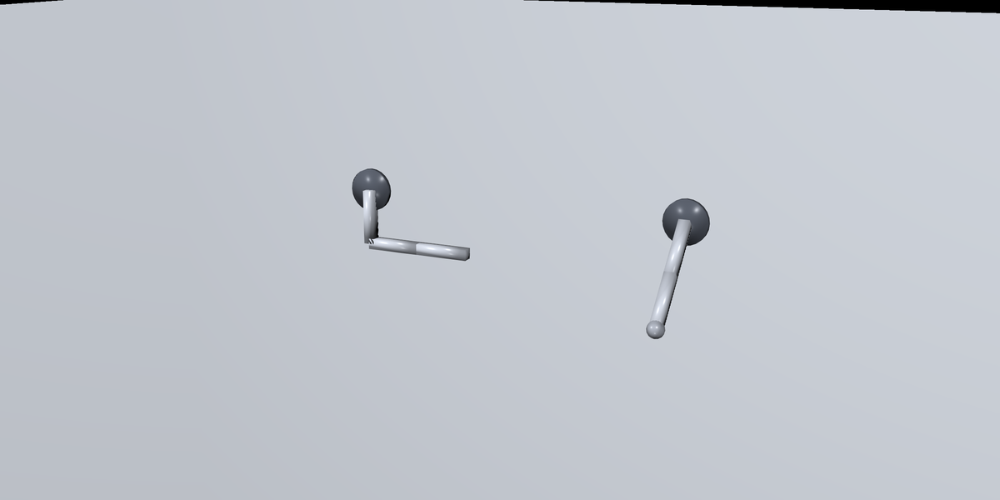
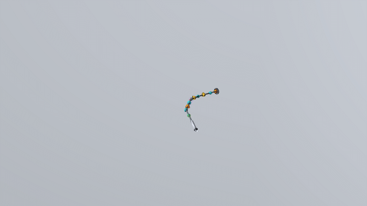
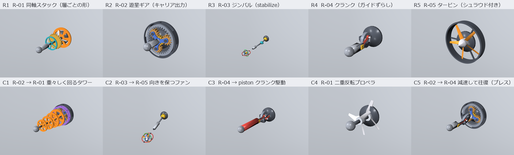
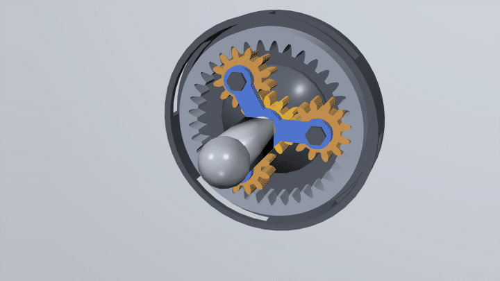
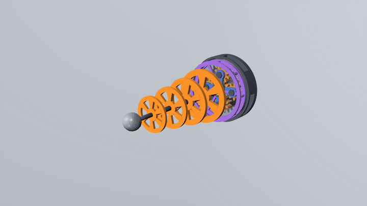

# 06 Mecha Chain — 解説レポート（Phase1）

「文字列のレシピ 1 行から、段数も順番も自由なメカを組み立てて動かす」HDA の作り方の記録です。
仕様は ikura さんの「HDA_Phase1_実装パケット v0.3」「HDA_初回構築チェックリスト v0.2」「HDA_プリセットレシピ集」。
仕様は変えずに、実機（Houdini 21.0.700 Indie）に合わせて関数名などを直して実装しました。
使い方だけ知りたい人は [README.md](README.md) へ。


## 1. 何を作ったか：ソケット契約

パーツ同士は、次の約束（ソケット契約）しか知りません。

1. 自分の **入力ソケット** を、親の **出力ソケット** にぴったり重ねる。
2. そこで自分の回転（モーターなら回転角、関節なら曲げ角）を足す。
3. 自分のローカル +Z 方向に `len` 進んだ所に、自分の出力ソケットを作る。

これだけなので、パーツを何段つないでも、途中を入れ替えても、計算の仕組みは変わりません。
合格ラインは「レシピ02（モーター → 関節 → モーター）が組み替えに耐えて動く」こと。実装パケットの Phase1 全体の条件「レシピ02 と 03 をコード変更なしに差し替えだけで再生できる」も満たしています（§6）。

## 2. 全体の流れ

```
one_point (Add)
  └ 1. recipe_parser (Python SOP)        レシピ → パーツ 1 個 = 点 1 個、親子は線
      └ 2. socket_solver (Wrangle/Detail)  親から順に frame / socket を計算
          ├ 3. frame_decompose (Wrangle/Point)  → @P / @orient / v@scale / s@piece
          │   └ detail_pieces (Wrangle/Point)    （追加）軸 rod とグリッパの指
          │       └ 5. copy_parts (Copy to Points, Piece Attribute = piece) ← templates
          │           └ global_scale → show_skeleton (Switch) → OUT（出力 1: パーツ）
          └ skeleton_view (Wrangle/Detail) → OUT_SOCKETS（出力 2: 骨組み）
```

使ったノード:
[Add](https://www.sidefx.com/docs/houdini/nodes/sop/add.html)、
[Python](https://www.sidefx.com/docs/houdini/nodes/sop/python.html)、
[Attribute Wrangle](https://www.sidefx.com/docs/houdini/nodes/sop/attribwrangle.html)、
[Tube](https://www.sidefx.com/docs/houdini/nodes/sop/tube.html) / [Box](https://www.sidefx.com/docs/houdini/nodes/sop/box.html) / [Sphere](https://www.sidefx.com/docs/houdini/nodes/sop/sphere.html)、
[Transform](https://www.sidefx.com/docs/houdini/nodes/sop/xform.html)、
[Pack](https://www.sidefx.com/docs/houdini/nodes/sop/pack.html)、
[Copy to Points](https://www.sidefx.com/docs/houdini/nodes/sop/copytopoints.html)、
[Switch](https://www.sidefx.com/docs/houdini/nodes/sop/switch.html)、
[Output](https://www.sidefx.com/docs/houdini/nodes/sop/output.html)。

ノードの役割分担は、実装パケット §4 の **属性の所有権表**（誰が書き、誰が読むか）のとおりです。
パーサが書いた属性をソルバが読み、ソルバが書いた `frame_pos` / `frame_orient` を decompose が標準の `@P` / `@orient` に写す。
この表を守っている限り、各ノードの中身は自由に直せます。

## 3. パーサ（Python SOP）

実装パケット §3 のコード v0.2 をほぼそのまま使っています。

- **トークンに分ける**: `>`、`[`、`]`、`|`、`パーツ名(...)` の 5 種類だけを正規表現で切り出します。
- **a〜d を pa〜pd に直す**: レシピは `a=` と書き、属性は `pa`。精査ログ第 2 周の「最重大」バグの修正がここに入っています。
- **rad の継承**: 明示した値が勝ち、書いていなければ親の解決済みの値を受け継ぎます。
- **splitter の分解**: `splitter [ A | B ]` を見つけたら、枝ごとに見えないパーツ `branch`（長さ 0、広がり角だけ持つ）を自動で差し込みます。ソルバは枝分かれを特別扱いせず、普通の親子として計算するだけです。
- **点の並び順 = 計算の順**: 親を先に作るので、点番号の小さい順に計算すれば親は必ず先に求まっています。

実装側で足したもの（`# 追加:` の行）:

| 追加 | 理由 |
|---|---|
| 知らないパーツ名をエラーにする | `motr_rot` のような打ち間違いが、形の無いパーツとして黙って通っていた |
| `splitter(a=3)` で枝が 2 本ならエラー | 元のコードは枝が **少ない** 時に空の枝を作って黙って進んでいた（多い時は止まる） |
| `]` の後ろに続けたらエラー | 一番外側でこれをすると、残りが黙って捨てられていた |
| 値が空・`=` が無い・読めない文字をエラー | Python の素のエラーではなく、何が悪いかを日本語で出すため |
| 使われないキーは警告 | `lenn=2` のような打ち間違いに気づけるように |
| `#` から行末をコメントにする | 長いレシピを改行してメモ付きで書けるように |

エラーは `raise hou.NodeError("...")` で出すと、ノードが赤くなり、そのメッセージがそのまま表示されます。
警告は `node.addWarning("...")` で、処理は止めずに黄色の表示だけを出せます。

## 4. ソルバ（Detail Wrangle）

### 4.1 状態はクォータニオンで持つ

実装パケット v0.3 の方式どおり、各パーツの状態を「位置ベクトル + クォータニオン」で持ちます。
回転を重ねる場所は `compose()` の 1 か所だけです。

```c
vector4 compose(vector4 parent_q; vector4 local_q)
{
    return qmultiply(parent_q, local_q);
}
...
vector4 fq = compose(pq, ql);                               // 親の向き × 自分の回転
vector fp = pp + qrotate(pq, off);
sout_pos[i] = fp + qrotate(fq, set(0, 0, lens[i] + ext));   // ローカル +Z に len 先が出力ソケット
```

[qmultiply](https://www.sidefx.com/docs/houdini/vex/functions/qmultiply.html)、
[qrotate](https://www.sidefx.com/docs/houdini/vex/functions/qrotate.html)、
[quaternion](https://www.sidefx.com/docs/houdini/vex/functions/quaternion.html) は仕様の仮置きのままで実在し、そのまま使えました。

### 4.2 掛け算の順番を実機で確かめる（実機確認点 3）

まず関数そのものを確かめました。X 軸 90° の `a` と Y 軸 90° の `b` で `+Z` を回すと:

| 式 | 結果 |
|---|---|
| `qrotate(qmultiply(a, b), {0,0,1})` | (1, 0, 0) |
| `qrotate(a, qrotate(b, {0,0,1}))`（先に b、次に a） | (1, 0, 0) |

つまり `qmultiply(a, b)` は「先に b（子のローカル回転）、次に a（親の向き）」。`compose(親, 子)` の引数の順番は仕様の第一案のままで正しい、という結果です。

次に、仕様 §5.2 の **bent テスト** `base > bent(a=45) > link > cap` を置きました。link は +Z から 45° 傾いた (0, -0.707, 0.707) へ伸び、合格です。

ただし、ここで 1 つ気づいたことがあります。**回転が 1 回しか入らないチェーンでは、掛け算の順番が逆でも同じ結果になります。**
根の向きは「回転なし」なので、`親 × 子` も `子 × 親` も同じ `子` になるからです。
そこで、回転が 2 回重なる **2 回折りテスト** を追加しました。

```
base > bent(a=90) > bent(a=90, b=90) > link
```

正しい順番なら link の先は (2, -1, 0)、逆なら (0, -3, 0) になり、はっきり見分けられます。結果は (2, -1, 0) でした。



回転の向きは右手系です（Houdini の Transform SOP と同じ）。`bent(a=45)` は X 軸まわりに +45° なので、+Z が -Y 側へ倒れます。

### 4.3 そのほかの確認（チェックリスト A2）

| 確認 | 結果 |
|---|---|
| motor_rot で末端が回る | レシピ02 の先端が最大 4.5 動く |
| motor_osc が往復し、上流に運ばれる | ±44.75°（96 フレームを 1 コマずつ見た最大）。位置も最大 1.78 動く |
| hinge の limit | 振幅 60° に `limit_min=-20, limit_max=20` → -20.00〜20.00° で頭打ち |
| hinge(d=1) が張り付かない（プリセット04） | 96 フレーム目で駆動角 855°、関節の向きは 135°（855° と同じ向き）。クランプしないので回り続ける |
| spring は深さで遅れる | 別の枝を伸ばして spring の点番号が 6 → 8 に変わっても角度は同じ -14.872° |
| global_speed | 2 倍ならフレーム 13、0.5 倍ならフレーム 49 で、1 倍のフレーム 25 と同じ姿勢 |

hinge(d=1) は、仕様 v0.3 のとおり「駆動消費の時はクランプしない」で実装しました。
角度は回転（クォータニオン）にしてしまえば 855° も 135° も同じ向きなので、±180° に折り返す処理は要りませんでした。

### 4.4 横ずれの単位（offset）

形は `v@scale = (rad, rad, …)` で rad 倍され、テンプレートは半径 1 で作ってあります。つまり **横（X/Y）方向の物差しは rad** です。
最初の実装では offset の横ずれ `off = set(pa, pb, 0)` を生の値のまま使っていたので、横方向だけ物差しが 2 種類混ざっていました
（別スレッドの仕様精査での指摘）。今のプリセットでは目立ちませんが、遊星ギアの公転半径や偏心ピンのように
「形に対してどこにずらすか」が大事なパーツで必ず崩れます。

そこでソルバで rad を掛けるように直しました。所有権表で `radius` の読み手にはソルバが入っているので、契約の範囲内です。

```c
off = set(pas[i], pbs[i], 0) * rads[i];   // 横ずれは「太さ rad = 1」の単位
```

パーサで掛けずにソルバで掛けたのは、Geometry Spreadsheet の `pa` / `pb` を「レシピに書いた値そのまま」にしておくためです（パーサの合格条件）。
目分量の係数ではなく rad そのものを掛けているので、rad を 2 倍にすると、ずれもちょうど 2 倍になります（自動検証: rad 0.15 → (0.150, 0.075)、rad 0.30 → (0.300, 0.150)）。
Z 方向の `len` と、piston / prismatic の伸び `ext` は、これまでどおり生の値です。

単位が変わると、offset に書いた値の意味も変わります。`offset` は `off` を使う唯一のパーツなので、プリセット 20 本と既定値を洗い出し、
offset を使う値をすべて「前と同じ見た目」になるよう読み替えました（根の太さ 0.15 で割る）。

| 場所 | 前（生の値） | 今（rad 単位） | 実際のずれ |
|---|---|---|---|
| プリセット17 `offset(a=…)` | 0.2 | 1.333 | 0.1999（前 0.2） |
| offset の既定値 `a` | 0.3 | 2.0 | 0.3000（前 0.3） |

ほかの 19 本は offset を使っていないので影響はありません（レシピ02・03 も同じ）。
この読み替えは HDA に入れたプリセットとパーサの既定値だけで、Drive のプリセットレシピ集は書き換えていません。
自動検証に「プリセット17 と既定値のずれが単位変更前と同じ」を足してあります。

## 5. 造形（frame_decompose → Copy to Points）

### 5.1 pscale ではなく v@scale

`pscale` は XYZ が同じ倍率なので、「長さだけ伸ばす」ができません。そこで `v@scale` を使い、`scale_mode` で 2 通りに分けます。

| scale_mode | パーツ | v@scale |
|---|---|---|
| 1（伸びる） | link, offset, bent, prismatic, piston | (rad, rad, len + ext) |
| 0（固定） | それ以外 | (rad, rad, rad) |

確認: link は len 1.0 → 2.5 で長さも 1.00 → 2.50。motor は len を 1 → 2 にしても 0.240 のまま、rad を 2 倍にすると 0.480（造形の合格条件どおり）。

### 5.2 テンプレート

規約は「半径 1・長さ 1・+Z 向き。固定サイズのパーツは半径 1 を単位に設計」。
[Tube](https://www.sidefx.com/docs/houdini/nodes/sop/tube.html) は Y 軸向きが既定なので、すぐ後ろの [Transform](https://www.sidefx.com/docs/houdini/nodes/sop/xform.html) で **X 軸まわりに 90°** 回して +Z に倒しています（ノード名の末尾が `_toZ`）。

24 種類のテンプレートは、それぞれ Wrangle でプリミティブ属性 `s@piece` と点の色 `Cd` を付けてから 1 つに Merge し、
[Pack](https://www.sidefx.com/docs/houdini/nodes/sop/pack.html) の **Pack by Name**（Name Attribute = `piece`）で piece ごとに 1 個にまとめています。
Pivot は **Origin**（原点 = 入力ソケット）。こうすると回転の中心がつなぎ目になり、あとで VAT の剛体モードに渡す時にもそのまま使えます。

実機で分かったこと: Pack by Name の出力は `PackedGeometry` ではなく **`PackedFragment`**（1 つのジオメトリを名前で切り分けて参照する形）でした。Copy to Points ではどちらも同じように使えます。

### 5.3 Copy to Points の Piece Attribute（実機確認点 1）

[Copy to Points](https://www.sidefx.com/docs/houdini/nodes/sop/copytopoints.html) の **Piece Attribute** は、Python では `useidattrib`（オン/オフ）と `idattrib`（属性名）というパラメータ名でした。
`idattrib = piece` にすると、点の `s@piece` とテンプレートの `s@piece` が一致するものだけが置かれます。テンプレートが無い `branch` は何も置かれません。

- レシピ02 では、パーツ 7 個 + 軸 4 本 + 指 2 本 = 13 個が、期待どおりに出ました。
- Python で作った Copy to Points は Attributes from Target が空なので、`resettargetattribs` ボタンを押して既定値
  `*,^v,^Alpha,^N,^up,^pscale,^scale,^orient,^rot,^pivot,^trans,^transform` を入れ、そこから `^orient` だけを外しています。
  これで `name` や `part_type` と、向き `orient` がパック済みパーツの点に残ります（`orient` は VAT で使います）。
  パックの回転は intrinsic transform が持っているので、点に `orient` があっても二重には回りません。

For-Each への退避は不要でした。

### 5.4 実装側で足した見た目（detail_pieces）

仕様の所有権表には無い、見た目のための部品です。decompose の後ろに置いたので、表の契約は壊していません。

- **軸（rod）**: 固定サイズのパーツは len を伸ばしても形が伸びないので、そのままだとパーツの間がすき間になります。そこで、入力ソケットから出力ソケットまでを細い円柱（太さ 0.45 × rad、長さ len + ext）でつなぎました。
- **グリッパの指**: ソルバに `open_angle`（グリッパの開き角）を 1 つ足し、`b=1` なら sin で自動開閉します。指は 2 本の別パーツとして、付け根で X 軸まわりに開きます。

## 6. 自動検証

`scripts/build_sample.py` の `verify()` が、HDA を作るたびに 103 項目を確かめて `verify_log.txt` に書きます。全部 PASS です（回転系 5 種の分は §9.10）。

中心になっているのは「ソケット契約が崩れていないか」の検査です。どのパーツでも、どのフレームでも、

- 子の入力ソケット = 親の出力ソケット（offset の時だけ、親の向きで回したずれの分だけ離れる）
- 出力ソケットは、入力ソケットからちょうど `len + ext` の距離
- 向き（クォータニオン）の長さは 1

を 5 フレームおきに確かめます。プリセット 20 本と、レシピ02 の組み替え 4 種（順番入れ替え、2 倍に延長、先端で分岐、途中から太く）のすべてで、ずれは最大 7.7e-07（計算の丸め誤差の大きさ）でした。



## 7. 気づいたこと（仕様へのフィードバック候補）

仕様は編集していません。実装していて気づいたことだけを書きます。

1. **bent テストは 1 回折りでは順番の誤りを検出できない**（§4.2）。2 回折りのテストをチェックリストに足すと確実です。
2. **`axis` の既定が 2（チェーンの伸びる向き）なので、何も書かないモーターや spring は「その場でねじれる」だけ**になります。
   自動検証で先端の移動が 0 になったのは 01、10、19、20 の 4 本でした。01 と 19 は回転が見えれば十分ですが、
   20「スプリング・カオス（末端だけ暴れる）」と 10「一輪セグウェイ風」は、`axis=0` を足さないと揺れが形に出ません。
3. **モーターの外側ごと回る**のは仕様 v0.3 の §6 のとおりです。回転系 5 種では housing / rotor の 2 個に分けたので、外側は止まって中だけ回ります（§9.3）。
4. 05〜07 は `axis=1` のヨー回転なので、チェーンが水平に伸びて旋回します。土台は原点で +Z に向いているので、
   「床に立つアーム」に見せたい時は、オブジェクトごと X 軸まわりに -90° 回すと +Z が上になります。

## 8. VAT（剛体モード）で書き出す

出力の 1 番手は、SideFX Labs の [Vertex Animation Textures](https://www.sidefx.com/docs/houdini/nodes/out/labs--vertex_animation_textures-3.0.html) の剛体モード（Rigid-Body Dynamics）です。
パック済みのパーツ 1 個ごとに、各フレームの位置と回転をテクスチャ（EXR）に焼き、Unity のシェーダーで動かします。

### 8.1 「1 フレーム目は回転なし」問題

過去の実機確認で、この ROP は **書き出しの最初のフレームで全パーツの `orient` が回転なし (0,0,0,1)** であることを前提にしていると分かっています
（内部で最初のフレームの回転を、逆にせずに掛けてしまうため）。ところがレシピ02 は 1 フレーム目から関節が曲がっています。

そこで、見本シーンの `vat_recipe02` では HDA の後ろに `vat_prepare` を置き、「1 フレーム目の姿勢」を基準に置き直しています。
[Time Shift](https://www.sidefx.com/docs/houdini/nodes/sop/timeshift.html) で 1 フレーム目に固定したものを 2 番目の入力に入れ、同じ名前のパーツを探して:

```c
int src = findattribval(1, "point", "name", s@name);   // 1 フレーム目の、同じ名前のパーツ
vector4 q1 = point(1, "orient", src);
vector p1 = point(1, "P", src);
v@pivot = p1;                                          // 回転の中心 = 1 フレーム目の位置
p@orient = qmultiply(p@orient, qinvert(q1));           // 1 フレーム目から、どれだけ回ったか
```

これで、どのフレームの形も「1 フレーム目の形を `pivot` のまわりに `orient` だけ回して、`P` へ動かす」で作れます。
VAT の剛体モードがやっているのはまさにこの計算なので、1 フレーム目が曲がっていても正しく再生できるはずです。

自動検証では、Houdini の中でこの計算を自分でやり直し、本物の形と比べています。5 つのフレームで頂点のずれは最大 4.8e-07 でした。
1 フレーム目の `orient` が全パーツで回転なしになっていることも確かめています。

### 8.2 書き出したもの

| ファイル | 大きさ |
|---|---|
| `export/geo/mecha_recipe02_mesh.fbx` | 551 KB（パーツ 13 個ぶんのメッシュ） |
| `export/tex/mecha_recipe02_pos.exr` / `_rot.exr` / `_col.exr` | 11 KB / 14 KB / 1 KB 未満 |
| `export/unity/mecha_recipe02_mat.mat` | 4 KB |

ROP の設定は 01 Mech Transform と同じです（engine = unity → `setEnginePreset`、mode = 1、slerpmode = 1）。
1 つだけ違ったのは、VAT ROP 3.0 のフレーム範囲 `f` が（開始, 終了）の **2 つ** だったことです（3 つ入れると `InvalidSize`）。

### 8.3 まだ分かっていないこと

- **Unity での再生はまだ確かめていません。** Houdini 側の計算が合っていることまでは確認済みです。
- 剛体モードは伸び縮みを表せないので、piston / prismatic を含むレシピは伸びない姿で書き出されます（軟体モードなら表せます）。

## 9. 回転モーター系 5 種（仕様 v0.5）



仕様「HDA_回転モーター系5種_仕様 v0.5（凍結）」と、精査メモ 4 本の指摘を実装しました。
5 種とも「チェーンに 1 個挿すだけで動き、中の部品をユーザーが触らなくてよい」が全体の合格条件です。

| 部品 | レシピでの名前 | 中で何に分かれるか |
|---|---|---|
| R-01 同軸スタック | `coax` | 層ごとの `motor_rot` の列 + 最後に太さを戻す `restore` |
| R-02 遊星ギア | `planetary` | ハウジング、リング、太陽、キャリア、遊星ごとの位置決め `offset` と自転 `motor_rot`、出力の軸 |
| R-03 ジンバル | `gimbal` | 取り付け台、3 枚の `gimbal_frame`、ペイロード |
| R-04 クランク | `crank` | 台、車輪（`motor_rot` か `hinge(d=1)`）、ピンごとの `crank_rod` と `crank_slider` |
| R-05 タービン | `turbine` | 1 個の `motor_rot`（形は housing / rotor / 羽根 1 枚） |

### 9.1 レシピ文法 v1.2（パーサの分割器の書き換え）

仕様 §9.1 のとおり、v1.2 は「1 行足す」では入りませんでした。v1.1 の分割器は `split(",")` なので、`ratio=[1,-0.8,0.5]` が括弧の中のカンマで割れて落ちます。

- **字句**: `パーツ名(...)` は括弧の深さを数えて 1 個のトークンにする（`[ ]` を含んでも割れない）
- **引数**: カンマで区切るのは `[ ]` の外だけ（`split_top()`）。値は数値 / `[ ]` のリスト / 名前（`disc` など）の 3 種類
- **宣言したキーだけ読む**: パーツごとに「読む」と宣言したキー（`recipe_parser.py` の `ROTARY` 表）と、共通キー・`a`〜`d`・`pa`〜`pd` だけを受け付け、それ以外は黄色い警告（`speeed=0.5` で確認）
- **リストと名前は parse 時に使い切る**: 点の属性にはせず、層ごとの数値や geo_id にたたむ。原始パーツにリストを書くとエラー
- 合格条件「レシピ02（v1.1 表記）が無変更で読める」は、Phase1 の検証（全パラメータが指定どおりの属性になる）がそのまま通ることで確認

パーツ数の上限 256 は **分解した後** の数にかかります（§9.2）。80%（205 個）で警告、256 でエラーで、どちらも
「`coax(#2): 17 個, coax(#3): 17 個, …`」のように、レシピの何番目のパーツが何個使ったかの内訳を出します。

### 9.2 分解（desugar）と internal 子

回転系はパーサが原始パーツの列に分解します。ソルバに新しい計算が要るのは、原始パーツで書けない R-03 と R-04 だけです。

- **internal 子**（仕様 §9.2）: 遊星、リング、太陽、ロッド、2 本目からのスライダは `i@internal = 1`。本線の次のパーツは、必ず分解した列の「出力役」のソケットにつながります（検証: 本線のパーツが internal 子にぶら下がっていないこと）
- **復元ノード**（仕様 §0.2）: `coax(radius_step=0.7)` のように中で太さを変えた時は、列の最後に長さ 0・形なしの `restore` を置いて元の太さに戻します。検証では 4 層の太さが 0.15 → 0.105 → 0.0735 → 0.0514 と細くなり、その先の `link` は 0.15 に戻っていました
- **時刻だけの関数**: 追加したソルバの計算も、すべて `@Time` から毎フレーム独立に解きます。検証で、フレーム 50 を最初に解いた答えと、90 → 3 → 50 の順に解いた答えが一致することを確かめています

### 9.3 形のバリアント（geo_id）と housing / rotor

「形の種類 + 形を決める数値」から **決まった文字列** を作り、それを形の名前（geo_id）にしています（例 `layer_gear_z24`、`pgplanet_z12_m0p2_t1_p1_h0_w12-36`）。
rad と位相は入れません（大きさは `v@scale`、姿勢は phase が受け持つ）。同じ形は 1 つの geo_id にまとまるので、32 枠を無駄に使いません。

形を作るのは Python SOP の `variant_builder` で、**パーサの出力**（時間で変わらない）から geo_id の一覧を作り、1 種類につき 1 回だけ形を作ってパックします。
仕様は For-Each（バリアント単位）でしたが、ループの単位が「バリアント」で各バリアントがパック済みの剛体、という肝は同じなので、
歯形や羽根の数式をそのまま書ける Python のループにしました。パーツが何百個あっても、形を作る回数は種類の数（32 以下）だけです。

1 種類の形は `geo_id + "_housing"`（回らない側）と `geo_id + "_rotor"`（回る側）に分かれます（タービンは羽根 1 枚の `_blade` も）。
仕様 §0.3 の指摘どおり、点の側も同じ名前を持たないと Copy to Points が何も置かない（形が消える）ので、`frame_decompose` で点を複製して両方の名前を書きます。

- 回らない側の向きはソルバが `housing_orient` として出します（モーターは「自分の回転を除いた向き」= 親の向き、それ以外はフレームの向き）
- クランクのスライダの「動くブロック」は、点を出力ソケットに置く（`rotor_at_socket`）ことで往復させます
- 形を持たない内部パーツ（`restore`、遊星の位置決めの `offset` など）は piece を `_none` にして、どのテンプレートにも当てません

### 9.4 R-01 同軸スタック

- **cumulative**（親に運ばれる）: 層 i を `motor_rot(speed = speed × ratio_i)` の列にする
- **independent**（親に運ばれない）: 全層が同じ Z 軸まわりで回転が可換なので、「親の回転を打ち消して自前の回転を足す」は
  速さと位相の **差分** `speed × (ratio_i − ratio_{i−1})` の 1 個の `motor_rot` にまとまります（仕様の成立条件どおり、軸が傾いたスタックには使えません）
- `ratio` のリストが層の数より短い時は、足りない層を `(−1)^i × (1 + 0.4 i)`（1, −1.4, 1.8, …）で補います。合格条件「`layers` を 2 → 6 に変えても、他を触らずに全層が別速度で回る」を満たすための既定です

検証（6 層、1 フレームあたりの角度）: cumulative 15.0, −6.0, 21.0, −12.0, 27.0, −18.0 / independent 15.0, −21.0, 27.0, −33.0, 39.0, −45.0。
independent では各層の角度が「drive × ratio + phase」と一致（親に運ばれていない）。全層が同じ形なら geo_id は 1 つ、形を変えれば 4 つでした。

### 9.5 R-02 遊星ギア



**歯数の自動解決**: `planet_teeth = 0` なら太陽と同じ歯数から始め、等間隔に置ける条件（(R + S) が遊星の数で割り切れる、R = 2P + S）を満たすまで P を ±1, ±2 だけ動かします。
勝手に変えた時は警告を出します。隣の遊星どうしがぶつかる個数（中心の間隔 < 遊星の外径）はエラーです。

**回転**（仕様 v0.2 のとおり、全部が時刻の 1 次式なのでソルバの追加なし）:

| 部品 | 角速度（リング固定、キャリア出力） |
|---|---|
| 太陽 | ω（`speed` そのまま） |
| キャリア | ω × S / (R + S) |
| 遊星（キャリアから見た自転） | −(S / P) × (ω − ω_carrier) |

**噛み合い位相**（形には焼かず、位相で入れる）: キャリアから見た角度 β_i にある遊星の初期の自転角は

```
ψ_i = β_i × (1 + S/P) + 180° − 180°/P − σ × S/P      （σ = 1 フレーム目の太陽の、キャリアから見た角度）
```

テンプレートの約束は「歯の中心がローカル角度 0」。太陽との噛み合い（歯と歯溝が向き合う: u_太陽 + u_遊星 ≡ 1/2）から導き、
リングとの噛み合い（u_リング − u_遊星 ≡ 1/2）が全遊星で同時に成り立つ条件が、ちょうど「(R + S) が遊星数で割り切れる」になります。
このとき遊星の位相差は配置（β_i）の側に吸収されるので、**全遊星が 1 つの geo_id に落ちる**のが正常、という仕様の検査も成り立ちました。

ここで 1 つ、仕様に無かったことが分かりました。**遊星の歯数 P が奇数の時は、太陽にも半ピッチ（180°/S）の位相が要ります。**
リングとの条件を式で追うと「P/2 が整数」が残るためで、P が奇数だと遊星の位相だけではリングと合わせられません（S=9, P=9, R=27 の組で確認）。
位相で入れるので「形には焼かない」の方針は崩れていませんが、入れる先は自転パーツ（遊星）だけでなく太陽もになります。

**歯がめり込まない工夫**: 位相が正しくても、歯形の近似のせいで歯の先が相手にかかることがありました（S = 9 のインボリュートでモジュールの 0.13 倍、台形近似で 0.22 倍、歯数 6 の内歯車で 0.2 倍）。
実物の歯車でいう「歯先の逃がし」と「切り下げ（アンダーカット）」に当たる処理を、次の数値計算で入れています（`variant_builder.py` の `trim_against`）。

1. 噛み合う相手（太陽なら遊星、遊星なら太陽とリング、リングなら遊星）を、噛み合いの式どおりに 1/40 ピッチずつ回す
2. 自分の歯の各半径で、相手の歯が一度でも通る角度を numpy で調べ、そこにかからない幅まで歯を細くする（すき間 0.04 × モジュール）
3. 細くするのは「かかる所」だけなので、歯面の大部分はインボリュートのまま（12 枚どうしで、歯面は 2〜6%、歯先でも最大 12% 細くなる程度）

相手の歯数で形が変わるので、相手の歯数も geo_id に入れました（遊星は `_w12-36` = 太陽 12・リング 36）。
検証では、遊星の輪郭を太陽とリングの輪郭に重ねて（両方向）、めり込み **0.000 × モジュール** でした。比較のため遊星をわざと半ピッチずらすと 1.09 × モジュール
めり込むので、この検査は位相の誤りをちゃんと見分けます。台形近似とインボリュート近似で位相の式は同じで足ります（仕様 §8 の確認点）。

### 9.6 R-03 ジンバル

**stabilize**: 親までの回転の逆 `q_rel = q_mount⁻¹ × q_hold` を、`axis_order` の順の 3 つの角度に分けて各リングに配ります（仕様 §R-03）。
分け方は、回転 q で 3 本の基底ベクトルを回した「列ベクトル」から読むので、Houdini の行列の並び（行ベクトル規約）に左右されません。

```c
// q = Ri(a) Rj(b) Rk(c) の分解。s = (i, j, k) が x→y→z の巡回なら +1、逆回りなら −1
b = asin( s * M(i,k) );   a = atan2(-s * M(j,k), M(k,k));   c = atan2(-s * M(i,j), M(i,i));
```

軸の順 6 通りすべてで、上流を揺らしてもペイロードのワールドの向きのずれは 0.0000°、各リングの回転は自分の軸まわりだけ（他の成分 1e-5 未満）でした。

- **ジンバルロック**（仕様 v0.4 の決定）: 真ん中の角が 80° → 90° に近づくにつれ、補正量を 1 → 0 へ `smooth()` でフェードし、警告用に `lock_fade` 属性を出します。直前のフレームは読みません（85° でフェード 0.50、60° で 0）
- **2 軸の時**（`axis_enable` で 1 本切った時）: 分解した角度を有効な軸にだけ配り、切った軸は follow のまま（成り行き）にしました。警告を出します
- **track**: 目標の向き d をマウントの座標で見て、X と Y の 2 軸だけで向けます（ロール Z は 0 のまま = 水平維持）。外側が X なら `θy = asin(d.x), θx = atan2(−d.y, d.z)`、外側が Y なら `θx = asin(−d.y), θy = atan2(d.x, d.z)`。座標指定と第2入力の点の両方で、ずれ 0.0000°

測り方の注意: 角度の検査に `acos(w)` を使うと、w ≒ 1 の所で単精度の丸めが 0.04° くらいの「見かけのずれ」になります。`2·asin(|xyz|)` と `atan2(|外積|, 内積)` で測っています。

### 9.7 R-04 クランク

回転軸はローカル X、ピンの角度 θ は +Z（往復の向き）から X まわりに測ります。スライダの位置は仕様の厳密式

```
x = r·cosθ + √(L² − (c − r·sinθ)²)        （r = eccentric、L = rod_len、c = guide_offset）
```

で、ロッドは「車輪から見たローカル角」β + asin((c − r·sinθ)/L) − θ の閉形式で置きます（ワールドの 2 点ルックアットにしないので循環しない）。
スライダは piston と同じ形で `ext = (x − x_min) × rad` を出し、下流はそのソケットにつながります。

- θ はソルバが車輪（`motor_rot`）の駆動角から読むので、`crank(d=1)` にすると車輪を `hinge(d=1)` にして **上流の回転で回せます**（プリセット C5 = 遊星ギアで減速してから往復）
- **ext を決めるのはピン 0**（`pin_phase_list` の最初）。精査メモ v0.5 §2.2 の提案どおりに決めました。2 本目からのピンは、ガイドの向きを 360°/本数ずつ回した見た目用のロッドとスライダ（internal 子）になります。2 本なら向かい合わせ（水平対向）です
- 寸法（eccentric、rod_len、guide_offset）は形と同じ物差しにするため **rad 単位** にしました（offset と同じ考え方）
- 成立条件 c < L − r を満たさない値はエラーです。`output_axis` は 2（Z）と 1（Y）に対応し、0 は警告を出して 2 にします

| 設定 | ストローク（rad 単位） | 式 |
|---|---|---|
| e = 0.5, c = 0 | 1.000 | 2e = 1.000 |
| e = 0.8, c = 0 | 1.600 | 1.600 |
| e = 1.2, c = 0 | 2.400 | 2.400 |
| e = 0.8, c = 0.6 | 1.636 | √((L+r)²−c²) − √((L−r)²−c²) = 1.636 |
| e = 1.0, c = 1.0, L = 2.5 | 2.236 | 2.236 |

ロッドの両端とピン・スライダのずれは、1〜3 ピン・96 フレームで最大 5.0e-07 でした（合格条件「一瞬も離れない」）。

### 9.8 R-05 タービン

羽根は「根元 → 先端の断面の列」を 1 枚作り、ねじれ（twist_root → twist_tip）、幅（`width=[根元, 先]`、3 つ書くと中間も）、後退（sweep）、前傾（lean）を断面ごとに入れます。
羽根 1 枚を 1 個の剛体にして `detail_pieces` で枚数ぶん並べるので、`pitch_anim`（羽根の角度を時間で変える）を入れても剛体 VAT のままです。

合格条件「枚数とねじれを変えても干渉せず、根元がハブに埋まる」のために、断面ごとに弦の長さを二分探索で自動調整します。

1. その半径で羽根が占める角度の幅が、羽根の間隔（360°/枚数）の 85% 以下
2. ハブの中にある断面は、ハブの円柱からはみ出さない

ハブの高さは、根元の断面が収まる高さまで自動で伸ばします。検証（実際の羽根の点で測定）: 3 枚 54%、5 枚 73%、7 枚（後退 25°）・8 枚・12 枚もすべて間隔の 85% 以下で、根元はハブの中でした。

### 9.9 第2入力の読み分け

精査メモ v0.5 §2.1 の指摘どおり、型では見分けません（ポリラインも面も同じ `Poly` なので、断面カーブが差し替えメッシュに化ける）。
`classify_shapes` が **グループ**（プリミティブグループ `sections` / `meshes`、ポイントグループ `targets`）を優先し、グループに入っていないものだけを
「開いたポリゴン・NURBS / Bezier カーブ = 断面、閉じたポリゴン = メッシュ（つながった塊ごとに 1 個）、どのプリミティブにも属さない点 = ターゲット」で判定します。
使い道は、羽根の断面（`section_form=curve, curve=k`）、遊星ギアのハウジング外形（`housing_curve=k`、回転体にする）、層の形の差し替え（`form=mesh, mesh=k`）、ジンバルの目標点（`target=k`）です。

### 9.10 検証と VAT

回転系の分として 39 項目を足し、全 103 項目が PASS です（`verify_log.txt`）。精査メモで「実装が入ったら見る」とされた 2 件、
「パーサ v1.2 でレシピ02 が無変更で読めるか」「R-01 の層ごとの geo_id が読めて、同じ形なら 1 つにまとまるか」も、この中で確認しています。

VAT は、回転系の見本 C1（遊星ギア → 同軸スタック、26 パーツ）も書き出しました（`export/*/mecha_C1_*`）。
レシピ02 と同じ「1 フレーム目を基準に置き直す」処理で、形の組み立て直しのずれは最大 1.2e-07 です。歯車の形が細かいので、メッシュの FBX は約 7 MB あります。



### 9.11 気づいたこと（仕様へのフィードバック候補）

1. **遊星の歯数 P が奇数の時は、太陽にも半ピッチの位相が要る**（§9.5）。仕様の「噛み合い位相は自転パーツの phase にだけ入れる」は、P が偶数の時だけ成り立ちます
2. **歯形の近似だけでは、歯数が少ない組でめり込む**（§9.5）。相手の通り道で削る処理で解決しましたが、相手の歯数で形が変わるので、geo_id に相手の歯数を入れています
3. **2 軸の stabilize** は「分解した角度を有効な軸に配り、切った軸は follow」と実装で決めました。厳密に「2 軸で最もよく合わせる」なら、track と同じ 2 軸の向け方を使う手もあります
4. **track は X と Y の 2 軸を使う**と決めました（ロール Z は 0）。`axis_order` は、X と Y のどちらが外側かだけに効きます
5. **クランクの寸法は rad 単位**にしました（offset と同じ理由）。`output_axis = 0` は今は未対応です
6. 仕様の `width_curve`（羽根の幅のカーブ）は、`width=[根元, 中, 先]` のリストで書く形にしました

## 10. 次の一手

- Unity で `export/` を読み込み、レシピ02 と C1 が Houdini と同じに動くかを確かめる。
- 静止メッシュ（ポーズ固定）は今すぐ出せます。アニメ付き FBX は、出力 2 の骨組みが `name` と `3@transform` を持つ KineFX スケルトンの形になっているので、それを起点に単独のセッションで進めます。
- 背景用途ライン（BG-01〜10）は、Phase1 の合格をもって着手できます。
